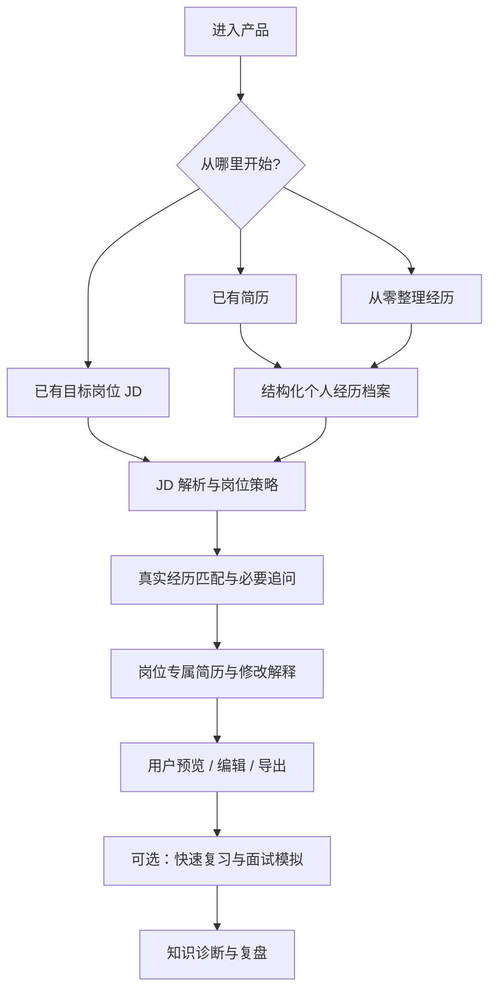

# AI 应届生求职助手 | AI Graduate Job Assistant

> 让真实经历被看见，让每一次岗位申请更有针对性。

**当前阶段：M1-1 与 M1-2A 已合并；M1-2B 合成对话工作台审查中（真实 AI 尚未接入）**
**产品目标版本：V0.3 · PRD 文档版本：v0.2**  
**目标人群：应届毕业生、在校实习求职者；初期优先验证计算机及相关专业场景。**

**[在线体验静态交互原型](https://greglien282-a11y.github.io/ai-grad-job-assistant/)** · [正式应用启动教程](docs/M1_0_SETUP.md) · [技术架构](docs/TECH_ARCHITECTURE_MVP_v0.1.md)

> 在线体验展示的是前端交互原型，不提供真实 AI 分析、账号或数据库。

## 为什么做这个项目？

对于不少应届生，求职难点不仅是简历排版，而是：

- **经历有但讲不清**：课程设计、比赛、校园项目做过一些，却不知道哪些值得写、怎样描述自己的贡献。
- **一岗一简历成本太高**：不同 JD 强调不同能力，重复修改让海投变得低效。
- **简历写出来却不敢讲**：AI 把措辞变专业以后，自己未必能解释每一句话。

这个项目希望把三个环节连接起来：**真实经历挖掘 → 面向 JD 的简历策略与定制 → 项目知识复习与面试准备**。

## 核心产品思路

| 模块 | 面向用户的问题 | 设计中的解决方案 |
|---|---|---|
| ① AI 经历挖掘 | “我没什么能写的，或者细节想不起来” | 每轮仅追问 1–2 个重要问题，维护有来源与确认状态的经历库，生成真实且专业的项目描述 |
| ② 一岗一策略 / 一岗一简历 | “每个岗位都需要调整，我根本改不过来” | 解析 JD、判断硬性要求与能力证据、生成可解释的岗位专属简历差异，支持用户确认和回退 |
| ③ 帮我掌握这份简历 | “简历写得很好，但面试官一追问就不会” | 快速复习 / 标准模拟 / 深度追问，区分「记不清历史细节」与「尚未掌握技术」，生成复盘建议 |

### 产品设计的底线

**简历可以一岗一策略，但经历不能一岗一造。**  
模型可以优化表达和排列顺序，不能编造项目、实习、职责、技术栈或实验指标；用户自述和材料核验也需要明确区分。

## 用户体验主流程（目标流程，尚非运行截图）

## 当前进度

| 事项 | 状态 |
|---|---|
| 用户痛点梳理、产品定位 | ✅ 已形成设计稿 |
| 三种首次进入方式 | ✅ 已定义产品流程 |
| 经历挖掘、岗位定制的需求与规则 | ✅ 已形成需求文档 |
| 面试训练三级模式与退出规则 | ✅ 已定义需求 |
| 交互原型 | ✅ v0.2 静态交互演示已上线 |
| 技术选型、数据库和 AI 工作流 | 🔄 技术栈已确认；数据库与 AI 工作流待实现 |
| 前后端编码、自动化测试 | 🔄 React / FastAPI 最小骨架已提交；CI 持续验证中 |
| 公测和真实用户反馈 | ⬜ 尚未开始 |

> 仓库已包含静态原型和正式应用工程骨架，但 **真实经历挖掘、简历生成与面试 AI 尚未实现**。后续以可验证代码、测试结果及真实用户反馈更新状态。

## 仓库导览

- [M1-2B 合成对话工作台与 Windows 视觉验收](docs/M1_2B_CONVERSATION_WORKSPACE.md)（真实 API、零费用 Scripted；真实 AI 未启用）

- [M1-2A 合成经历挖掘后端](docs/M1_2A_BACKEND_MINING.md)（状态机、来源、恢复与迁移合同；无真实模型调用）

- [M1-1A 经历事实库持久化基础](docs/M1_1A_PERSISTENCE.md)（已合并）
- [M1-1B-1 HTTP API、版本控制与本地 PostgreSQL](docs/M1_1B_1_API.md)（React 工作台待 M1-1B-2）
- [M1-1B-2 React 事实确认工作台](docs/M1_1B_2_WORKSPACE.md)（真实 API，开发期临时会话）
- [M1-1B-3 隔离浏览器测试与 Windows 验收](docs/M1_1B_3_E2E.md)（含真实幂等阻断与待审修复提案）
- [M1-1B 幂等修复与临时恢复](docs/M1_1B_IDEMPOTENCY_FIX.md)（独立 Draft，24 小时不是长期账号恢复）

- [产品愿景与目标用户](docs/PRODUCT_VISION.md)
- [公开版产品需求摘要](docs/PRODUCT_BRIEF.md)
- [典型用户流程](docs/USER_JOURNEY.md)
- [三级面试模式设计](docs/INTERVIEW_MODES.md)
- [研发路线图](docs/ROADMAP.md)
- [重要产品设计决策](docs/DECISIONS.md)
- [模拟使用案例（虚构示例）](docs/DEMO_SCENARIO.md)
- [参与讨论和贡献](CONTRIBUTING.md)

## 近期目标

1. 邀请少量用户体验已上线的静态原型，记录首次价值感知与导航问题。
2. 按已确认的 React + FastAPI + PostgreSQL 方案，完成事实库数据模型与迁移。
3. 开发「经历挖掘 → JD 匹配 → 可编辑简历」的最小闭环。
4. 邀请少量真实应届生试用，以真实性、节省时间和可理解性改进产品。

## 技术与开源说明

正式应用的技术方向已确定为 **React + TypeScript + FastAPI + PostgreSQL（数据库在后续阶段引入）**；现阶段尚未实现实际 AI 能力。尚未复用第三方简历编辑器，也未与第三方项目建立合作。

仓库暂未选择开源许可证。**公开可见不等于已授予代码或文档再分发许可**；后续确定许可时将明确标注。

欢迎通过 Issue 交流产品需求和真实求职痛点；**请勿上传包含个人信息的真实简历、联系方式、招聘网站登录信息或 API Key**。

M1-2C-1 的多轮上下文与合成 v2 输出合同见 [技术说明](docs/M1_2C_1_CONTEXT_CONTRACT.md)。真实模型未启用，旧 Scripted/UI 合同保持兼容。

M1-2C-2 当前仅提交 [真实接入准备与合成评测设计](docs/M1_2C_2_ADAPTER_EVAL_DESIGN.md)，真实开关关闭、费用授权为零；30 元是待批准草案。

M1-2C-2B 零费用实现与运行方式：[适配器、账本和隔离评测](docs/M1_2C_2B_OFFLINE_IMPLEMENTATION.md)。只有 Mock Transport；真实接口和密钥未接入。

M1-2C-2 C-0：[DeepSeek 官方零费用接入准备](docs/M1_2C_2C0_DEEPSEEK_PREPARATION.md)。官方 HTTP 协议仅通过离线 fixture 验证，真实请求入口仍拒绝，已批准真实费用0元。
