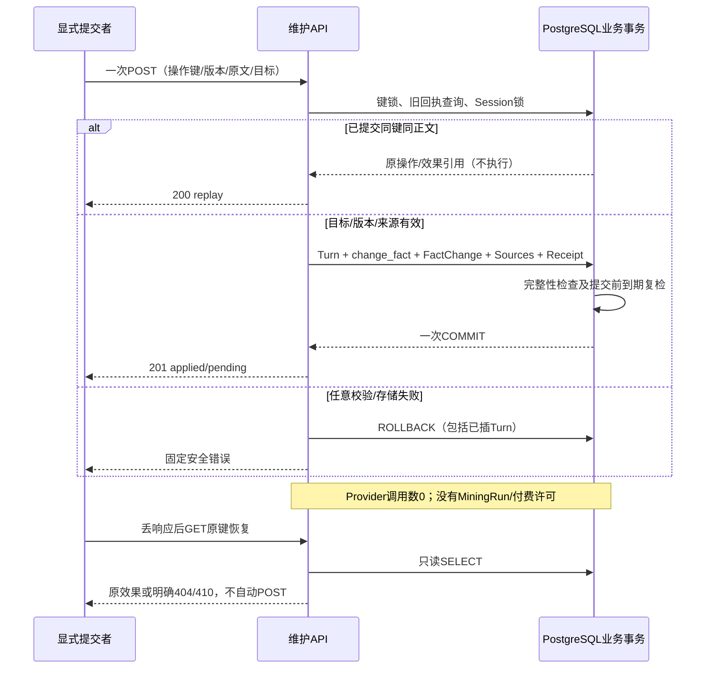
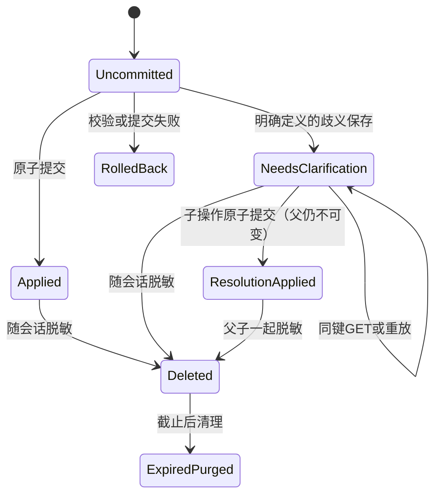
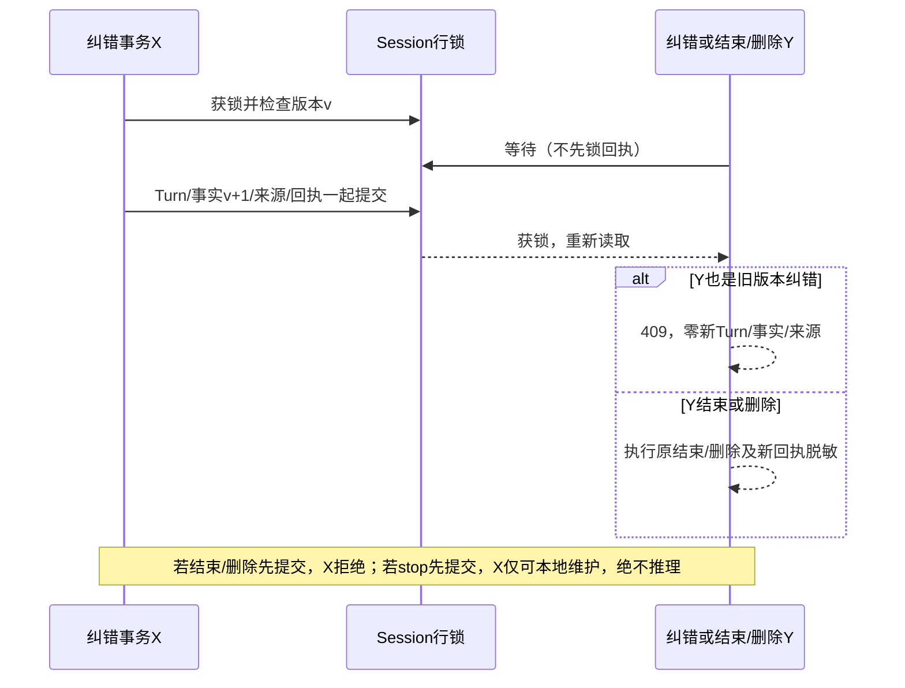

# Pathwise V0.3｜B1：事实维护 Schema 与原子纠错合同

状态：**设计候选，待独立审查；没有实现、迁移或上线许可**。2026-10-18。

基线main `8a6dc56d98a4696b92aa25b601d2076c5d565c2f`。依据：[产品审核](Pathwise_V0.3_20Cases_Product_Review_Implementation_Plan.md)、[阶段A](MINING_PRODUCT_STAGE_A_DESIGN.md)。本文是唯一新增文件；不回写上述文档或冻结quality-v1。以下SQL约束/API名称均为拟议合同，不是可执行迁移或现有接口。

## 1. B2边界与当前缺口

本设计推荐B2先提供**显式提交的一次本地事实维护命令**：保存一次原始输入，创建pending或纠错/撤回，无Provider。已能定位的用户明确纠错不再要求重复确认同一个意思；其新事实仍需以后明确审核。没有自然语言语义判断器时，只接受显式操作/目标及其原话证据，无法确定则返回歧义，不冒充已实现自由语言理解。

普通“请继续挖掘”的模型流程仍走既有mining API及全部门禁。B2事实维护不得顺便创建MiningRun、自动补问或重推；同一次输入不能由客户端同时投递到两条路径。自然语言跳过/停止/自动答题关联属于阶段C，本文只规定不能绕过它们。

代码证据：

- [facts.py](../apps/api/app/facts.py)：change_fact的statement分支不检查当前rejected，会把它改为pending；状态分支却禁止rejected转换。旧来源快照保存在FactSource，编辑后current source为FactChange，编辑清空当前evidence_id；不能只修新API而保留旧PATCH作为绕过入口。
- [models.py](../apps/api/app/models.py)：FactChange无(id,fact_id,session_id)组合唯一键；新复合FK需要补唯一约束。原始Turn不可变，MVP一会话一项目。AnswerQuestion不可改写，本合同不动它。
- [idempotency.py](../apps/api/app/idempotency.py)：Bearer绑定的v1操作键、HMAC request_tag、24小时窗口、advisory事务锁和提交前过期复检可复用；cleanup/erase_receipts针对旧表，不能自动清理新表。
- [mining.py](../apps/api/app/mining.py)：MiningReceipt的live状态要求run_id；reserve已有同原文/既有输入、版本、重试、六轮、stopped检查。receipt恢复不等于新推理。complete只做追加/去重，不负责替换事实。
- [schemas.py](../apps/api/app/schemas.py)及[experience_api.py](../apps/api/app/experience_api.py)：旧PATCH只有expected_version，没有原子“新Turn+纠错”的幂等合同。AddTurn再PATCH的浏览器串联不能满足原子性。

## 2. 产品动作与事实转换

| 动作 | 目标状态/前提 | 成功后 | 不做什么 |
|---|---|---|---|
| append（GQ01/GQ11） | 无替换目标；合法独立原句 | 每个新增事实pending/version=1；已有事实不动 | 不因后句更具体就覆盖旧背景 |
| correct（同一事实；GQ12冻结表示另见下文） | 唯一同项目目标且确为同一原子主张，pending/confirmed/evidence_supported，版本精确 | 同一fact_id新版本pending；当前evidence_id=null；新FactChange/来源 | 不把撤回一种职责、补充另一种职责硬塞为同一事实修订 |
| withdraw | 同上，明确撤回但无替换句 | 同一fact变rejected，版本+1，保留原历史/撤回依据 | 不空字符串替换、不物理删除原Turn/历史 |
| progress（GQ08） | 原话明确阶段；可有唯一关联旧计划 | 新阶段陈述形成独立pending；旧计划/history保留，关系指明是进展 | 不把计划改写成已完成，不推断线上效果 |
| ambiguous | 无唯一目标/指代不清 | 一个needs_clarification回执；无任何事实改变 | 不选最高置信候选，不把它当成功纠错 |
| 任意编辑/纠错rejected | 已拒绝/撤回 | 409 fact_rejected_immutable，零业务写入 | 不换key、新Fact或旧PATCH复活 |

confirmed指user_confirmed。任何来源/Schema不合法是422，不能借“歧义”吞掉错误。推荐withdraw清空当前evidence_id，旧FactEvidence仍留历史，不再表示当前支持；现有reject分支会保留该指针，故这也是B2需单独验证的兼容性收紧，不能假称已有行为。显式撤回允许准确的否定原句，不能要求它先通过“正向贡献”的atomic()动作词表；撤回意图验证与候选事实验证分开。

### 2.1 同一事实修订与独立职责的边界

新自动维护合同中的correct必须同时满足：唯一目标及版本可定位；用户明确更正；新句仍针对同一经历中的同一原子动作/对象，只修正该主张的数量、时间、范围等属性。例如把“我测试了3个导出按钮。”更正为“我测试了2个导出按钮。”可保留fact_id。仅有相同项目、相邻轮次、同一fact_id或模型高置信度，都不足以证明事实身份相同；不得把“更具体”默认当纠错。

“自动标注不是我写的。我测试了导出按钮。”包含**撤回旧职责+新增独立职责**：旧标注贡献应rejected并保留撤回来源；新的测试贡献应为不同fact_id的pending，各自有FactChange/来源。这是语义上两个效果，不得为了减少接口数把不同动作改成同ID，也不得只保存新职责却让旧已确认贡献继续有效。

冻结GQ12草案及其既有历史用同ID修订表示这次用户纠正；**原样保留该表示、引用、SHA和报告**，不回写评测资料或追溯判定旧记录无效。它用于历史兼容与产品意图讨论，不是对所有新“跨职责替换”请求的同ID许可。新自动维护的身份规则与旧手工编辑/冻结样例的表示能力分开记录，不声称两者已经统一。

当前B2候选只有单目标correct/withdraw或独立append，没有“withdraw_and_append”动作、双效果结果合同及相应幂等resolution。因此**不支持该复合动作的原子完成**，不能声明完整支持GQ12自然语言维护。明确识别为复合动作时422 composite_operation_not_supported，Δ=0、U=0、Provider=0；不得执行前半部分、降格成correct、自动拆为两个POST或换key补写。未来需独立审查复合合同及其一次事务内两个效果、共享原始Turn、分别的来源与历史，未通过前不开放。

仅目标不唯一、但拟议动作及事实身份关系已明确时，沿既有needs_clarification流程等待用户定位。目标已知却无法可靠判断“同一事实还是独立职责”时，422 correction_identity_unresolved、零写入，提示尚未修改，允许用户提供更明确的主张/范围；现有只选目标ID的resolution不能解决这个语义缺口，不伪造同一性或重复要求确认已明确的纠错意图。安全回退不是把两个不同动作静默合并。

推荐兼容修复：在共享change_fact的statement分支加rejected拒绝，覆盖旧手工PATCH及新入口；reject/confirm/verify状态规则不变，旧rejected数据原样保留。曾经通过漏洞被编辑而当前已pending/confirmed的历史资料**不自动回滚、不推定真伪**；离线合成测试证明历史仍可读取，生产审计/处置另批。记忆标注不等于重开贡献；是否继续允许对rejected做纯memory标注保留现状，不改变正文/信任状态。

复活防护覆盖共同创建/自动提取边界：同一拒绝事实的原来源区间、当前及历史陈述的精确引用不能换新turn/key再建Fact。现有source_already_used只在v2挖掘路径，不足以约束旧手工AddFact；B2要在共享事实创建策略中补齐，并明确旧API可能新增409。无可靠依据判断“不同措辞是否同一已拒绝职责”时保持澄清，不声称精确哈希具备语义防复活能力；自由改写自动恢复仍为BLOCK。

## 3. Schema候选

所有时间timestamptz使用服务端时间，UUID由服务端产生。输入/会话/目标ID不是授权凭证；所有关联都绑定鉴权会话。以下设计只涉及业务表，不新增资金池、Grant、费用许可或供应商字段。

### 3.1 ConversationOperation（conversation_operations）

- `id UUID PRIMARY KEY`；`contract_version smallint NOT NULL CHECK (=1)`。
- `key_digest char(64) NOT NULL UNIQUE`：原Idempotency-Key字符串摘要；不保存原键。作用域kind=`conversation_maintenance_v1`、scope=`session:<sid>`，复用原v1键证明算法，不接受mining_run/add_turn/add_fact的key替代。
- `state text NOT NULL CHECK IN ('applied','needs_clarification','deleted')`；本地事务没有可提交的reserved/running，不制造可后台续跑状态。
- `session_id UUID NULL`，FK→experience_sessions(id)，**ON DELETE NO ACTION DEFERRABLE INITIALLY DEFERRED**；新增`UNIQUE(id,session_id)`供复合FK使用。删除会话必须先脱敏回执，不能CASCADE丢失防重放记录。
- `input_turn_id UUID NULL`；复合FK(input_turn_id,session_id)→conversation_turns(id,session_id)，同样延迟NO ACTION。live根操作必须有Turn，resolution复用父Turn；deleted清空。
- `kind text NULL CHECK IN ('root','resolution')`；`action text NULL CHECK IN ('append','correct','withdraw','progress','disambiguate')`。
- `parent_operation_id UUID NULL`；复合FK(parent_operation_id,session_id)→本表(id,session_id)，延迟NO ACTION；resolution必填，root必空。partial UNIQUE(parent_operation_id) WHERE state!='deleted'：一个待澄清父操作最多一个有效resolution。禁止祖孙链/环，resolution只能引用根needs_clarification。
- `submission_tag char(64) NULL`：Bearer HMAC(scope + 原始content)，仅root有值；partial UNIQUE(session_id,submission_tag) WHERE kind='root' AND state!='deleted'。与含完整业务正文的request_tag不同，用于检测换key重复投递原文。分隔符/JSON canonical规则写入版本，不trim/NFKC改原文。
- `request_tag char(64) NULL`：HMAC绑定完整已验证请求、版本、动作、目标、所有引用、歧义候选选择、parent ID；不得只绑定content。不得保存普通SHA原文指纹供离线猜测。
- `proposed_action text NULL CHECK IN ('correct','withdraw','progress')`：仅needs_clarification根操作必填，明确待解决的动作，不让resolution猜用户本来要做什么。`proposal_spans JSONB NULL`：live必有、最多6项，仅保存role/start/end整数位置（一个intent及最多五个statement），不复制quote；DB验证精确键集、长度及整数范围。resolution据父Turn+冻结位置恢复引用，并重新核验，不靠原文摘要反推正文。`progress_stage text NULL`为有界阶段枚举，仅progress或其歧义提案可有值。
- `base_revision integer NULL CHECK (>0)`、`result_revision integer NULL CHECK (>=base_revision)`、`target_fact_id UUID NULL`、`target_version integer NULL CHECK (>0)`；目标复合FK(target_fact_id,session_id)→experience_facts(id,session_id)，延迟NO ACTION。
- `effect_count smallint NULL CHECK BETWEEN 0 AND 5`，`outcome_code`有限枚举（created/corrected/withdrawn/progress_recorded/no_new_fact/target_ambiguous）；`decision_contract`固定版本标签。只存结果ID/版本和固定码，不存输入副本、自由理由、模型响应、Key或Bearer。
- `created_at timestamptz NOT NULL`、`expires_at timestamptz NOT NULL CHECK (>created_at)`，`expires_at`沿操作键签发时间+24小时，不能每次重放续期；`completed_at`live必有值且>=created_at；此时间不是供应商授权窗口。
- CHECK live：上述回执/Turn/版本/动作/结果字段齐全；applied按动作检查目标与effect_count，correct/withdraw恰好1；needs_clarification无target、effect_count=0、outcome=target_ambiguous；禁止MiningRun引用（本版本没有该列）。
- CHECK deleted：除id、contract_version、key_digest、state、created_at、expires_at外所有业务引用、tags、结果/版本、proposal_spans/proposed_action/progress_stage均NULL。旧回执没有授权能力，不能仅凭UUID恢复资料。
- 索引：UNIQUE key_digest；session_id+created_at+id供聚合；expires_at WHERE state='deleted'供清理；input_turn_id供跨入口检查；parent唯一及submission唯一索引如上。无对原文/JSON大字段全文索引。

已提交live记录不可UPDATE业务身份、摘要、结果或期限，禁止普通DELETE。仅允许受限删除流程将**整组父子**记录变deleted，并在同事务删除会话；清理仅删已过期deleted墓碑。初次INSERT后的结果完整性由延迟约束触发器核对，不允许未完成effect数量的记录提交。

该脱敏例外不能是任意state=deleted就放行：延迟约束触发器用UPDATE的OLD.session_id验证提交时原会话确已不存在；否则回滚，防止保留会话却清除submission_tag来换key重放。来源DELETE约束亦仅在原会话已被删除时允许级联，不允许只删FactChange或Source抹除审计。测试需直接尝试这些部分清理攻击。

needs_clarification→resolved不通过覆盖父记录表达：插入一个applied resolution，父记录永久保留原决定。GET父回执可只读投影resolved_by及子结果；原POST重放仍返回原accepted outcome及resolution引用，不重新改事实。不同key竞争同一parent只能一个成功，其余409 conversation_resolution_already_applied。

### 3.2 FactChangeSource（fact_change_sources）

- `id UUID PRIMARY KEY`，`operation_id UUID NOT NULL`，`effect_slot smallint NOT NULL CHECK BETWEEN 1 AND 5`。
- `change_id UUID NOT NULL`、`fact_id UUID NOT NULL`、`session_id UUID NOT NULL`；补FactChange的`UNIQUE(id,fact_id,session_id)`（仅加索引/约束，不改旧JSON）。复合FK(change_id,fact_id,session_id)→fact_changes，ON DELETE CASCADE；复合FK(operation_id,session_id)→ConversationOperation，延迟NO ACTION。
- `turn_id UUID NOT NULL`；复合FK(turn_id,session_id)→conversation_turns，延迟NO ACTION。普通单独删Turn时受FK拒绝；整会话删除会通过FactChange级联清除此表，事务末不会留悬挂引用。
- `source_role text NOT NULL CHECK IN ('statement','intent')`；`reason text NOT NULL CHECK IN ('addition','explicit_correction','explicit_withdrawal','progress_update')`。
- `start_cp integer NOT NULL CHECK (>=0)`、`end_cp integer NOT NULL CHECK (>start_cp)`、`quote text NOT NULL CHECK length BETWEEN 1 AND 10000`。角色为statement时<=500且新贡献继续严格完整原句/原子性限制；intent可是一句明确撤回，不能充当贡献事实。
- `before_version integer NULL CHECK (>0)`、`after_version integer NOT NULL CHECK (>0)`；created效果before=NULL/after=1，edited/status_changed精确before+1；必须与FactChange.before/after快照相同，不能客户端声明版本。`created_at timestamptz NOT NULL`。
- `UNIQUE(change_id,source_role)`：每次变更最多一个intent和一个statement；`UNIQUE(operation_id,effect_slot,source_role)`；延迟校验同一effect_slot的两条来源必须指同一change/fact。同一operation不允许两次修改同一个fact。共享一条用户Turn不代表共享两个FactChange。
- 索引：fact_id+after_version、turn_id、operation_id+effect_slot；operation→effect/change由此表读取，无不可校验的Fact ID JSON数组。

延迟完整性检查须验证：Turn.role=user；该Turn就是本操作input_turn_id；项目归属由Fact→Session和MVP唯一Project确定；原文Python code-point区间吻合（PG text substring以字符索引校验需测试Unicode，start用+1）；after快照、action、状态和source_role匹配。created要statement；correct要intent+statement；withdraw要intent且没有statement；progress要statement。intent来自用户明确原话，模型推测不能标user actor。

**append/correct正文一致性是强制合同，不只是“引用本身存在”：** 对每个statement来源，`Turn.content[start_cp:end_cp] == FactChangeSource.quote == FactChange.after.statement`，逐code point完全相等；不得trim、归一化、改写、补数字或把另一条合法原句贴为该效果的来源。该效果提交时当前`ExperienceFact.id == fact_id`、`version == after_version`，且`ExperienceFact.statement == FactChange.after.statement`。append初始FactSource的对应statement引用也必须等于同一原句；correct的旧FactSource只作历史，不要求它等于新正文。

这些等式由API来源/效果构造校验及数据库延迟完整性约束双重保证；后者不能只验证quote等于Turn切片而漏掉after/current正文。after.statement必须存在且为非NULL字符串，不能让JSON缺字段/NULL或SQL三值逻辑绕过相等检查。后续合法编辑使Fact版本大于after_version时，历史source仍只与它自己的不可变FactChange.after核对，**不要求所有旧引用都等于最新正文**，否则会阻断正常版本演进。未来聚合读取当前来源必须选择当前版本的变更，不能把历史等式当成当前支持。source_role=intent不适用statement等式，withdraw没有新statement，仍保留原文及撤回依据，不把否定指令改成贡献正文。

actor=user表示经会话凭证鉴权的提交者，不是实名身份或供应商认证。created沿现有system建档历史，不改写成用户已确认。来源插入须伴随相应FactChange/事实版本变化，不能提交独立“补来源”事务；因此不额外引入能独立改变当前语义的回执UPDATE或来源编辑接口。

一条source不可UPDATE，不能独立删以换来源；权限/触发器仅允许整会话业务删除的级联。B2来源校验函数若使用SECURITY DEFINER，必须另审查非LOGIN owner、固定search_path、PUBLIC EXECUTE撤销及调用链；不能默认授予Web绕过角色。拒绝跨会话的FK不替代HTTP鉴权。

### 3.3 与原来源/历史的兼容

普通新事实：原FactSource仍保存初始引用，FactChange(created)追加FactChangeSource(statement)。纠错：保留旧FactSource，仅新edited FactChange的statement引用表示当前支持；withdraw的intent只表示撤回原因，不能当新贡献。手工旧编辑没有对话引用仍标user_edit/无current_citations，不能回填猜测来源。

新DTO可新增edit_method、current_citations、withdrawal_basis；旧source_kind仍conversation_turns/user_edit。`citations`如仍表示原提取来源不可含糊混用，新增字段合同须版本化明确；03与导出取当前版本/current来源，旧版本仅在history，不恢复旧evidence。所有source通过复合FK绑定操作和历史，不以修改FactChange.after自由JSON代替约束。

### 3.4 GQ08的类型/进度：需一并决策的最小附加字段

推荐B2后半单独实现ExperienceFact：`fact_kind`取personal_action/background/plan/boundary/legacy_unspecified，`progress_stage`取planned/in_progress/completed/not_applicable/legacy_unknown。旧行默认legacy_unspecified/legacy_unknown，**不推断旧资料阶段**。plan只配planned或in_progress；background/boundary只配not_applicable；personal_action只配in_progress/completed；legacy两值成对出现。修改分类必须增加Fact.version及FactChange快照，不让分类绕过确认。

已批准的计划原话以pending/plan保存，不参与03贡献正文，即使以后用户确认计划也不等于已完成。GQ08“后来我部署了测试服务。”新建pending/personal_action/completed；旧计划保留，可用当前操作target_fact_id与reason=progress_update表示关联，不能把旧计划偷偷改成成果。03对新分类只接纳确认/材料支持的personal_action；旧legacy保持原既有展示行为并标未分类，不静默下线旧资料。

现有atomic()拒绝“计划”；新增显式plan/boundary保存需独立非贡献校验合同，仅精确用户原句且禁止写成personal_action，不修改旧MiningOutputV2或扩张旧来源范围。若附加字段/非贡献校验未获审查批准，progress在B2返回422 progress_contract_unavailable，**不能声称仅靠两张表已支持完整进度语义**。本B1不批准字段实施。

## 4. 原子API候选（均未实现）

`POST /api/v1/experience/sessions/{sid}/conversation-operations`；Header仅Authorization Bearer与Idempotency-Key，No URLs/logs中凭据。输入extra=forbid、整数strict、content长度1–10000且非空白，不trim保存，最多5个statement、correct/withdraw一次一个目标。客户端状态、actor、信任级别、evidence、Provider/Grant/费用字段一律不接受。

```json
{
  "contract_version": 1,
  "base_revision": 12,
  "action": "correct",
  "input": {"content": "纠正上一条。我测试了导出按钮。"},
  "target": {"fact_id": "11111111-1111-4111-8111-111111111111", "expected_version": 3},
  "intent_span": {"start": 0, "end": 6, "quote": "纠正上一条。"},
  "statements": [{"start": 6, "end": 15, "quote": "我测试了导出按钮。"}],
  "progress_stage": null
}
```

以上UUID/版本为公开合成示例，实际值由当前业务状态得出；引用坐标须实际核算（例中第一句6 code points，第二句9 code points）。新Turn UUID由服务器产生，不让客户端把assistant或外会话旧Turn贴来冒充本次输入。正文中quote必须完全等于input.content[start:end]，再由服务器保存后核验同一Turn。

动作discriminator：append要求target/intent/progress=NULL，statements 1–5；correct要求target+intent+恰好1 statement；withdraw要求target+intent，statements为空、撤回原因只能intent原文；progress要求stage+statement，target可指相关旧计划，但不修改它；disambiguate要求intent原文、proposed_action及相应合法statement/progress字段，不含一个假定的target，只产生needs_clarification。非disambiguate请求proposed_action必NULL（示例省略的可选字段统一归一为NULL纳入摘要）。

API的action/target只是用户请求，不是授权证明；必须验证其和明确原话及服务端唯一目标一致。直接“我又做了测试”不当纠错；含引用/假设/否定的纠错指令不自动执行。B2解释器不支持的自然句，不猜target，归入歧义或422明确不支持；无需为了降低点击调用模型。

append/correct只接受上述statement引用对象，不接受与quote分离的自由`statement`或`replacement_text`字段。响应中的正文只能来自通过一致性合同的该效果原句，不能一边存B一边展示A。新请求的复合动作与身份不明错误按2.1节拒绝，不通过resolution暗中扩展动作类型。

成功201 AppliedResult：operation_id、input_turn_id、action、outcome、base_revision、result_revision、effects[{fact_id,change_id,before_version,after_version,applied_status}]、provider_calls=0、mining_run_id=null。applied_status是本次提交历史值；另行GET聚合的current_fact可已被后续修改，不能谎称现在仍pending。响应不含Bearer、原操作键或内部HMAC。

歧义201 ClarificationResult：同一稳定operation/input、state=needs_clarification、effects=[]、固定reason=target_ambiguous、provider_calls=0、可选同会话可选目标ID/版本及显示摘要通过实时鉴权读取，不在回执存文本。**这不是纠错半成功**：该动作本来就定义为保存原话等待目标，绝不显示“已修改”。有明确target但版本错/无权限不降格歧义。

`POST /.../conversation-operations/{parent_id}/resolution`：独立同类型proof key；正文含contract_version、base_revision、expected target版本、selected_fact_id，引用父intent/statement，不重传/重存原输入。父必须needs_clarification且同会话、未被resolution；fresh版本再次检查；子action只能等于父proposed_action，位置/stage由父冻结字段复制并复检。一次成功子操作产生effects，父保持不可变。无合法替换statement的父不能通过resolution补造文本，用户需另行明确提交新内容；不产生Provider。

### 4.1 恢复、错误与顺序

`GET /.../conversation-operations/recovery`用原Idempotency-Key+Bearer；或鉴权后`GET /.../conversation-operations/{operation_id}`读取尚在有效恢复窗口内记录。所有SQL为只读，不调idem.lock（其函数会登记before_commit期限），不清理过期、不写unknown、不解析供应商配置。不存在404 conversation_operation_not_found；过期410 conversation_operation_expired；deleted410 conversation_resource_deleted。超过24小时可从既有会话历史人工核对，但不能宣称长期凭证恢复或自动续期。

推荐GET用数据库强制REPEATABLE READ READ ONLY；读取线性化于鉴权快照。删除先提交则后来的GET只能410/404；已取得删除前快照的读取可返回当时合法结果，但不能写回/重建。旧结果依赖行损坏或缺失返回410 conversation_result_unavailable，不从摘要生成新Turn或来源。

- 200：同键同完整请求重放，Header Idempotency-Replayed=true；不校验旧base_revision去重新执行，返回旧effects与当前资源可用性标识。首次成功201，GET恢复200。
- 401：缺凭据/操作键proof不符；404：鉴权会话不存在或外会话目标（不泄漏目标存在性）。
- 409 idempotency_payload_mismatch：同键改任意action/target/span/stage/正文/父关系；409 version_conflict：已知归属目标版本错；409 context_conflict：目标版本正确但会话revision变。
- 409 fact_rejected_immutable / conversation_input_already_submitted / conversation_resolution_already_applied / mining_result_unresolved / session_ended：固定安全码，无新业务行。
- 422 conversation_source_invalid / correction_intent_invalid / progress_contract_unavailable / composite_operation_not_supported / correction_identity_unresolved：输入、来源或动作范围不合法/不支持；503 idempotency_busy：有界锁超时。合法输入若因服务端写入的source/after/current不一致被DB约束拒绝，500 conversation_integrity_failed并整笔回滚，不能把服务端缺陷冒充用户引用错误；不输出原始SQL/堆栈/输入，不自动重试。

同键查询/重放先验证key proof与截止时间，再查tombstone、鉴权live会话、校验request_tag；相同成功回执优先于过时版本、ended/stopped检查，**只读恢复不变成新写**。新操作先归属再fact版本，版本冲突先于context冲突，双错返回version_conflict且均零写。未获准引用目标不返回它的版本。

确认session.status active；本地append/correct/withdraw可以在mining_status stopped下像手工审核一样维护事实，Provider始终0，不改mining_status/轮数。ended禁止所有新维护。reserved/running/有效投影unknown或未恢复的客户端写操作先GET核对，不以自然语言纠错绕过；failed/stale不自动重推。B2没有resume，更不能借本地操作再挖同一input突破六轮。

## 5. 原子事务、跨入口幂等与删除

### 5.1 写事务

1. 无DB写地校验请求结构/键proof；开启事务、按原idem.lock取得该key advisory锁（5秒timeout），提交前复检key期限。
2. 读取既有回执，若deleted或mismatch按上述返回；live需鉴权再返回结果。fresh取得父Session FOR UPDATE锁；resolution随后按UUID序锁父操作。所有旧、新业务写都依赖同一Session锁，不仅锁Fact。
3. 复检会话、未知运行门禁、目标归属/version/context；核验来源、阶段、意图、原文/来源去重与跨入口历史。未通过前不插Turn。
4. 新root插一次user Turn；resolution复用父Turn。调用共享facts.add_fact/change_fact，记录原FactChange，不另写一个替代历史；每个effect附FactChangeSource；回执完整落库。
5. flush后重读最终revision，延迟触发器检查来源/效果数量/状态；提交前key未过期才COMMIT；任意异常整事务ROLLBACK。不要把revision固定加1，按真实行触发器变化断言一致性；同键重放、失败、GET均不增加。

事务不跨Provider。新业务操作不取Funding锁；锁序key advisory→Session→父operation→Fact（多fact按UUID序）。未来费用链仍Funding→Session→Run，本维护不建立Session→Funding。删除只锁Session并在同事务脱敏整组回执再级联删业务行，**不得先锁operation再等Session**。唯一键冲突/死锁/超时安全失败，不自动重试写事务。



### 5.2 三种回执协作，不能跨namespace复制一次输入

旧MiningReceipt、IdempotencyOperation表/键格式/历史正文约束不改，已成功旧请求仍可同键恢复。新表不能拿旧nonce重解释成新动作；B2禁止把同一UI发送先add_turn、再维护POST、再mining POST。

仅CO的UNIQUE submission_tag不足以阻止旧路由重复：**B2必须在共享入口增加跨路径检查**。Session锁下，新维护检查同原文已存在的MiningRun.input_turn/旧add_turn，旧mining.reserve及add_turn入口检查CO.root的input/submission_tag；涉及旧add_fact的重复/拒绝来源检查也放共享策略。若找到已提交操作返回409 conversation_input_already_submitted并给已鉴权的恢复引用，不领养旧Turn、另开Run或重存答案。旧成功回执恢复先行，不被新检查破坏。

同原文换key/选另Run也不重新处理；这是保守策略，可能拒绝用户后来合法的完全同文操作。B2不开放“忽略重复”参数；需要不同意图/再次主张时用明确resolution或未来审查的恢复合同。不能宣称该精确匹配检测了任意语义重复。旧路由可继续手工操作，但引入这些额外409属于兼容性收紧，必须在B2逐项回归并文档化；未证明跨入口锁/保护前新入口不上线。

### 5.3 留存/防重放

24小时仅是键与自动恢复窗口，不是活跃业务数据的删除时刻。live CO及其submission_tag随活跃会话保留，用于跨key去重和来源审计；清理器不能24小时一到就删除它而恢复写入资格。会话删除时清除CO的所有业务字段成deleted，FactChangeSource/Turn/事实/私有历史级联清理；只保留最小id/key_digest/时间到旧键截止。键过期后原parse直接410，允许删已过期deleted墓碑，不延长隐私留存。不把业务正文复制到费用审计或manifest里。



ResolutionApplied是聚合投影，不是父state字段值；RolledBack没有提交行。无failed→自动retry、deleted→新授权或GET→写入的边。

### 5.4 并发线性化



新命令没有sent状态；不得和MiningRun/PaidCall状态合并。已有费用unknown/sent/reconciled及冻结账本完全不改。

## 6. 迁移及权限风险

当前head为0012_request_manifest；B2开工再核对编号，B1不创建0013文件。候选升级：先加FactChange组合唯一，再建CO、来源表、约束/索引及必要类型列；历史FactSource/FactChange/receipt原样保留，不伪造历史引用。空新表/默认legacy字段不应改变旧读结果。

运行角色只经审核的业务服务事务使用必要表权限；不能直接改不可变回执/来源或伪造FactChange actor。设计触发器校验UPDATE/DELETE权限不能等于赋予审批/资金权限；普通Web仍不能改paid_funding/paid_calls。完整角色权限在B2隔离真实角色测试，不以迁移管理员“能操作”当受限角色通过。

非空CO或FactChangeSource阻止普通downgrade（含已deleted但防重放窗口未结束），防止回滚重装清空重复保护。空表降级仍须检查类型列不存在新分类历史；如果有非legacy数据或快照含新合同，拒绝丢字段。升级失败在同事务回滚，无半套Schema；不修改历史0008–0012、不reset版本。生产部署、清理任务和留存策略需另批，不能把测试迁移当生产许可。

## 7. B2测试矩阵（计划，尚未执行）

计数记为Δ(T,F,C,S,O,R)：已提交新增Turn、Fact、FactChange、FactChangeSource、ConversationOperation、MiningRun行数；原Fact更新单列U。不等于底层SQL次数（触发器会额外UPDATE revision）。所有业务POST仅1次事务COMMIT；失败/GET/重放Δ=0。所有B2测试Provider=0、Secret=0、费用=0；另保留原挖掘通道测试它最多一次且门禁不变。

| ID/案例 | 前提与动作 | HTTP/结果 | 已提交数据预期 |
|---|---|---|---|
| B01 GQ01 | 原背景/确认事实；新增一条合法个人动作 | 201 applied | Δ(1,1,1,1,1,0)，旧Fact原样，新pending v1 |
| B02 GQ11 | 三个合法完整原句不同区间 | 201 | Δ(1,3,3,3,1,0)，来源逐条吻合；任一非法整笔422/Δ0 |
| B03 同一事实修订 | 唯一confirmed v3；同一导出按钮测试主张的数量被明确更正，合法新句 | 201 | U=1到v4/pending；Δ(1,0,1,2,1,0)，当前evidence=null；不把本例当完整GQ12复合动作支持 |
| B04 材料支持纠错 | evidence_supported v4 | 201 | 同B03的Δ；v5/pending、旧材料历史保留，不支持新句 |
| B05 撤回 | 唯一有效目标/明确否认无替换 | 201 | U=1/rejected v+1；Δ(1,0,1,1,1,0)，03不再使用 |
| B06 歧义 | 无唯一目标 | 201 needs_clarification | Δ(1,0,0,0,1,0)，U=0，不显示已纠错 |
| B07 消歧 | B06后明确选择且版本有效 | 201 applied | Δ(0,0,1,2,1,0)（纠错子例），父Turn/回执不改 |
| B08 GQ08 | 先计划后明确已完成，类型合同获批 | 两次201 | 各Δ(1,1,1,1,1,0)；旧plan保留，新completed pending；计划不进03 |
| B09 GQ08无类型合同 | progress请求而功能未获启用 | 422 | Δ0，不用memory_state假装实现 |
| B10 rejected攻击 | 旧PATCH/new correct/换key append同被拒引用 | 409 | Δ0、U=0；历史rejected仍可读取，不能pending |
| B11 同键重放 | B03提交后断线 | GET200/POST200 replay | Δ0、U=0，原change/版本不再递增，即使之后Fact已确认 |
| B12 改正文 | 同键改action/target/span/stage/parent任一字段 | 409 payload mismatch | Δ0，旧结果保持 |
| B13 双版本冲突 | 目标v错或context错 | 409专用version/context码 | Δ0，不先保存Turn；两者错按规定优先级 |
| B14 双连接纠错 | 不同key同目标旧v，屏障控制先后提交 | 一201一409 | 仅胜者B03的Δ，败者无Turn；版本只增一次 |
| B15 同键跨进程 | 同正文并发/锁超时 | 201+200或503 busy | 一次B03的Δ，503不自动重试 |
| B16 故障窗口 | Turn后/Fact后/Source前/约束前/COMMIT前杀进程 | 错误/失联 | 全部Δ0；结果不明仅GET，不推定失败重发 |
| B17 COMMIT后退出 | 原连接断开再新进程GET | 200 | 原B03完整Δ，恢复Δ0；原文/版本一致 |
| B18 引用权限 | 错quote/UTF-16偏移/越界/assistant/外会话目标 | 422或404 | Δ0，不泄露目标/原文；emoji/组合字符合法例201 |
| B19 跨入口重复 | 新维护后旧mining/add_turn/add_fact；逆序；换key/receipt过期 | 409，旧成功key可读恢复 | Δ0，不额外Turn/Run，不绕过六轮/停止 |
| B20 end/delete竞争 | Y先提交与X先提交两种屏障时序 | ended409/deleted404或有效201后被清理 | 无半套source；deleted保留id、contract_version、key_digest、state=deleted、created_at、expires_at，其余业务字段NULL（按3.1白名单核验）；旧key410 |
| B21 stopped/六轮 | 本地纠错与再挖掘分开 | 本地可201；挖掘409 | 本地仅B03 Δ；R=0，mining_status/轮数不重置 |
| B22 unresolved | reserved/running/unknown尚未恢复 | 409 mining_result_unresolved | Δ0；GET只读，不能把它变成retry |
| B23 迁移/权限 | 空库、0012升级、失败注入、受限角色、空表/非空降级 | 明确成功或拒绝 | 原数据无损；非空拒降级；没有资金/Provider能力 |
| B24 API正文替换攻击 | append/correct提交与quote分离的statement/replacement_text，或quote不等于指定原句 | 422 | Δ0、U=0；不能改写再配一条合法引用 |
| B25 source/after不等 | 合法输入A；数据库直写或测试注入使source.quote=A、after.statement=B，及after.statement缺失/NULL/非字符串 | DB提交拒绝；经API固定500 integrity码 | 全事务Δ0、U=0，连已插Turn/回执回滚；保留错误码，无秘密或原始异常 |
| B26 after/current不等 | source.quote=after.statement=A，但该after_version的当前Fact.statement=B | 同B25 | Δ0、U=0；配套正例：后续合法v+1编辑不强求旧source等于新正文 |
| B27 复合职责/身份歧义 | 明确撤回标注+新增测试；或有目标但无法证明同一主张 | 422 composite/identity专用码 | Δ0、U=0、Provider=0；不拆POST、不部分撤回、不改为同ID成功 |
| B28 GQ12冻结兼容 | 对比原冻结数据、报告和同ID修订表示；新API执行B03/B27各自合同 | 静态一致/相应API码 | 冻结文件不改；不以历史样例宣称新复合事务已支持 |

补充：noop去重若新原文但statement已有有效事实，201 outcome=no_new_fact、Δ(1,0,0,0,1,0)，不伪造effect；需要被拒职责重新主张时不作为noop掩盖，须拒绝/澄清。FK/延迟约束测试直接尝试错误配对、少一条source、不同change共享effect_slot，必须整事务拒绝。非空operation必须与真实effects数量一致。

Python/TS用同一新合成Unicode样本，GQ20冻结原句“我制作了🧪原型图。”code-point区间[0,9)，UTF-16长度10。客户端高亮用code points转换，不能改quote“修复”偏移。GQ03 atomic“整理”差异本B2 Schema/纠错实现不顺手改，仍保留旧质量报告。

测试仅pathwise_test/pathwise_e2e随机Schema、独立连接/进程，禁止pathwise_dev/pathwise_probe及真实凭据。保留当前完整后端、React、38项Chromium E2E、12/48历史合同、迁移/Mock CLI；新增来源聚合/导出/03当前版本断言。不用模型置信分、Oracle通过率或平均UX分抵消真实性失败。

## 8. 先决策事项及B2拆分

1. **推荐批准共享rejected编辑拒绝**：这收紧旧PATCH行为，但不改旧数据、不清历史；否则新接口可被旧路径绕过，是上线BLOCK。
2. **推荐批准CO与来源关系的正式迁移方案**：live回执随会话保留、删除后只留到键截止；仅24小时恢复不等于24小时后清空所有重复保护。需确认该保留与隐私策略。
3. **推荐显式B2命令先行**：只接受可验证目标/意图，自由语义解析及自动关联留阶段C。不反复确认已明确纠错，但不能为减少点击默认猜目标。
4. **推荐进度类型同独立子阶段审查**：未批准就明确不支持progress，不假称旧状态或memory字段足够；legacy默认不重分类。
5. **推荐精确重复拒绝的保守兼容策略**：跨旧路由检查是必要修改，需产品接受完全同文再次提交不能强行重开；语义改写的恢复未解决前继续BLOCK，不自动换key。

B2-a（独立小PR）：rejected共享guard、迁移候选/模型、约束/权限/升级删除降级测试；默认不注册新入口。B2-b：本地correct/withdraw与GET-only回执、resolution、跨入口保护、原子故障与并发测试，来源DTO/导出；无Provider。B2-c：append多事实、类型/进度及03筛选兼容、GQ01/08/11回归；仍不动UI和真实模型。每个子阶段需独立审查，不以本文通过替代开工授权。

回滚只关闭未启用的新路由；有审计/防重放数据时不删表、不重签操作、不取消历史费用责任。后续阶段C的控制话题/自动关联、阶段D页面优化、阶段E质量新版本另立任务。B1结束后停止，不创建迁移、不执行上述测试、不新增Provider、预算或生产配置。
