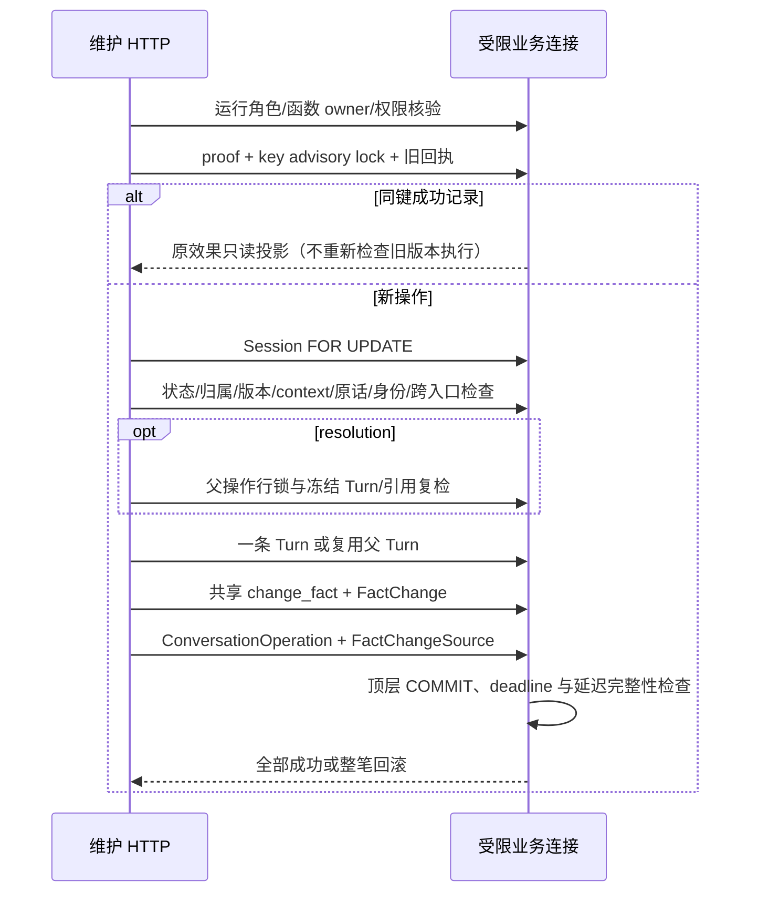

# B2-b：显式事实纠错、撤回与只读恢复

基线 B2-a 合并 `c73805fceb9e4d5152933628c80baf9fb65bccdd`；合并 CI [39195833273](https://github.com/greglien282-a11y/ai-grad-job-assistant/actions/runs/39195833273) success。实施依据是阶段 A、产品审核及 B1 最终合同。**新接口默认关闭；本文不是生产部署、迁移、角色授权或真实模型许可。**

## 范围与受控语法

本阶段只有 correct、withdraw、disambiguate/resolution，没有 append、progress、多职责复合操作、自动语义关联、UI 改版或 Provider。GQ12 冻结样例和 quality-v1 不变，不能把这里的同一事实修正宣称为完整 GQ12 跨职责处理。

纠错身份采用可核查的保守子集：原句和新句都通过既有 atomic()；仅有一个明确的“动作＋了＋整数数量＋量词（个/条/张/次）＋对象”数量字段变化，**全部其他 code points 完全相同**。例如“我测试了3个导出按钮。”→“我测试了2个导出按钮。”。序号（第3个）、编号（3号）、日期、小数和多数字不属于该数量合同，不能仅靠去掉数字判断事实身份。不改主语、动作、对象、否定、不确定性或措辞；不是自由语义理解。时间、范围、中文数量或其他改写无法由该规则证明时返回 `422 correction_identity_unresolved`，零业务写入。选中 fact_id 不能替代身份检查，resolution 同样重新核验。

有限意图模板：correct 为 `纠正上一条。`、`更正这条事实。`、`更正数量。`；withdraw 为 `撤回上一条。`、`撤回这条事实。`。这是显式命令的原话语法，不是聊天意图分类器。引用必须覆盖输入的全部非空白内容，intent 在前；新陈述必须为完整原句并逐 code point 匹配，不能把引号、假设、否定前缀藏在切片外。无法识别的原话返回 422，不猜用户意思；明确含撤回和新增/补充的复合指令返回 `composite_operation_not_supported`。不自动拆成两个 POST。

## HTTP 合同

前缀 `/api/v1/experience/sessions/{sid}`：

- `POST /conversation-operations`：根操作；201 首次成功，200 同键重放（`Idempotency-Replayed: true`）。
- `GET /conversation-operations/recovery`：原 Bearer + 原 Idempotency-Key，只读恢复。
- `GET /conversation-operations/{operation_id}`：同会话 Bearer 鉴权的只读投影。
- `POST /conversation-operations/{parent_id}/resolution`：独立同 namespace 幂等键，选择一个目标，不重新传/存原文。

所有输入 extra=forbid，整数 strict，contract_version=1。操作键 proof 的 kind=`conversation_maintenance_v1`，scope=`session:<sid>`，沿用现有 v1 Bearer HMAC 证明、5 秒事务 advisory 锁及提交前到期检查。正文 canonical JSON 包含默认 NULL/空列表、全部版本/引用/目标，resolution 摘要还包含父 ID。submission HMAC 使用独立的版本化内容结构，只存 HMAC/引用，不存普通原文 SHA。操作键不进入 URL/日志/回执。

示例（UUID、revision/version 必须取实际同会话状态；这里只是公开合成格式）：

```json
{
  "contract_version": 1,
  "base_revision": 7,
  "action": "correct",
  "input": {"content": "纠正上一条。我测试了2个导出按钮。"},
  "target": {"fact_id": "11111111-1111-4111-8111-111111111111", "expected_version": 1},
  "intent_span": {"start": 0, "end": 6, "quote": "纠正上一条。"},
  "statements": [{"start": 6, "end": 17, "quote": "我测试了2个导出按钮。"}]
}
```

withdraw 为 action=withdraw、空 statements、原始 content 仅为 intent。disambiguate 为 action=disambiguate、target=null、proposed_action=correct/withdraw；其语法和 statement 数量仍按拟议动作验证，至少有两个当前合法候选；没有可靠身份候选则 422，不假装歧义已保存。候选 ID/正文不复制到回执。

resolution 请求为 `{"contract_version":1,"base_revision":9,"selected_fact_id":"…","expected_version":1}`。它只使用父 Turn 和 proposal_spans；不得补新正文/来源、改变动作或处理复合职责。父仍为 needs_clarification，GET 只读显示 resolved_by。不同键竞争同一父只有一个子操作，后者 409；同键则恢复原子结果。

响应有 operation_id、input_turn_id、state/action/outcome、base/result_revision、parent_operation_id、resolved_by、effects。每个效果含 fact_id、change_id、before/after_version、历史 applied_status 和另列的 current_version；后者可能受后续合法编辑影响，不把历史 pending 当作当前状态。固定 provider_calls=0、mining_run_id=null。没有原文/完整响应副本、Bearer、HMAC、材料内容或模型输出复制到回执。

## 事务、历史和材料



锁序 key→Session→parent→Fact，不取 Funding/Capacity/Provider 锁。每会话每事务一个维护操作，不支持 SAVEPOINT 构造来源。correct 进入 pending 并清当前 evidence_id；withdraw 通过共享 change_fact 的内部显式参数置 rejected、清当前 evidence_id，before 保留旧材料指针，FactEvidence 不删。旧 PATCH reject 不传该参数，保留既有指针语义，不能宣传为完整 withdraw。

先检查目标归属，再版本，再 context；两版本错误优先 version_conflict。所有检查通过前不保存 Turn。整笔事务由路由写入函数拥有，COMMIT 约束失败也被捕获并脱敏，不能先返回成功再提交。root 保存一次原文；resolution 不新增 Turn；父不可变。没有 MiningRun、模型调用、自动补救或半成功纠错。

stopped 和六轮之后允许本地维护，不重开挖掘或重置计数；ended 拒绝新写。严格保留 0013 的保守门禁：存在任何 reserved/running/unknown 都禁止新维护，包括过去 unknown 尚留存的情况。新接口不判断/清理 unknown，不借纠错重推。如何安全投影已被后续重试解决的历史 unknown 仍需独立设计，不能直接放宽既有 DB 合同。

## GET-only 恢复与错误

两种 GET 都在**同一个实际连接**执行 `REPEATABLE READ READ ONLY` 并核验两项事务状态；权限核验、Bearer 鉴权及全部结果读取共用该连接。只有 SELECT/SHOW，没有 advisory lock、deadline 登记、行锁、TTL 清理、UPDATE、Provider 或隐式恢复写入。关闭即回滚只读事务。快照在删除前建立可读取当时结果；删除先提交后，原键恢复只返回安全 410，不重建资源。

24 小时是原键恢复窗口，不是长期账号恢复或 live 审计删除期限。GET 不清理过期记录。同键成功恢复优先于 ended/stopped/旧版本检查；输入结构非法仍在 DTO 层拒绝。受 0013 的 created+24h 上限约束，新操作的未来时间戳键（尚未到本机服务端签发时间）422 clock_skew；不改旧 proof 算法、不续期，已成功回执恢复优先。

- 401 `idempotency_credential_invalid`：键 proof 与 Bearer/scope 不符。
- 404 `resource_unavailable` / `conversation_operation_not_found`：无权访问目标、外会话或不存在操作。
- 409 `version_conflict` / `context_conflict` / `idempotency_payload_mismatch`。
- 409 `fact_rejected_immutable` / `conversation_input_already_submitted` / `conversation_resolution_already_applied` / `session_ended` / `mining_result_unresolved`。
- 410 `idempotency_key_expired` / `conversation_operation_expired` / `conversation_resource_deleted` / `conversation_result_unavailable`。
- 422 `invalid_request` / `conversation_source_invalid` / `correction_intent_invalid` / `correction_identity_unresolved` / `composite_operation_not_supported` / `idempotency_clock_skew`。
- 500 `conversation_integrity_failed`：包括 COMMIT 时的延迟约束失败，整笔回滚，无原始 SQL、异常和敏感数据。
- 503 `conversation_maintenance_disabled` / `conversation_runtime_unapproved` / `conversation_top_level_required` / `conversation_readonly_required`；锁超时沿既有 `idempotency_busy`。

客户端丢响应只能先 GET，不能自动 POST、换键或调用 Provider。本轮没有 UI 客户端，不添加自动重试路径。

## 跨旧入口的明确兼容变化

1. 共享 add_turn 在 Session 锁下检查新操作已保存的完整输入；旧成功 receipt 在 HTTP 层优先恢复，新增 guard 不影响已成功旧键。
2. 新 root 检查同会话所有已存在 user Turn 的精确原文；旧 add_turn/mining 已保存时拒绝，不领养旧 Turn。旧 mining.reserve 在旧成功 receipt 之后检查新操作输入/Turn，不新增 Run、不调用 Provider。
3. 旧 add_fact 不得消费新维护操作保存的 Turn；普通来源不能把纠错输入另当一份新经历。
4. 共享 add_fact/change_fact 拒绝 rejected 事实的当前及历史陈述精确重建；拒绝复用 rejected 的原始来源 Turn。缺少精确区间的 legacy 来源采用整 Turn 保守排除，可能拒绝同 Turn 中另一条本来独立的新增事实。这是明确的 409 兼容性收紧，不改变已有事实/历史。自由改写后的语义等价无法证明，仍是自动语义准入 BLOCK，不提供忽略重复参数。
5. mining.complete 也检查共享 rejected 策略，命中时抑制候选，不复活、不制造 storage unknown 或额外调用。旧 source_already_used、来源/原子性与输出 Schema 约束不变。

精确匹配可能拒绝以后合法的完全同文输入。过期 live 回执仍保留原文关联，不因换 key 恢复资格。没有新的历史改写或全局 legacy FactSource 冻结。旧迁移目标（0013 之前）没有 CO 表时无法存在新维护记录，旧路径保持可用；新入口缺完整函数/权限仍拒绝。

**旧角色部署兼容 BLOCK**：0013 已存在时，跨入口 guard 需要 CO SELECT，新来源 DTO 需要 FactChangeSource SELECT。B2-a 默认撤销这些新表权限，因此现有普通业务角色如果尚未独立配置这两项读取权限，旧写入/读取可返回 503 并回滚；不会“权限不足就略过来源/重复保护”。测试显式验证此失败边界。新路由关闭不等于可以不审查旧角色权限就部署本次代码；本 PR 不给任何持久 Web 角色自动授权，部署前必须一并审查读权限及完整调用链。

## 来源 DTO v2（只添加字段）

旧 source_kind、source_turn_ids、original_source_turn_ids、source_change_id、citations 的意义不改，旧 JSON 客户端可忽略新增字段；不改 FactChange.after 历史快照。

- provenance_version=2 是 DTO 版本，不是信任等级。
- edit_method=conversation_correction / legacy_manual / null。
- current_citations 只提供最新当前 edited FactChange 对应的新维护 statement 来源；确认/记忆变化不重置它。后续旧手工编辑没有对话引用则为空，不猜来源；rejected 时为空，不能当贡献支持。
- withdrawal_basis 提供当前拒绝状态对应的显式 withdraw intent；旧手工 reject 不伪造此依据。
- maintenance_history_sources 包含不可变历史引用（change_id/fact_version/source_role/turn_id/quote/start/end），明确为历史，不用于当前贡献正文。

原始来源继续在 original_source_turn_ids/原 Turn 中追溯。读取/JSON 技术备份和原 03 合同只选当前 user_confirmed/evidence_supported 的当前正文；新 pending/withdrawn 不进整理文本。JSON 不是正式简历导出。

## 默认关闭与最小权限隔离验证

`get_maintenance_factory()` 始终拒绝，没有环境变量/配置开关；正式应用不会回退到旧 configured_factory。测试通过依赖注入提供专用真实 LOGIN，每次请求验证 current_user=session_user、无高权限/继承/成员关系、无数据库/Schema CREATE、无表 owner、无金额表 DML 或资金运行函数 EXECUTE。

六个 maintenance 函数 owner 须独立非 LOGIN、非高权限、无其他角色成员关系、无 paid_funding 写权；固定 search_path=pg_catalog，PUBLIC EXECUTE 撤销，运行者不可直接 EXECUTE。运行者不是这些函数 owner 的成员，不能 SET ROLE。

隔离测试角色所需权限（仅测试夹具配置，不是生产 SQL 授权工具）：

- 必要业务/来源/运行状态/回执表 SELECT；无 paid 表读取需求。
- user Turn、FactChange、CO、FactChangeSource INSERT。
- Session 仅 UPDATE(updated_at,context_revision) 供既有触发器及时间更新；Fact 仅 UPDATE(statement,status,evidence_id,updated_at,version)。
- CO 仅 UPDATE(id) 是 PostgreSQL `FOR UPDATE` 所需权限；真实 UPDATE（包括 id=id）仍被不可变触发器拒绝。无 CO/来源 DELETE、来源 UPDATE、表 DDL 或全表 UPDATE。

运行角色是可信后端服务身份，不是用户 SQL 账号或 RLS 多租户隔离方案；HTTP Bearer/同会话校验不可省略。它拥有构造业务效果所需 DML，不能将此称为已部署的单一 SECURITY DEFINER 命令 Broker。生产数据访问/RLS、Secrets、角色部署、可调用链和应用配置接线仍须独立批准；本轮没有生产可用工厂。禁止因 Mock/隔离测试通过就启用新权限。

没有新增迁移，Alembic head 仍为 0013_fact_maintenance；不修改任何历史迁移。若未来要让 DB 本身认证每次用户证明而不是信任服务端命令执行者，须另审查受限 SQL 命令 Broker，不能以扩大现有 role 权限替代。

## 测试与停止点

`tests/test_maintenance_api.py` 使用真实 PostgreSQL 随机 Schema、真实受限 LOGIN 与非 LOGIN 函数 owner；原迁移管理身份仅供建测试 Schema/角色、准备旧状态及断言，不用于新 HTTP 命令。隔离 fixture 禁止供应商 HTTP/凭据 API；子进程只接收合成请求/临时角色连接、净化继承环境、独立阻断网络/原生凭据接口。

专项覆盖 correct/withdraw 三种旧状态及材料 before/after、只读 GET 实际事务和单连接、幂等/版本/权限、歧义父子与双连接竞争、跨旧入口重复、rejected 精确复活、两种删除先后顺序、故障后整笔回滚、COMMIT 前后 os._exit 与新进程恢复、Unicode、无高权限/owner/资金通道及默认关闭。所有维护场景 MiningRun 增量及 Provider 调用=0。

原 B2-a 数据库攻击夹具改用原始 ORM user Turn INSERT：让 DB 唯一性/不可变性攻击实际到达约束，而不是被本轮共享业务去重提前截住。**原错误类型/SQLSTATE/效果数量断言不改**，没有生产绕过选项。

执行命令（apps/api，仅 TEST_DATABASE_URL 指向专用测试库）：`python -m pytest -q -ra`、专项 `tests/test_maintenance_api.py`、原 B2-a 两套测试、`check_isolated_migrations.py`、`check_m12c2_contracts.py`、`check_s03b_output_contract.py`、`evaluate_mining_quality.py`、`run_offline_evaluation.py --profile 0`。apps/web：原 `npm run test`、`npm run build`、38 项 E2E（本机 Edge，CI Chromium）。最终数量/CI 链接在 PR 执行记录，不把计划写成已通过。

B2-c 前置：独立 append 多事实/类型/进度合同、精准 legacy 来源区间策略及语义再主张规则；本轮不实现。回滚仅保持新工厂关闭，不删除 live 审计、墓碑或重签操作。冻结 quality-v1、GQ03 动作词表、历史请求/账本、UI 和真实 Provider 全部不改。
