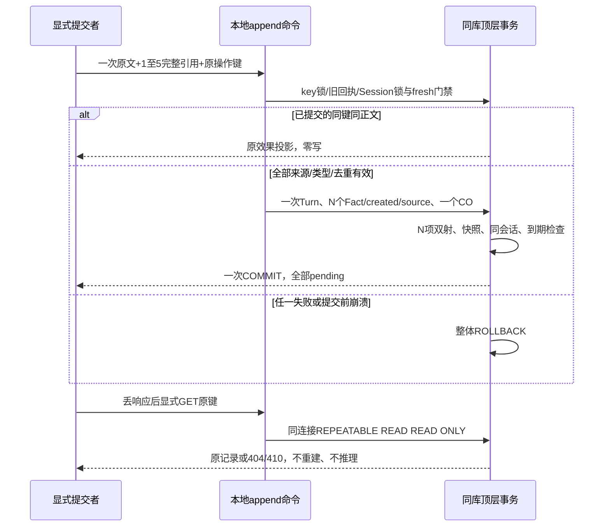

# B2-c0：多事实 append、类型/进度与来源兼容设计

状态：**设计候选，等待 ChatGPT 与用户决策；未实现、未迁移、未部署**。2026-10-19。

基线 main `c6f50022c3f6c749c450705f28445f5755ca6c85`；B2-b 合并 CI [39215776324](https://github.com/greglien282-a11y/ai-grad-job-assistant/actions/runs/39215776324) success。本轮仅新增本文。文中的 DTO、错误码、约束、编号和测试都是候选，不是现有接口或已执行的功能验收。

依据：[产品侧 20 案例审核](Pathwise_V0.3_20Cases_Product_Review_Implementation_Plan.md)、[阶段 A](MINING_PRODUCT_STAGE_A_DESIGN.md)、[B1](FACT_MAINTENANCE_B1_DESIGN.md)、[B2-a](FACT_MAINTENANCE_B2A.md)、[B2-b](FACT_MAINTENANCE_B2B.md)。产品原则认可不等于本文候选已批准，更不等于模型质量已经通过人工评审。

## 1. 基线事实与本轮决策边界

1. 当前 Alembic 单头是 `0013_fact_maintenance`。它已有 CO/FCS、1–5 个 append statement 槽位及 created 来源检查，但没有对外 append API；`maintenance_contract.Command` 只接受 correct/withdraw/disambiguate，`fact_maintenance.apply()` 也不是 append writer。不能把测试 DDL 已覆盖 append 说成用户功能已完成。
2. 0013 对 append 允许 `created` 的实际效果数小于 statement 数，也允许 `no_new_fact`。它没有本设计拟议的“每项都新建或整笔拒绝”双射约束；不能仅启用旧分支就宣称数据库保证无部分处理。
3. B2-b 的 `get_maintenance_factory()` 始终拒绝。`maintenance_permissions.check_runtime()` 不允许 INSERT experience_facts/fact_sources，只接受六个 maintenance 函数及受限列权限。append 不可偷偷扩大这个角色或复用它绕过准入。
4. `ExperienceFact` 尚无 fact_kind/progress_stage；`ConversationOperation.progress_stage` 不是事实字段，且 0013 明确拒绝非 NULL 和 progress 动作。一个操作可含多个不同阶段，不能把该单值字段当成批量分类存储。
5. `facts.snapshot()`、FactChange.before/after、FactView 和 `FactContext` 尚不含类型/进度。`experience-summary` 当前只按确认状态取当前正文，未区分计划/背景/边界。`memory_state` 只表示记忆把握程度。
6. 原 FactSource 保存建档来源；FCS 保存维护历史。已有 FCS 后，原 FactSource 的 INSERT/UPDATE/DELETE 被保护；legacy 来源没有精确 citation 时，`source_already_used()` 及共享 rejected guard 使用整 Turn 保守排除。有 citation 也不代表未经审计的 legacy 行已经获得可信认证。
7. 本轮不改上述行为、默认关闭策略、0001–0013、冻结 quality-v1、历史 12/48 合同或任何 Provider。业务操作不产生费用或派发许可，不取 Funding 锁。

推荐方向：**显式、本地、零 Provider 的批量追加；事实类型与信任状态分离；计划与完成另建事实；不能证明来源独立时不追加。** 自动语义解释、问题关联、复合 withdraw+append、真实模型和前端低点击均不在 B2-c0/c1/c2 的默认范围。

## 2. 产品场景 → 数据/API 效果

下表是未来验收映射。N 为一个原始输入中合法独立完整原句的数量，1≤N≤5。Δ(T,F,C,FS,S,O,R) 分别是提交新增 Turn、Fact、FactChange、原始 FactSource、FactChangeSource、CO、MiningRun 数；不是底层 SQL 次数。Provider、Secret、费用均为 0。

| 场景 | 推荐效果 | 不能推断/覆盖 |
|---|---|---|
| GQ01 后补个人工作 | append 一条 pending/v1；Δ(1,1,1,1,1,1,0)，旧背景不动 | 不能把小组讨论升级成独立系统开发 |
| GQ03 整理记录 | 新版本窄词法规则通过后，原句含 27，pending/v1 | 不造提升率、不转移团队归属；冻结 v1 仍保留原差异 |
| GQ04/GQ19 基础工作 | 合法原句可追加；方法、价值未说明则不补写 | 不强索材料、KPI，不扩大“负责”的实际工作 |
| GQ11 三个完整原句 | Δ(1,3,3,3,3,1,0)，一个 Turn、三个 Fact/历史/来源、一个回执 | 不把“我编写并测试……”凭切词改成两句；任何一项失败全部回滚 |
| GQ08 计划 → 完成 | 两次独立追加，旧计划保留；新完成事实 pending/v1，证据为 NULL | 不 UPDATE 旧计划为完成；不继承确认/材料/数字 |
| GQ02/GQ05/GQ10 | 类型合同通过后可保存 background；个人职责不明则澄清 | “我们”或课程学习不等于个人已完成贡献 |
| GQ06/GQ07/GQ09/GQ18 | 类型合同通过后可保存 boundary 原话；不确定/否定完整保留 | 无指标不是 0%，没材料不否定已有合法确认；不反复逼猜 |
| GQ12 跨职责纠正 | 继续沿 B2-b 不支持复合动作的 422 回退 | append 不得只加新职责而忽略输入里撤回旧职责的意图 |
| GQ13/GQ14 | 不改问题、AnswerQuestion 或自动关联；控制/拒答输入不冒充 append | 不把跳过或只答一题转成 stop/resolution |
| GQ15/GQ17 | 保留 business_gate/no-dispatch 语义；独立本地维护遵循 §5 门禁 | 不因本地 append 重开挖掘，不计入正常模型生成质量分母 |
| GQ16 | 六轮之后可按本地维护规则追加；轮数、mining_status 不变 | 不创建第七轮 Run，不重置空轮计数 |
| GQ20 | “我制作了🧪原型图。”精确 [0,9)，UTF-16 为 10 units | 不用 JS slice 的单位代替 code points，不删句号 |

“同 ID correct”和“进展另建”必须分开：同一数量被明确更正仍走 B2-b 有限语法；事实在后来时间真正取得进展，追加新的时间陈述。缺少能证明是哪一种的原话时，零写澄清，不靠选中 fact_id 决定。

## 3. append 批量合同候选

### 3.1 版本选择与 API 归属

推荐新入口 `POST /api/v1/experience/sessions/{sid}/conversation-appends`，使用独立 Append DTO。保留 B2-b 的四条路由、contract_version=1、correct/withdraw/resolution 请求及已提交结果。**不要扩展旧 Command 的 discriminator 后假装没有合同变化。**

推荐 CO 存储 `contract_version=2, decision_contract='append-batch-v1'`，action=append、kind=root。HTTP 同样 contract_version=2；URL 中 api/v1 是服务路由版本，不是 CO 合同版本。新只读恢复候选是 `GET .../conversation-appends/recovery` 与 `GET .../conversation-appends/{operation_id}`，允许按明确支持的 append 版本投影。

操作键证明继续 kind=`conversation_maintenance_v1`、scope=`session:<sid>`；不新建一个可复制额度/重复正文的 namespace。完整 request_tag 纳入合同版本和全部已验证字段；submission_tag 沿 B2-b 的原文 HMAC 结构，跨版本/入口查重，不因为换版本、nonce、key 或路由重新获得写入资格。这里的 v1 kind 是既有键证明格式，不表示新正文能由旧 DTO 解释。

旧成功 v1 行原样恢复。新行不能经过旧 `view()` 被硬编码返回为 v1：未来需在旧投影前增加版本拒绝边界，已鉴权的“不支持合同”返回候选 409 conversation_contract_mismatch，不能重解释、更改旧回执或返回不完整效果。非法请求形状仍可先 422；只有结构有效的同键不同正文按 409 payload mismatch。此适配是未来明确列出的兼容工作，本轮没有修改 B2-b。

#### 跨版本分派、鉴权与摘要顺序

以下是未来适配的固定边界，不改变合法 v1 的既有恢复/错误优先级。跨版本测试前提为未过期、非 deleted 的合法记录；过期/删除仍沿 B2-b 的安全 410/404，不先披露版本或业务内容。

1. **查询前**：服务端路由固定可接受的 DTO/CO 版本、decision_contract、action/kind 组合；不能由客户端声明版本来选择任意投影器。POST 的无效版本/结构返回既有 422 invalid_request；键恢复先验证 Bearer 绑定的 key proof、scope 和期限，错误 proof 为 401 idempotency_credential_invalid。GET 不接受正文来修补版本或摘要。
2. **鉴权前**：只可读取定位回执与判断安全可用性所需的内部字段，不投影 Fact/Turn/来源、不向外返回 version/action/效果。保留 B2-b 两种恢复路径的现有顺序：原键恢复的 available() 可先返回固定 deleted/期限错误，再鉴权路径 Session及回执归属；operation_id恢复则先鉴权 Session并检查归属，再由投影前的 available() 判断期限/删除。未找到记录时仍先核验路径鉴权，再返回固定404。外会话/错误归属统一 404 resource_unavailable（错误 key proof 已在上一步401），不能用版本差异泄漏他人记录；不能为了版本分派把原ID路径的鉴权后置。
3. **鉴权后、摘要比较前**：核对持久 CO 的版本+decision_contract+动作族与路由白名单。v1 conversation-operations 的 GET 只读 v1；append GET 在 c1 只读 v2 append。相互错用返回 409 conversation_contract_mismatch、零效果投影；不能调用旧 view 后改 version 标签，也不能按“字段差不多”降级解析。未知持久版本同样固定拒绝，不能通过 GET 升级/补写它。
4. **摘要比较**：POST 恢复仅在合同匹配后，对经该 DTO 验证并规范化的完整正文计算 request_tag，与原值恒定时间比较；版本、action、parent、区间、顺序等均不能省略。同版本 correct↔withdraw 等有效改正文为 409 idempotency_payload_mismatch；跨 append/v1 路由先按合同不匹配拒绝。两种冲突都不重新执行、不保存输入。GET 没有待比较的提交正文，不伪造或重算原请求来替代此步骤；其授权依据仍是原键证明或已鉴权 operation_id。
5. **投影前后**：只对通过上述检查的回执选择对应版本的只读投影；核对 effects 数量/来源归属和原 after_version，输出 contract_version 必须来自已验证的持久合同。缺依赖或版本不一致按固定 410 conversation_result_unavailable，不能返回部分结果或改写回执。输出后也不得注册 deadline/清理/修复/Provider；GET 全程同一个 REPEATABLE READ READ ONLY 连接。POST 同键恢复不能递增任何版本或触发新业务效果。

0014 升级不得重算合法 v1 的 request_tag/submission_tag、迁移它的 version/decision、延长期限或“补齐”历史正文。旧键、旧 operation_id 及其已提交效果在原窗口内仍按 v1 原样恢复；v1 GET白名单不得仅按当前HTTP可创建的动作缩窄而误拒既有合法v1历史（包括0013合法append原型记录）。结果中的 current_version 仍可如 B2-b 一样反映后续合法变化，不冒充历史回执被修改。fresh 请求只有确认没有原回执后才进入 Session 锁/写入流程，不能把未知版本或冲突当“没找到”而换入口创建。

### 3.2 请求例：完整原文、三个独立来源

以下为公开虚构格式；base_revision 仅示例，不可当执行授权。

```json
{
  "contract_version": 2,
  "base_revision": 12,
  "action": "append",
  "input": {"content": "我编写了清洗脚本。我测试了导出按钮。我制作了结果图。"},
  "statements": [
    {"start": 0, "end": 9, "quote": "我编写了清洗脚本。"},
    {"start": 9, "end": 18, "quote": "我测试了导出按钮。"},
    {"start": 18, "end": 26, "quote": "我制作了结果图。"}
  ]
}
```

- extra=forbid；revision/start/end 严格整数，拒绝 bool/浮点；content 1–10000 code points，单 statement 1–500，N=1–5。原文仅在本次 user Turn 保存一次，不复制到回执、日志或错误。
- 客户端不提供 Turn ID、Fact ID、actor、status、version、evidence、项目/账号授权、Provider 或费用字段。服务端由 Bearer→Session→唯一 Project 决定归属，并生成 Turn/Fact/Change ID。
- quotes 按原输入顺序，区间 [start,end) 严格递增、不重叠、不重复；不得服务端静默排序、去重、补标点或改 quote。所有非空白内容须由这 1–5 个完整 statement 覆盖；空白间隙可保留，不允许藏在选中切片外的否定/团队/假设/纠错前缀。无 intent_span/target/parent/progress 顶层字段。
- “补充：”等未被引用的非空白引导、混合控制意图、复合职责撤回与新增，本窄合同不支持：422，草稿留在客户端，不先保存半份回答。需要自由叙述解析的是后续阶段 C，不由后端把含限制的片段丢掉。
- 每条 source 都来自这一个新 user Turn；禁止采用旧 Turn、assistant Turn、其他会话/项目来源。原文可直接构造 Fact.statement，不另接受可自由改写的 statement 参数。
- UTF-8 必须有效；不做 NFC/NFKC、CRLF→LF、trim 后重存等隐式变换。Python code-point 切片与 PostgreSQL substring(start+1,length)双检；未来浏览器以 Array.from 转换，字素/UTF-16/UTF-8 不混用。

### 3.3 一条来源对应一条新事实

推荐严格 all-new：每个被接受的 statement 必须新建独立 Fact，N 个来源与 N 个 created 效果双射；重复项或任何被拒项使整笔零写。B1 的 no_new_fact/部分去重是备选，0013 仍支持其历史表示，**本推荐不追溯修改它，但不在新 v2 中静默跳项**。需要产品确认此取舍，见 D1。

同批完全相同原句/区间：422 append_duplicate_statement；与现有有效事实精确重复：409 fact_already_exists。命中 rejected/current/history/受阻来源则专用拒绝，不能当 no-op 算成功。语义近似而不能证明独立时按 §7 回退，不制造第二份候选。丢响应不是“重复事实”，同键成功重放优先返回原效果。

每项：Fact pending、version=1、evidence_id=NULL、origin=manual、ai_run_id=NULL；这里 manual 表示本地用户命令，不表示事实已确认。FactChange(action=created, actor=system, before=NULL)沿共享建档语义；FCS(source_role=statement, reason=addition, before_version=NULL, after_version=1, effect_slot=1..N)。每个 Fact 恰好一个原始 FactSource，含本 Turn 和恰好该条完整 citation。不能把全部 N 个引用复制到每个 Fact。

必须逐 code point 同时满足：

```text
Turn.content[start:end]
  == FactChangeSource.quote
  == FactChange.after.statement
  == 本效果提交时 ExperienceFact.statement
  == 此 FactSource 唯一 citation.quote
```

事实版本、来源 Turn、项目及引用区间也必须对应；合法 quote A 配 after.statement B、缺字段、JSON null、额外来源或重复 change/effect_slot 均失败。后续合法编辑后，旧来源仅核对自己的不可变 after，不强求它等于最新正文。既有原始来源冻结、xmin 顶层事务限制及禁止补挂旧 FactChange 全部保留。

### 3.4 响应与恢复例

首次成功 201；同键重放 200 加 Idempotency-Replayed=true。精简响应例只展示一条效果；多条按 effect_slot 递增，各有独立 UUID：

```json
{
  "contract_version": 2,
  "operation_id": "11111111-1111-4111-8111-111111111111",
  "input_turn_id": "22222222-2222-4222-8222-222222222222",
  "state": "applied",
  "action": "append",
  "outcome": "created",
  "base_revision": 12,
  "result_revision": 14,
  "effect_count": 1,
  "effects": [{
    "effect_slot": 1,
    "fact_id": "33333333-3333-4333-8333-333333333333",
    "change_id": "44444444-4444-4444-8444-444444444444",
    "before_version": null,
    "after_version": 1,
    "applied_status": "pending",
    "current_version": 1
  }],
  "provider_calls": 0,
  "mining_run_id": null
}
```

result_revision=14 是此单条响应的示意值，**不是通用递增公式或对上面三条请求的响应**；实现必须从事务实际重读。历史 applied_status/version 与当前 current_version 分列；后续确认不会篡改原 pending 结果。不得复制输入、完整 FactView、材料、模型文本、Bearer 或操作键到 CO 结果。

GET 与 B2-b 同样在一个实际连接执行并 SHOW 核验 REPEATABLE READ READ ONLY，鉴权、权限检查及效果投影都在该连接。无 row/advisory 锁、deadline 注册、TTL 清理、修复或 Provider。404 表示未找到，不等于准许自动再发；410 不生成新 key。刷新/响应丢失先 GET，界面不得自动 POST。已成功回执优先于旧 revision、ended/stopped；已删除回执仅安全错误，不能恢复原文。24h 到期不清掉 live 防重复关联，也不改变原文删除合同。

### 3.5 错误候选

复用既有 401 证明失败、404 resource_unavailable/operation_not_found、409 context_conflict/idempotency_payload_mismatch/conversation_input_already_submitted/session_ended/mining_result_unresolved、410 过期/删除/结果缺失、500 conversation_integrity_failed、503 默认关闭/权限不足/只读失败/top-level/idempotency_busy。均为固定安全码，无 SQL、正文、DSN 或原始异常。

新增候选：422 append_duplicate_statement、append_source_invalid、append_classification_invalid、append_contract_unsupported、composite_operation_not_supported；409 fact_already_exists、fact_rejected_immutable、append_requires_clarification、conversation_contract_mismatch；503 append_runtime_unapproved/append_schema_unavailable。目标化进展关联另用 version_conflict，先归属再版本再 context。数据库延迟约束因服务端构造错误而拒绝是 500 并回滚，不能伪称用户引用错误。没有遇错自动重试、自动换键或用另一入口“补成功”。

## 4. Schema 方案与类型/进度

### 4.1 c1：批量合同的两个方案

**推荐 S1：新前向迁移候选，预计 0014，开工重核 head。** 仅扩展 CO 的版本分派/shape 与 append v2 延迟检查，不新增资金权限。保留全部 v1 允许的行、错误和旧恢复语义；v2 检查 action=append/root/target=NULL/progress_stage=NULL、N=1–5、无 intent，效果数恰好 N，proposal span→FCS→FactChange→Fact 严格双射，无未引用 Turn/变更和跳号。created 的状态/来源检查复用 0013；旧版允许的 no_new_fact 不得因此被追溯判错。

不用 UPDATE 历史 0013：候选迁移按版本替换/分派当前约束函数，新旧分支均保留。若需要内部 helper，不得无意增加 B2-b 所匹配的 maintenance_* 函数数量；要么维持原六个入口、内部调用单独撤权 helper，要么另审查版本化权限指纹。所有 helper 同样非 LOGIN owner、固定 search_path、撤销 PUBLIC/default EXECUTE，运行角色不得直接调用。

**备选 S0：只用 0013 的 v1 append 基础、不迁移。** 少改 Schema，但必须诚实承认数据库仍允许少效果/零效果，严格 all-new 只能由应用验证与 fault test保证，不能声称达到 S1 的 DB 双射安全性质。若采用它，须另行批准降低该项数据库保证；本设计不据此建议上线。无约束 JSON 结果、复用 MiningReceipt 或先 add_turn 再多次 add_fact 不是可接受备选。

### 4.2 c2：正式事实字段（推荐显式列）

后续迁移（预计 0015，取决于实际拓扑）为 experience_facts 新增 NOT NULL、有界字符串及 CHECK：

| fact_kind | 合法 progress_stage | 含义 |
|---|---|---|
| legacy_unspecified | legacy_unknown | 未作类型判断，不表示假、完成或待开始 |
| personal_action | in_progress / completed | 用户本人具体动作；阶段必须有原话依据 |
| plan | planned / in_progress | 意图/筹备，不能写作已完成贡献；开始实施可另记 personal_action |
| background | not_applicable | 团队/课程/项目环境，不授予个人职责 |
| boundary | not_applicable | 否定、不知道、记不清等限制，不是正向成果 |

同时记录有界 classification_contract（推荐 legacy-v0/unclassified-v1/explicit-typed-v1）：legacy 两字段可配 legacy-v0 或 unclassified-v1，新类型只能配 explicit-typed-v1；没有自由默认“completed”。旧行及未升级写入者默认 legacy_unspecified/legacy_unknown/legacy-v0，不扫描文本、不改 Fact.version/updated_at/context_revision、不伪造 backfill FactChange。历史快照缺新键的只读解释为 legacy，原 JSON 字节不改。unclassified-v1 专用于已分类事实失去分类依据后的隔离，**不享受旧来源的摘要兼容例外**；不能只用两个legacy字段把它和从未分类的旧路径混为一谈。

metadata 选择不能证明语义：客户端自报 personal_action/completed 也必须由独立、版本化规则检查原话；不能用 enum 合法替代来源/否定/团队校验。memory_state 继续原四值，不能存 planned/completed 或从类型自动推断“certain”。不确定性首先保留在完整原话及 boundary 分类，不能靠 memory_state=approximate 把“可能做过”变成完成事实。

新 typed 请求使用 **contract_version=3、decision_contract='append-typed-v1'**，其余批量/幂等/来源规则与 v2 相同；每条 statement 增加 fact_kind/progress_stage、可选的 related_plan（见 §6）。类型为每项值，不用 CO.progress_stage，该列仍 NULL。v2 继续拒绝这些 extra 字段；v3 未获准前拒绝，不偷偷忽略。

所有新版本 FactChange.before/after 由共享 snapshot 记录类型/阶段/分类合同；既有事实创建/确认/记忆/编辑/核实都要适配快照构造和 current/history 延迟检查，而不重写旧历史。DB 验证枚举/配对、与当前相同版本快照一致、来源指向；语义只能由已审查本地规则证明，DB CHECK 不能判断用户真的完成了什么。

**分类修改候选（不是进展 UPDATE）**：同一文字被错误分类时，应有独立、显式且带 expected_version/base_revision 的本地 classify 合同；记录新用户意图、同一完整 statement 引用、FactChange(action=classified,actor=user)及 FCS intent/statement；一个事务 version+1、pending、evidence_id=NULL、context_revision 正确递增。旧状态/材料保留 before，rejected 拒绝，纯无变化请求零写拒绝。不得裸 PATCH 字段、复用 SET memory、自动 reclassify 老事实；没批准此命令就不提供分类修改入口。

旧文本编辑/旧 v1 correct 对未来 typed 事实的推荐兼容：共享 change_fact 在**原来的那一次** version 递增与 edited 历史内，将分类退为 legacy两字段+unclassified-v1、回 pending、清 evidence，防止把旧“完成”分类沿用到不同原文；不另加一次历史/版本。该事实即使后来确认也不进入正文，须先通过明确分类合同，不得借退legacy把计划洗成贡献。对原 legacy-v0 行行为不变。此项是未来需明确批准的语义收紧，不能在只读 DTO 层假装已保存。纯确认/记忆/材料操作不改分类；分类本身变更却不能保留旧确认或材料支持。

### 4.3 类型方案的反案与降级

- 只加 DTO 推断字段：不能可靠版本化或并发，拒绝作为正式方案。
- 塞进 memory_state/statement 前缀：混淆独立维度、污染原文，拒绝。
- JSON 自由分类：无法保证必填/配对/同版本历史，拒绝；FactChange 的受控快照只记录正式列，不作为唯一当前状态。
- 独立分类表可减少主表列，但要处理每次版本/删除/读取额外权限；MVP 没有收益，推荐显式列。关联进展则确有独立关系，见 §6。
- 非空 v2/v3 CO、FCS、防重放墓碑或进展关系阻止丢弃新合同的普通 downgrade。类型即使当前已改回 legacy，只要历史曾含新合同，也不能降级删证据。空表/纯 legacy 且无新历史才能按隔离测试证明的逆向顺序降级。
- 迁移函数 owner、默认 ACL、依赖及 v1 分支在升级/失败回滚/空降级后必须恢复一致。停用优先关闭新工厂，不删审计、不 drop 非空表、不重签 key。持久库部署另批，本轮无迁移文件。

## 5. 事务、幂等与并发

推荐顺序：结构与 proof 校验 → key 事务 advisory 锁 → 旧回执/完整摘要匹配 → Session FOR UPDATE → 新会话/当前 revision/未决 Run 门禁 → 原文、逐项来源、重复与 rejected 审查 → 一次 add_turn → N 次共享 add_fact/created 历史及各自初始来源 → CO/FCS → 重读真实 result_revision → 全部延迟约束与 key 到期复检 → 顶层 COMMIT。任何一项错误包括提交时错误全部 ROLLBACK；不在 SAVEPOINT 里吞错继续提交。

**写入次序细节**：共享 add_fact 已检查该来源是否被 CO 消费，因此不能先提交/插入一个已应用 CO 再调用共享创建函数；应在同一事务先构造全部受控效果，再插 CO/FCS 并让延迟约束在 COMMIT 证明完整性。不新增 skip_guard 参数或第二套无保护写 Fact 的实现。后续句出错连第一条 Fact/Turn 一起回滚。

锁序 key advisory → Session → 可选相关计划 Fact（UUID 排序）→ 新 Fact/来源/回执。删除、旧编辑、stop/end 继续先 Session；不先锁回执/Fact 再等 Session，不引入 Session→Funding，未来费用链的 Funding→Session→Run 不变。不同 key 同 session 被 Session 锁串行化，重新读 revision 后只有合法者可提交；同 key 只恢复一次。唯一索引/HMAC不替代持锁后的重检。

- 新批量提交要求 session active；stopped/六轮之后允许本地维护，0 Provider/0 Run，不变更停止/轮数。任何 reserved/running/unknown（包括旧 unknown）沿 B2-b 保守阻断，不通过 append 清掉或“解决”。ended/deleted 不新写，旧回执只读恢复不受旧 base_revision 阻断。
- 一会话一项目由 DB 与服务端授权保持；跨会话不返回事实存在性。批量无目标版本，但有 base_revision；related_plan/classify 有 expected_version，归属→目标版本→context 的优先级保持。
- 新旧三个 receipt 系统各管原语义；旧成功 IdempotencyOperation/MiningReceipt 优先恢复。新输入与旧 add_turn/mining 已保存的同文冲突，不领养旧 Turn。新 CO 之后旧 add_turn/add_fact/mining 不得消费该输入/Turn；live 超过24h仍保留防重放，换 key 不可重开。
- stop先提交不取消本地维护资格；end/delete先提交则 append 拒绝。append先提交则 end保持其历史、delete按既有规则清理原文/FCS/事实并将所有版本 CO 脱敏为 deleted。墓碑仍只保留 id、contract_version、key_digest、state、created_at、expires_at；新的类型/关系也不得残留原文副本。



## 6. GQ08：计划与后续完成

冻结 GQ08 仅有计划陈述，没有完成回合；下列“后来完成”是新增设计夹具，不回填冻结案例。完整旧句“我计划把服务部署到学校服务器，还没有开始。”为 plan/planned，必须全部引用（含“还没有开始”），不是截成“我部署服务”。这不通过当前 personal atomic()，所以 c1 拒绝；c2 需独立 plan 规则，不能简单移除 UNCLEAR/COMPOSITE 限制去冒充同一个正向校验器。

在未来批准的 typed 窄规则里，计划和否定其已开始状态属于同一计划边界，允许保留完整限定句；不概括、不拆掉逗号后内容。若该规则尚不足以安全表达原句，返回 422 append_classification_invalid，零写；**“应支持”不等于已经证明可安全支持**。

后来新原话“我部署了服务。”可在有明确动作/项目依据时新增 personal_action/completed；原话“我正在部署服务。”只能 in_progress。两者不允许基于先前计划补出“学校服务器”、访问量、上线稳定性。相同项目不自动证明二者有关；没有可靠相关计划目标也可以作为独立事实，但不能显示已完成原计划。

推荐可选持久关系 `FactProgressLink`（名称候选）：new_fact_id 主键、session_id、prior_fact_id、prior_version_at_link、operation_id、new_change_id、created_at、relation='reported_progress'。同会话组合 FK，服务端再校验同项目；prior必须是仍存在且非 rejected 的明确计划、版本正确，new是本次 created/v1 Fact，禁止自身/循环/复用其他操作；一个新事实最多一个 prior。父已存在、新子本事务创建形成方向性，后续不得 UPDATE 关系。

此关系只声明“用户将新原话关联到旧计划”，不证明完成效果、不更新旧计划、不让新事实继承旧信任。逐项 FK/唯一/不可变/删除级联/非空危险降级须正式迁移，不能仅存前端可随意提交的 ID 列表。关系禁止普通UPDATE/DELETE/TRUNCATE；只有整会话确已删除的事务允许清理，不允许单删父计划或关系洗掉进展审计。旧计划 later version 与 prior_version_at_link 分列，历史不与未来版本混同；父撤回后不自动撤回子，也不能将子反向作为父的支持，应显示关系目标已撤回并等待用户判断。

默认不要求关联，不自动猜 related_plan；无法验证“同一计划进展”则只拒绝关联请求、整笔不提交，不降格无关联偷偷成功。若 c2 不实现这张关系表，就必须拒绝 related_plan extra，不宣称支持可恢复的进展链；仅能保存两条互相独立的来源事实。这是 D4 的最小范围选择。

## 7. rejected、legacy 来源与精准区间

### 7.1 现有保护不等于语义防复活

当前共享 guard 拒绝 rejected 当前/历史的精确正文及复用其原始 Turn；v2 source_already_used 对可信区间重叠、缺 citation 的整 Turn 拒绝。它们不会识别任意改写、相近职责或换数字后的语义身份。新 key、不同 Turn、不同 quote/措辞不能被当作“已经证明是新贡献”。

推荐 B2-c1/c2 **不放宽现有整 Turn 策略**。对新 append：同会话存在 rejected 历史、又无法通过已审查的有限规则证明新主张与它独立时，409 append_requires_clarification，整笔0写；B2-c0没有可靠的通用独立性解释器，因此最保守可实现子集是拒绝该会话新的 append，直至另审查澄清/再主张合同。普通确认、读取历史仍可进行；不提供 force/ignore_duplicate/new_source 参数，单选一个 fact_id 也不是独立性证明。

这是可见的可用性代价，应由产品明确接受（D3），不能写成“已有智能去重”。旧 add_fact/手工 edit/Provider complete 仍存在精确规则以外的语义缺口：**只收紧新 append 不足以保证全入口防改写复活**。若要求全入口保证，必须独立批准共享准入的相应保守收紧、验证旧接口兼容和 Provider 完成路径的错误/抑制语义；未通过前保留生产上线 BLOCK，不能趁本设计静默改变 B2-b。历史记录不因这个风险被改写或删除。

**D3 过渡能力与正式可用性分开验收**：B2-c1“存在 rejected 就阻断本会话新 append”只能作为明确受限的临时安全子集。即便用户确实在补充毫不相关的新工作，也可能被拒绝；不能把该过渡测试通过标记为正式产品已支持普通连续补充，更不能以此解除语义防复活的生产 BLOCK。正式可用性至少须另审如何证明独立贡献、歧义如何解决、旧入口如何一致保护，并给出正反例和用户可理解的结果。

临时阻断的提示候选为：“本会话有已拒绝或撤回的事实，当前版本还不能可靠判断这条补充是否独立。本次内容尚未保存，也没有新增或修改事实。草稿请保留；现有事实仍可查看和审核。”返回 409 append_requires_clarification；Δ(T,F,C,FS,S,O,R)=0、原事实版本/context_revision不变、Provider=0。它不是已保存的 needs_clarification 回执，不生成 operation_id、待办或后台解析任务；GET 原键未找到也不代表可自动 POST。已有成功回执仍优先恢复，不因后来出现 rejected 而被此门禁阻断。

当前没有可以继续执行的语义澄清协议。提示不得建议换 key/Turn/会话、改写同一职责、走旧接口或先确认另一事实来解锁。后续澄清/再主张必须独立批准其输入保存与幂等、独立性证据、目标/来源/历史绑定和成功/拒绝语义；“我确认是新事实”、选中一个 fact_id 或模型置信分本身均不够。本轮不预留 force/ignore_duplicate/new_source 或等效绕过参数，也不自动撤销 rejected。若无法提供正式可用的澄清合同，就保持该场景不支持及生产 BLOCK，不能悄悄默认放行。

### 7.2 精确区间候选必须具备什么证据

将来若放开同 Turn 中另一条独立贡献，必须以不可变 user Turn + 已审计 FCS/建档锚点证明每个被拒主张的全部历史区间；逐句/重叠检查含否定和限定语，不能只信任可改的 legacy citation JSON。部分重叠、重复引用、缺区间、旧编辑无当前来源、同文不同 Turn、记录损坏或语义身份不明均回到保守拒绝。不得通过回填猜测区间或“确认此来源正确”按钮洗白旧资料。

精确不重叠仅证明原文位置不同，不能证明职责不等价；仍需有限的独立性合同或专门人工审查流程。整 Turn 排除是因缺证据，不应全局冻结所有 legacy 来源。已有合法 legacy 历史继续可读；首次纳入维护审计若建档快照漂移，则按 0013 拒绝，不修补。

**重要范围差别**：新 append 原子保存新 Turn，不能引用/领养旧 Turn；即使将来证明旧 Turn 不重叠，也不会自动使“用旧 Turn append”合法。该能力涉及独立导入/提取合同与 xmin/幂等边界，不在本阶段。精准来源方案首先是未来共享来源策略的研究条件，不是 c1 绕过整 Turn 限制的后门。

## 8. GQ03 最小词法候选与真实性反例

不修改当前 atomic() 及冻结 Prompt/Schema/数据/报告。推荐未来为新 append 使用显式版本 `append-personal-v1` 的校验器，在现有个人主语、完整原句、单动作、长度、组合动作及不确定性限制基础上，只把“整理”加入其动作词集合；新旧策略分别测试。不能先让旧全局 atomic() 改变，再声称历史评测可复现。将该扩展应用于其他入口须另审查，不自动接到正式 Provider。

positive-only append 还须显式拒绝否定、假设、计划、团队归属和未知；atomic() 并不是完整的否定分类器，不能仅加一个词就宣布语义安全。候选用法限定为可验证的“我整理了…”单句，原文中的数字逐字保留。难以判断的嵌套引用/指代零写回退。类型为 boundary/plan 时要走独立 typed 规则，不把它们正向放行。

| 新合成输入或攻击 | 推荐新合同结果 | 要验证的边界 |
|---|---|---|
| 我整理了27条缺失记录。 | 新 personal 规则正例，quote=[0,12)，pending/v1 | 旧 atomic 仍 False；不声称已测模型质量 |
| 原文为27，quote/正文改成28或补“提升80%” | 422 append_source_invalid，Δ0 | 数字必须来自该完整原句，不是同 Turn 其他句子 |
| 我们整理了27条缺失记录。 | positive append 拒绝 | 团队主语不能改成我 |
| 团队整理了27条缺失记录。 | positive append 拒绝 | typed background若另获准也只能原话保存 |
| 如果我整理了27条缺失记录。 | 拒绝 | 假设不等于做过 |
| 我计划整理27条缺失记录。 | c1拒绝；c2只可能为plan | 不能去掉“计划” |
| 我可能整理过27条缺失记录。 | positive拒绝/澄清 | 不靠memory_state=approximate转成完成 |
| 我没有整理过27条缺失记录。 | positive拒绝；独立boundary规则另审 | 否定不能被动作词匹配吞掉 |
| 我整理并测试了27条记录。 | 拒绝整句，不自行造两条 | 复合动作约束不放宽 |
| 同句假设/团队前缀在选中片段之外 | 拒绝 | 全非空白覆盖及完整句界，不做安全切片 |
| 我整理了27条缺失记录。我测试了导出按钮。 | 两项各自验证，任一不合法则全部回滚 | 来源不能串用，不能把27转成测试数量 |

GQ20补充：BMP中文、🧪、组合字符 e+U+0301、ZWJ、CRLF、首尾空白/标点均以保存的原文坐标比较。字素高亮可选，但不能通过 NFC 或 UTF-16偏移转换后的“修复”改变原 quote。冻结20例只是公开DRAFT讨论材料，不是新规则的盲测或人工gold。

## 9. 03、导出、DTO 与上下文兼容

### 9.1 正式分类前后

c1不实现类型列/新03过滤：新建事实仍无类型判断，当前03规则不变。c2迁移使所有旧事实成为legacy组合，**旧确认事实仍按旧规则展示当前正文**，避免静默清空既有结果；必须标明“未分类”不等于“个人已完成”。是否对legacy采取更严过滤须另批，不从文字猜测回填。

推荐新的服务端正文资格：确认或材料支持，且 `(personal_action,completed,explicit-typed-v1)`；只有 legacy两字段+legacy-v0 保留上面的旧路径兼容分支。unclassified-v1及其他新typed事实即使被用户确认，也不进入贡献正文；in_progress、plan、background、boundary只作为可审核背景/限制，不被隐式改写成成果。新完成事实pending仍不入正文；rejected和历史版本永远不入。

legacy-v0 是兼容标记，不是新的语义安全证明：未升级旧AddFact仍可保存未经分类的自由文本，这一旧能力与全局“计划绝不进入正文”的新承诺不能同时被假称已解决。新typed事实不能通过旧编辑转回该例外；跨旧入口新建未分类改写也仍受§7的独立性/防复活BLOCK。若要求所有新写入都适用类型过滤，必须另批旧writer准入、legacy-v0默认的截止/路由策略和旧UI升级；在此之前只可验证隔离合同，不能宣称03全局分类保证或开启typed生产写入。D6须明确选择，不能靠改原E2E断言消除冲突。

`experience-summary` 的未来 typed 投影：正文及 confirmed（正文依据）只含eligible当前事实；pending保留当前pending；已确认但不适合正文的typed事实另列 reviewed_non_contributions 并给固定排除原因。incomplete只按正文资格判断，不能因存在一个已确认计划就宣称有成果。正文仍逐条原文拼接，不专业改写、不生成PDF/正式简历。

推荐**显式分路由**，不在原响应上只加一个可被忽略的 summary_contract_version 来改变 confirmed 的意义：

- 原 `GET /api/v1/experience/projects/{pid}/experience-summary` 保留旧 legacy 数据的正文、confirmed/pending、排序及字段语义，不自动升级；它不是 typed 结果的兼容投影。对当前项目是否需要新读合同的判断只使用已鉴权数据/可信合同标记；只要有 explicit-typed-v1、unclassified-v1、typed 分类历史或进展关系，旧 summary 返回候选 409 summary_contract_upgrade_required，不把这些记录混入旧 confirmed。曾有 typed 数据不能仅靠修改当前标签来静默退回旧投影。
- 新候选 `GET /api/v2/experience/projects/{pid}/experience-summary` 固定响应 summary_contract_version=2，采用本节 typed 资格及 reviewed_non_contributions；其中 legacy-v0 仍按旧数据兼容规则处理，不自动重新分类。客户端必须显式使用该路由并验证版本、事实类型/阶段/来源及排除原因，不能遇到新版本就 fallback 旧 GET 或自己重拼所有 confirmed。
- 未支持的版本路由按固定 404 resource_unavailable；新路由依赖/权限缺失503，不退回旧投影。409升级提示只在鉴权后返回，不泄漏外会话是否含 typed。新旧版本都不能为了读取去写分类/修复历史。

上述分路由是 D6 推荐候选，尚未批准或实现；api/v2 路由版本与 append CO v2/v3不是同一编号体系。若改选媒体类型协商，必须另给固定 Accept/Vary、未协商请求的拒绝、缓存与前端消费测试，不能自动按客户端缺字段猜版本。未完成明确选择及验证，typed 写入口保持关闭。

### 9.2 FactView 与来源

FactView推荐只新增 fact_kind/progress_stage/classification_contract，旧字段不改名。旧TS Zod当前会丢弃不认识的新字段，**成功parse不代表旧UI能正确呈现类型**。typed功能启用须先证明旧03消费的是服务端筛选正文、不会自行把所有已确认背景重拼成成果；未通过则typed写入口仍关闭，不借本轮改UI。

这里“新增字段”仅描述新 FactView 投影，不授权将 typed 记录塞给未升级旧读者。旧 FactView/会话聚合及 summary/export 任一路径不能表达新分类、当前来源或排除原因时，应在鉴权后固定拒绝（候选409 fact_contract_upgrade_required/export_contract_upgrade_required），不能去掉类型字段、把 typed 改标 legacy、漏掉记录后假称完整读取。纯 legacy 数据继续使用旧投影；精确版本路由/DTO适配须在c2实现前确认。

typed 写入启用必须同时具备：新 FactView/来源投影及其权限、新summary路由和资格测试、新完整技术备份版本、前端显式路由与严格版本/枚举校验及真实消费验收。旧Zod只忽略extra字段、把缺失字段默认legacy、只测试JSON parse成功、只验证新后端而未验证当前02/03，任一都不算兼容通过。旧客户端仍可能访问同项目时，必须先证明它的所有入口都安全拒绝 typed 或完成升级；做不到即保持typed入口关闭，而不是允许写入后再让用户遇到坏结果。B2-c1未分类append的独立门禁不因此获得typed能力。

旧编辑/旧v1 correct对未来typed资料的共享事务语义（§4.2）不等于批准旧客户端可用这些入口操作typed。旧写入口若不能提供已审查的新响应/后续读取合同，须在任何效果前固定拒绝；不能先提交修改再在FactView序列化时报告升级错误。仅具备完整新读合同的受控调用链才可讨论复用共享函数，纯legacy旧调用的行为保持不变。

B2-b provenance_version=2/current_citations仍按最新edited的来源语义保留；不能把created/classified偷偷塞进去又称完全兼容。推荐将来显式FactView来源v3（受控协商/独立投影）：current_statement_citations指最新文字变更或初始created来源；classification_citations分列分类依据；history只作历史。分类/记忆/确认不让旧正文引用支持不同文字；后来的旧手工编辑没有新对话引用就如实空缺，不能恢复初始来源充数。v2读者仍可从original/citations追溯建档，不把空current_citations当无任何来源。

### 9.3 导出与 MiningContext

原JSON是技术备份，需保留当前类型、所有历史/来源及可选进展关系，并区分未分类旧快照；不得把它当仅筛好的简历。旧format_version=1的历史意义不改，完整新关系需独立导出版本，保留旧版本投影而不重写历史文件。恢复回执不承担整份导出副本。

推荐新候选 `GET /api/v2/experience/sessions/{sid}/export` 固定 format_version=2，完整包含会话当前资料及新历史/类型/关系，不套summary的正文过滤。旧export仅为纯legacy资料保留原行为；会话有任何需要新合同的项目/历史/关系时，旧路由409 export_contract_upgrade_required，不能丢关系或删字段后返回format_version=1成功。新导出缺权限则503，不能输出“部分备份”。后续重分类不得触发自动重写已导出的历史文件。

当前FactContext没有类型/进度，不能让后续Provider把计划当确认贡献。类型字段若纳入context payload，会改变冻结bytes/SHA/预算及Prompt/Schema适用性：须另审版本化上下文/准备请求合同，不能在B2-c顺手把新列注入历史v2.1或正式Provider。未审查之前typed数据不得被标成已准备真实外发，不能因synthetic开关假装已经衔接真实AI。

## 10. 权限与 fail-closed

新append工厂继续默认关闭，无普通环境开关；与B2-b factory/权限核验区分。候选运行身份须真实LOGIN隔离测试验证：无super/createdb/createrole/replication/bypassrls/inherit、无其他角色成员关系/SET ROLE、无DB/持久Schema CREATE、非表/函数owner。

在B2-b所需读取和精确DML外，append确实需要 experience_facts/fact_sources 的受限INSERT；typed需要新列及关系的最小权限。**给现有B2-b角色增加这两个INSERT会使其check_runtime拒绝，这是预期边界，不可删检查以迁就。** 推荐独立append角色与独立严格准入（或以后另审统一Broker）；不能复用普通Web身份、管理员或临时宽权限使HTTP测试通过。来源/CO/FCS仍无普通UPDATE/DELETE；trigger内部校验函数不对runtime/PUBLIC开放，迁移与审批/核账角色分离。

缺 CO/FCS/进展表SELECT或新列/新Schema版本时：新入口503并零写；旧路径需要该数据的保护/投影则503并回滚，不以空数组、默认legacy、略过guard或跳过进展关系掩盖权限失败。必须区分“旧版Schema真的没有此功能”和“当前Schema存在但无权限”：兼容旧版本的特定分支不等于对任意数据库错误降级。

普通旧角色在0013上已存在的CO/FCS读权限BLOCK仍保留。c2新增关系如果被聚合/导出读取，则必须一起审查其SELECT和v1读者适配；未配齐不能让旧API悄悄成功而漏来源。生产owner与SECURITY DEFINER可调用链、默认ACL、部署回滚均另批。无 paid_*、Grant、Secret Broker 或公网派发权限需求。

## 11. 未来测试矩阵（本轮未执行）

所有功能测试只用pathwise_test/pathwise_e2e随机Schema及合成资料；真实受限LOGIN执行HTTP，不以管理员冒充。每项除另注明外Provider=0、MiningRun新增0、费用0。失败/GET/重放Δ=0，原事实/历史/来源/回执/版本均与测试前相同；若写入已成功则GET仅恢复那一笔。

| ID | 场景/故障 | 预期HTTP/提交效果 |
|---|---|---|
| A01 | N=1、3、5完整句；GQ01/11 | 201；Δ(1,N,N,N,N,1,0)，全pending/v1，旧事实0更新 |
| A02 | N=0/6、缺字段/extra/bool offset、超长 | 422，Δ0 |
| A03 | 一条合法、一条非法/复合/隐藏否定 | 422，整批Δ0，不部分成功 |
| A04 | 同批重复/重叠/逆序，既有精确重复 | 422或409固定码，Δ0，不静默去重 |
| A05 | quote≠切片、after≠quote、当前v1≠after、错误FactSource | API422或DB拒绝/API500，整批Δ0；直接受限SQL负例覆盖JSON缺键/null/非字符串 |
| A06 | assistant/外会话/旧Turn/旧FactChange、同事务touch旧行 | 404/422或DB拒绝，无补挂来源；保留顶层XID限制 |
| A07 | 同键同请求/改变第N项、顺序、类型/关系/版本 | 200原结果或409 mismatch；版本/revision不增加 |
| A08 | 保存Turn后/第1及第N个Fact后/FCS前/COMMIT故障 | 错误/断线；提交前全Δ0，提交后恰好一次，真实os._exit+新进程GET验证 |
| A09 | 同键多进程、不同key同原文、不同key同旧revision | 一201+重放/冲突或busy；仅一批Δ，不第二次Turn/效果 |
| A10 | 双连接append与edit/stop/end/delete双向受控时序 | 依Session锁线性化；stopped允许本地，ended/deleted拒新写；GET旧快照可读但不重建 |
| A11 | append与legacy来源UPDATE/DELETE/INSERT、首次审计竞争 | 原审计保护保持；旧漂移不追认，冲突失败，无死锁/自动重试；覆盖RR旧快照 |
| A12 | reserved/running/unknown、六轮、failed/stale | 未决409；六轮/stopped只本地，状态/计数不重置 |
| A13 | 旧add_turn/mining先保存输入；新append先提交后旧add_fact/mining | 409跨入口冲突；旧成功receipt优先恢复，不领养Turn |
| V01 | 未过期v2 append CO经v1两种GET读取 | 鉴权后409 conversation_contract_mismatch，Fact/来源投影0次、Δ0，不能硬标v1 |
| V02 | 未过期v1 correct/withdraw/resolution CO经v2两种GET读取 | 鉴权后409 conversation_contract_mismatch，投影0次、Δ0，不能映射成append效果 |
| V03 | 同键correct→withdraw及反向；二者↔append；root↔resolution错用 | 同合同有效异正文409 idempotency_payload_mismatch；跨合同409 conversation_contract_mismatch；非法DTO422，均Δ0，不新Turn/执行/错误恢复 |
| V04 | 0014升级前合法v1 correct/withdraw/needs_clarification/resolution及其父回执，另有合法append原型 | 升级前后原键/ID GET一致；原本支持的同键同正文POST效果一致，不为原型新增v1创建能力；摘要/期限/合同不改、Δ0，之后合法编辑只影响既有current_version投影 |
| V05 | 无效请求版本、未知持久版本、路由版本与decision/action不符 | 请求422 invalid_request；鉴权后的持久合同不支持409 conversation_contract_mismatch；无部分投影/修补，Δ0 |
| V06 | 同键改正文/第N项/引用/版本，以及错误Bearer/scope/外会话ID | 既有proof错误401，归属错误404且先于版本披露；合法同合同异正文409 mismatch，Δ0；过期/deleted保持原安全410/404 |
| V07 | GET权限/依赖不足、源/效果损坏，所有版本分派异常分支 | 固定503或410，REPEATABLE READ READ ONLY下无写、无fallback、无新key/Provider |
| R01 | rejected当前/历史原文，换key/换Turn/改写来源 | 精确命中409；无法证明独立则澄清零写，不能把改写当新贡献 |
| R02 | 同Turn不同句，有/无可信完整历史区间 | 默认整Turn保护；精确不重叠本身不作放行授权 |
| R03 | 旧入口改写rejected避开精确guard的攻击样本 | 如仍能接受，报告全入口上线BLOCK，不改预期让测试“绿”；需另审共享保守策略 |
| R04 | rejected会话补充明显无关的新工作，c1仍无独立性协议 | 临时409 append_requires_clarification；提示未保存、保留草稿、允许现有审核；Δ0且无needs_clarification回执，不宣称正式可用性通过 |
| R05 | 临时阻断后换key/Turn/措辞/入口或自报“独立”试图解锁 | 不以这些信号放行；无force/ignore_duplicate参数；缺完整跨入口保护仍生产BLOCK，不引导绕过 |
| L01 | §8全部整理正反例，数字/否定/假设/团队 | 新窄规则只允合法正例；旧atomic/GQ03结果与冻结文件blob不变 |
| U01 | GQ20、CRLF、组合字符、ZWJ、非法UTF-16偏移 | code-point精确，错误422，合法保存/历史/导出一致 |
| P01 | GQ08计划已确认后再明确完成 | 两个fact_id，各有来源，旧计划状态/版本/材料不变，新pending/evidenceNULL；03只用确认后合格新完成 |
| P02 | plan误标completed、团队冒充personal、未知数字 | 422且全Δ0；记忆字段不补救分类 |
| P03 | related_plan跨会话/非计划/rejected/旧版本/循环/重复 | 404/409/422，整笔Δ0；无关联合同则extra拒绝 |
| P04 | 明确分类修改、并发修改、noop、rejected | 合法v+1/pending/清当前材料并记完整历史；冲突/noop拒绝，不补正文 |
| C01 | 旧legacy确认/编辑/memory/material/rejected历史 | 旧结果保持；typed文字编辑退unclassified-v1在同一版本历史，确认后仍不能借legacy例外进正文；分类变化不继承确认 |
| C02 | 03/JSON导出/FactView v2与新投影 | 原字段/旧结果兼容，typed计划/边界不进正文，pending/旧版本不混入；不完整新投影不得伪成功 |
| C03 | 源表/关系表无SELECT，INSERT越权、恶意函数owner/PUBLIC EXECUTE | 503零写或DB拒绝；不默认空来源/忽略规则，无资金权限 |
| C04 | legacy资料旧FactView/summary/export，含typed资料误用旧路由 | legacy结果不变；typed项目/会话依§9固定409升级错误，不能省类型/关系或把typed confirmed当旧语义，Δ0 |
| C05 | 新summary v2、FactView/来源新投影、export v2及旧Zod丢extra | 严格版本/类型与排除语义验收；plan/boundary不入正文，备份保留全部；parse成功但语义缺失须阻断typed写入 |
| C06 | 新读合同/前端/权限任一未完成、未知版本、跨会话升级探测 | typed工厂保持关闭；404/503/已鉴权409固定失败，不fallback或写后补救，无迁移重分类 |
| M01 | 0013→候选、空库、旧业务资料、失败注入 | 随机Schema升级/check一致、失败原子回滚，不改历史迁移/旧快照 |
| M02 | v1合法历史/empty downgrade与re-upgrade、v2/typed/墓碑非空 | 空且无新历史时才安全降级；否则拒绝，不能清防重放/进展审计 |

完整回归门槛：当前1498项Windows后端（Linux1497+既有平台skip）、91项React、38项Chromium E2E、隔离迁移、12/48历史合同及Mock/质量工具不得删除、xfail或放宽；开工时按最新main重核实际数量。新词法规则的工程通过、来源准确、产品rubric一致性、人工语义评审、真实模型质量分别报告；人工/模型实际数据缺失保持null/unreviewed。文档示例可纯离线核对字段和区间，但不能冒充上述功能测试已经通过。

## 12. 必须先确认的开放决策

D1–D8均仍为待确认候选。本轮三处补充不是对实施/上线的批准；D3仅提出受限临时能力，D6明确分路由建议及typed禁用门槛，原生产BLOCK保留。

- **D1 批量效果语义**：推荐all-new或整批拒绝，不静默部分去重；确认是否接受重复项导致用户整批需修改。若要混合noop，须另设计每项回执/来源绑定及零效果语义，不能套本双射保证。
- **D2 合同/迁移成本**：推荐S1版本化CO v2及前向迁移，而非只用0013宽规则；确认独立append路径/恢复投影与旧v1拒绝未知版本的方式。不修改已有v1记录。
- **D3 rejected可用性与兼容**：推荐保留整Turn、语义不明零写；整会话保守阻断仅是c1明确受限的临时安全子集，提示未保存且不创建澄清回执，不能当正式产品可用性方案。正式独立性/澄清及全入口保护仍需审查，生产BLOCK不解除；不能宣称精确匹配已解决。
- **D4 类型/阶段及进展关系**：推荐§4矩阵、legacy不推断、计划/完成另建。确认c2是否包含可持久恢复的related_plan；不含则明确不支持关联，不假装有进展链。
- **D5 分类修改与旧编辑**：推荐分类实质变化重回pending/清材料，旧typed文字编辑退unclassified-v1且不恢复legacy正文资格；classify命令、引用方式及可接受的窄语法必须单独批准，未批准就不开放。
- **D6 03与旧客户端**：推荐显式新summary/export路由及严格版本投影，旧路由只保留legacy原行为、不能错误读取typed；新typed只把确认的personal_action/completed放正文，unclassified-v1隔离。确认FactView/来源新合同、前端真实消费和旧writer兼容截止策略；任一未就绪即禁用typed入口，不能以JSON/Zod parse成功替代兼容，不降低原验收。
- **D7 GQ03范围**：推荐仅新版本append窄词法增加“整理”，保留全局atomic、历史模型输出合同与冻结质量v1；扩大到其他路径需另审。
- **D8 部署与权限**：append独立受限角色、函数owner/ACL、清理和新表读取权限未部署；c1/c2离线通过也不授权生产启用、真实资料外发或付费。

## 13. B2-c1 / B2-c2 最小实施拆分

### B2-c1：批量原子append（待D1/D2/D3/D7通过）

候选文件：新append DTO/事务/独立默认关闭路由与权限准入；复用facts.add_turn/add_fact、CO/FCS及幂等读取的经版本化适配，不复制确认逻辑；新增0014候选模型/约束分派、append窄词法策略及专项测试。旧维护writer/factory保持原能力。新事实尚无分类列，未分类不得宣称已完成；GQ08不支持、无progress/related_plan/classify。新工厂仍默认关闭，Provider/Run=0。

必须证明N项双射、全回滚、并发、真实进程崩溃/GET-only恢复、V01–V07双向版本隔离/v1升级恢复、跨入口和来源权限；必须明确R03失败意味着什么，R04临时阻断通过不能替代正式可用性。受限运行角色只在随机Schema配置，不给持久库授权。拒绝/澄清与既有合成手工流程共存，不实现新UI。审查通过后停止，再请求c2授权。

### B2-c2：类型、进度及读取兼容（待D4/D5/D6通过）

候选文件：ExperienceFact正式列/新迁移、共享snapshot/current-history约束、typed append合同v3与独立类型规则、可选FactProgressLink及分类修改命令、FactView/summary/导出版本化投影与权限适配、合成P/C/M矩阵。C04–C06与D6的读路由/DTO/完整备份/前端真实消费门槛须全部满足；若typed规则或旧UI兼容无法安全证明，就只提交Schema/读取合同与拒绝测试，写入口不启用；不能用自由JSON或关闭否定检查来跑通GQ08。c1获批或其CI成功不授予c2实施/启用许可。

不修改旧MiningOutputV2/正式Provider输入；将来context/动态请求的新合同另审。生产角色/工厂部署、语义再主张/精准来源放行、阶段C自动解释、阶段D前端和阶段E新评测均为后续独立授权。停用是关闭新入口、保留审计/来源/旧恢复能力，不删历史、不重签key、不恢复任何费用许可。

## 14. B2-c0 本轮验证与停止点

仅静态审查上述源码/文档/冻结GQ20例、迁移拓扑和Git范围；纯离线核对本文JSON、Unicode区间及相对链接，并验证冻结目录、历史迁移、运行源码相对基线未变。不启动数据库、不运行功能或生产CLI，不读取凭据、不访问Provider，不生成费用/授权。实际检查结果见本PR记录，未把未来矩阵写成已通过。

提交独立Draft PR后停止，等待ChatGPT与用户对D1–D8的明确审查。B2-c0文档通过也不自动授权c1/c2实现、迁移或上线；不转Ready、不合并。
