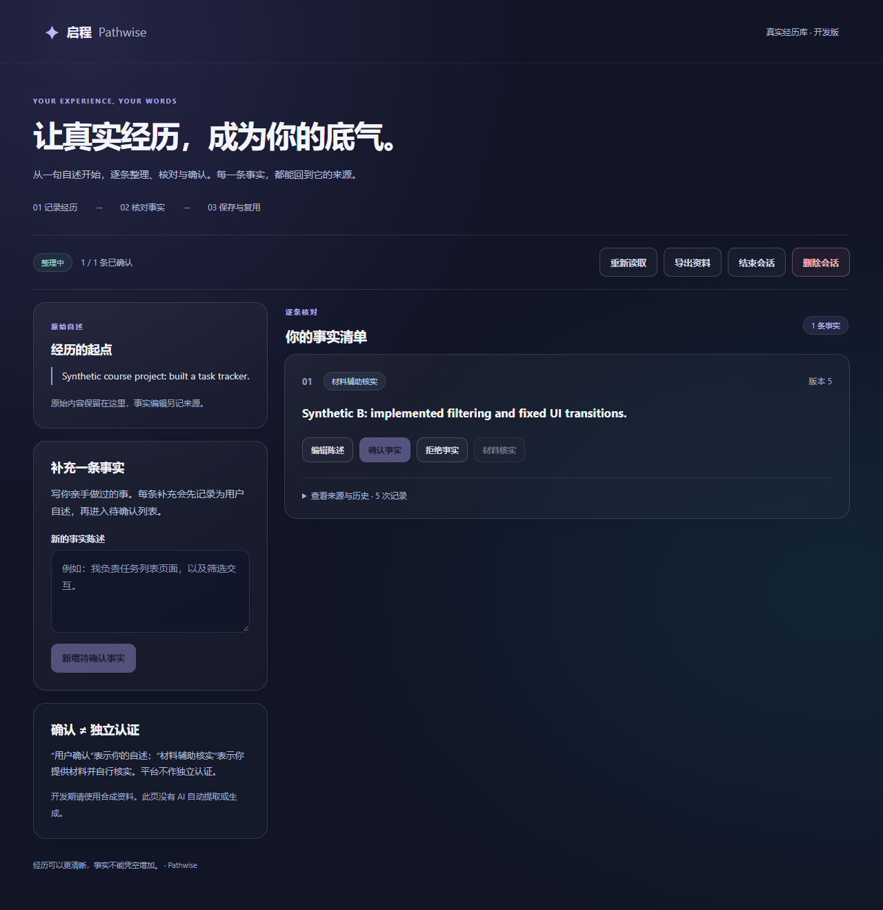
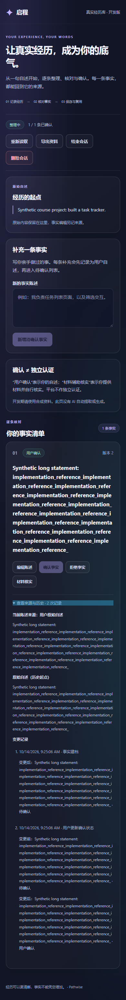

# M1-1B-3：真实浏览器 E2E 与人工验收

已整合 main `e7e872c`（PR #6 幂等修复）；[main 合并后的 CI 已通过](https://github.com/greglien282-a11y/ai-grad-job-assistant/actions/runs/38491827293)。开发分支 `codex/m1-1b-3-browser-e2e`，PR #5 保持 Draft，等待最终代码审查与 Windows 人工体验反馈。

## 环境与隔离

- Node.js 22 / 项目 npm 11；API 独立 Python 3.12 虚拟环境；PostgreSQL 16。脚本不安装系统软件、不修改系统服务。
- 本机只读取被忽略的 `apps/api/.env` 中明确的 `TEST_DATABASE_URL`；绝不使用 `DATABASE_URL` 作为回退。也可通过私有环境变量 `PATHWISE_E2E_DATABASE_URL` 提供专用连接。CI 必须显式提供后者。
- 连接必须是 localhost/127.0.0.1，数据库仅允许 `pathwise_test` 或 `pathwise_e2e`，不能使用 postgres/pathwise_dev 角色、超级用户或带自定义 options 的连接。启动时检查实际数据库、角色及 18000/15173 端口可用性；不满足即停止。
- 每次运行创建新的 `pathwise_e2e_<随机 UUID>` schema，执行真实 Alembic 空库迁移。search_path 仅指向该 schema，API 使用专用端口 18000，React/Vite 使用 15173 且 strictPort。任何非空 `VITE_API_BASE_URL` 都拒绝启动，包括本地 Vite env 文件。
- 测试专用 ASGI 包装仅给真实 FastAPI 响应添加本次 schema 标识。启动器检查 API、直接 PostgreSQL schema/revision 以及 Vite 代理返回的标识一致，然后才启动浏览器。业务接口与应用代码没有 Mock 开关。
- 每项测试的自动 fixture 清空本次 schema 的合成会话；最终正常结束/失败/Ctrl+C 只删除本进程创建的 schema，不删除 public 或已有用户数据。不可复用旧 schema，不自动清理其他运行遗留的 schema。
- 强杀进程/系统重启可能留下随机测试 schema，需管理员核实归属后人工处理；不提供宽泛的自动 DROP 操作。
- `.e2e/` 存放受限权限的临时配置与本地服务日志，永不提交或上传。仅使用合成数据；禁止在此预览中输入真实经历。

## Windows Edge 人工体验

当前机器已具备 Python 3.12 venv、Node 22、PostgreSQL 16 与独立测试角色。项目依赖安装完成后，在仓库根目录运行：

```powershell
./scripts/start-isolated-preview.ps1
```

等待输出 `Edge manual preview` 后，在 **Edge** 打开 http://127.0.0.1:15173。脚本不会自动打开浏览器。可以在同一标签页刷新恢复；停止终端会删除本次隔离资料。请勿使用日常开发地址 5173/8000 代替该入口。

已有环境的新 checkout 可在 `apps/web` 执行 `npm exec --yes --package=npm@11 -- npm ci`。缺少 Python 3.12、数据库/测试角色或系统软件时，参考 [API 环境说明](M1_1B_1_API.md) 并另行授权安装；启动器不会自动配置系统。

如果 PowerShell 执行策略阻止脚本，可直接进入 `apps/web` 执行 `npm run e2e:manual`，不用修改系统执行策略。

### 人工清单（仅合成例子）

1. 输入“合成课程项目：制作任务管理工具，负责列表界面”，创建会话；应显示原始经历、空事实列表，不自动生成内容。
2. 补充“合成事实 A：实现任务列表”，新增一条待确认事实；核对来源是该补充，而非借用创建输入。确认后变为用户确认。
3. 编辑成“合成事实 B：实现任务列表及筛选”，保存后重新待确认，单独再次确认。展开来源，检查当前来源为用户后续编辑，原始 A 与完整变更仍可查。
4. 刷新同一标签页，应恢复 B 和状态。不要复制或截图开发者工具中的 sessionStorage/Authorization。关闭标签页不保证恢复。
5. 材料核实填写“合成报告第 2 节”和“用户比对筛选功能”；检查展示明确说明用户自行核实，无平台独立认证。
6. 导出 JSON，核对陈述、状态、来源、版本和历史；文件不含凭证。不要上传包含个人内容的导出文件。
7. 新增第二条合成事实，拒绝后编辑并再次确认；原历史仍保留。
8. 点击结束并取消，仍可编辑；再次点击结束并确认，变为只读，仍可导出/删除。
9. 点击删除并取消，数据仍在；再次确认永久删除，回到创建入口，刷新后无旧会话凭证。
10. Edge DevTools 切换 Offline 后尝试补充，检查安全错误提示和草稿保留；恢复 Online 后先重新读取、核对是否已写入，再决定操作。**失败提示不能证明写入未发生。** 创建结果不确定时界面只读恢复；刷新不会自动 POST。恢复未找到时，必须重新输入完全一致的原正文，再明确同键重试。事实重试复用原操作键；不要因错误提示另建一条事实。
11. 双标签或外部客户端冲突及精确响应丢失建议通过自动化复现，无需人工复制 Bearer。自动化覆盖 open delete panel + 409 + 读取失败后的结束/删除禁用、重新读取成功后恢复操作但不自动提交。

记录每步是否符合预期、首次找到新增/确认入口的时间、一次新增确认所需输入/点击数、错误恢复是否看懂；只反馈合成截图及脱敏描述。

### 桌面与窄屏体验

- 桌面建议 1280×900：输入与事实列表双栏，管理操作、状态、编辑与来源需能清楚定位；检查 Tab 焦点与 Enter 确认。
- Edge DevTools 响应模式 390×844（另人工检查 320 宽）：应无横向滚动，长文本不溢出，按钮可触达，确认面板不被遮挡。自动化只覆盖 390 宽触控模拟，不能替代物理移动设备验收。
- 本轮观察：新增一条事实需要一次输入/一次新增点击，确认需要另一点击；底层有两次 POST 和一次读取，失败恢复仍需要用户理解“重新读取”。状态颜色、版本和来源文字清楚，材料免责声明可见。
- 窄屏采用单栏，补充框及说明在事实列表上方；长文本展开来源后滚动距离大。事实操作按钮当前约 36px 高，触控舒适度需人工反馈。建议后续审查折叠重复说明、跳转事实列表及更大点击区域，本轮不改变 UI 合同或布局。

## 自动化命令

`apps/web`：

```powershell
npm run e2e:preflight
npm run test:e2e:types
# 默认 Chromium，首次需下载项目浏览器（非系统安装）
npx playwright install chromium --only-shell
npm run test:e2e
# 本机已安装 Edge，可明确指定；不自动回退，CI 禁止覆盖
$env:PATHWISE_E2E_CHANNEL = 'msedge'
npm run test:e2e
```

直接 `npx playwright test` 会拒绝缺少已验证环境的启动。默认单 worker、零重试、无 trace/视频/自动失败截图，不掩盖不稳定写入。Chromium 与 Edge 通道采用 [Playwright 官方浏览器配置](https://playwright.dev/docs/browsers)；使用 [route.fetch/abort](https://playwright.dev/docs/network) 在真实 POST 已完成后丢弃响应，不修改成功响应内容。

## 覆盖与当前结果（2026-10-14）

- 本机 Edge + 真实 React + FastAPI + PostgreSQL：**16 项全部通过**。原 workspace/mobile 两个 spec 的 11 项断言与 `21fca42` 完全一致，没有跳过、放宽、预期失败或重试；另外保留 PR #6 的 5 项恢复回归测试。
- 原 11 项覆盖完整生命周期、来源与编辑历史、版本冲突及读取失败后的管理禁用、断网/到达前中断、部分成功、快速点击、拒绝后重编辑、编辑响应丢失、窄屏，以及创建/事实响应丢失。
- 新增 5 项覆盖创建及恢复响应连续丢失后刷新、未发送创建的刷新只读与原正文门禁、回合响应丢失后复用、删除后刷新不可复活、事实 A 创建重放返回编辑后的 B 且不增加历史。
- 完整流程同时检查浏览器 DOM、真实 HTTP 合同及独立 PostgreSQL 连接读出的状态、版本、来源、历史和材料依据。删除后全部业务资料归零；仅保留不含正文/归属/凭证摘要的有期限墓碑。导出不含临时 Bearer（断言只输出布尔值）。
- 历史结果：2026-10-13 曾为 9 通过、2 失败，确实复现孤立会话与重复事实；两项阻断由已合并的 PR #6 修复，原失败断言未经修改即通过。合同见 [已批准 v2](M1_1B_3_IDEMPOTENCY_PROPOSAL.md)，实现见 [幂等说明](M1_1B_IDEMPOTENCY_FIX.md)。
- PostgreSQL Pytest **66 项通过**（含 9 项隔离守卫）；React Vitest **35 项通过**；E2E TypeScript 检查及 TypeScript/Vite 构建通过。迁移测试包含空 schema upgrade/check/downgrade/upgrade 与既有已确认事实升级；每次 E2E 另执行空库迁移并核对 `0003_idempotency`。
- Windows 人工预览启动、真实代理标识及正常停止后的 schema 清理已通过烟雾验证。用户本人体验仍待进行。
- 本机明确使用已安装 Edge；Chromium 在 CI 单独验证。构建保留现有 Zod 注释移除提示；Pytest 有现有 TestClient/httpx 弃用提示。

### 日常开发库迁移

2026-10-14 先只读验证目标为本机 `pathwise_dev.public`：旧版本 `0002_fact_version`，1 个会话、1 个项目、1 个回合，其余事实相关业务表为空。取得用户单独授权后，检查日常端口未运行服务，在 Git 忽略且 ACL 仅当前 Windows 用户可读的目录保存 PostgreSQL 自定义格式备份，并用 pg_restore 验证归档可识别；随后 upgrade 到 `0003_idempotency`、alembic check 通过。迁移前后业务行内容及计数完全一致，新操作表为空。备份与资料不上传 GitHub。此操作与 E2E 隔离栈独立，测试不会连接日常库。

### 仍存在的限制

- 24 小时只是匿名创建的临时恢复窗口，不是长期账号恢复。关闭标签页、清空存储或丢失凭证可能无法找回已创建资料；不会自动删除未知资料或重新创建。
- sessionStorage 不保存完整经历正文。创建未找到时需要用户重新输入完全一致的正文；存储/加密不可用时创建请求不会发送。
- 过期操作清理命令及失败测试已提供，但本机/生产小时调度未配置。未运行调度时不能保证过期后 1 小时内物理清除；旧键即使清理后也受时间守卫限制。
- 强杀测试进程可能遗留独立随机 schema；人工验收及物理移动设备触控反馈仍待完成。没有 AI 或长期账号体系。

## CI 与交付证据

保留 api/web 的测试、构建与迁移检查，API 增加清理命令烟雾检查。仅有 api/web/e2e 三个作业；每个作业只检出当前项目一次。移除 PR #6 临时双检出组合脚本及重复 E2E 作业，独立 E2E 作业使用 PostgreSQL 16 新服务，通过 CI-only 引导生成随机密码、创建无管理员权限的专用角色/数据库，然后执行隔离守卫、空库迁移和 Chromium E2E。随机密码与 URL 立即 mask，不输出连接信息；只上传两张合成界面截图（7 天保留），不上传 HAR、trace、服务日志、下载文件或 HTML 报告。

原两项失败的历史记录保留，当前原断言全部通过。最终提交的 Chromium CI 链接与状态记录在 PR #5；需最终代码审查及人工反馈后才可决定合并。Refs #1，不能自动关闭 Issue #1。无 AI 接入、prototype 或 Pages 改动。

成功流程截图（合成内容，无凭证）：




