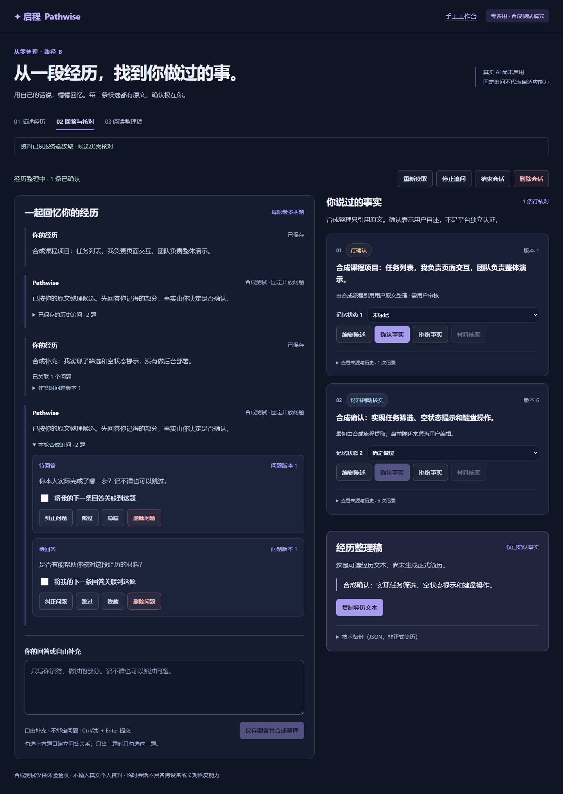
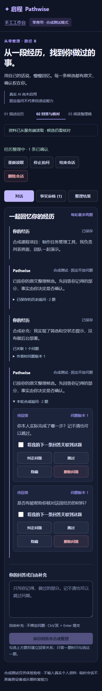
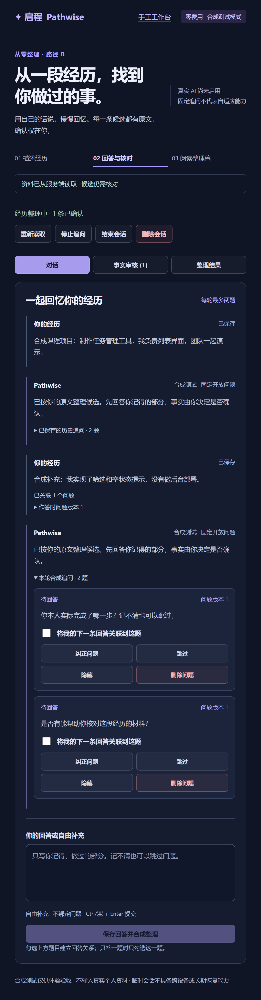

# M1-2B：合成对话工作台与视觉验收

基于 main `5c6396a7ef380f8e652d0a23af91667eb540a80a`，分支 `codex/m1-2b-conversation-workspace`。产品依据完整 V0.3 PRD、USER_JOURNEY 及 [M1-2A 后端合同](M1_2A_BACKEND_MINING.md)。本轮没有真实模型、费用、API Key、后端合同变更或前端之外的业务迁移。

## 入口与功能

- `/` 保持三个既定入口；B 进入 `/discovery`。已有简历导入、目标岗位解析明确“开发中”，不重定义定位。首页下方保留原手工兼容流程，`/manual` 可直接使用原工作台及同一临时会话。
- `/discovery` 首屏只需一段自然语言，创建并保存经历后在同次明确操作中整理初始 user turn。全部响应声明 scripted/synthetic，界面始终标注零费用合成模式与固定开放问题，不能冒充真正自适应 AI。
- 每轮最多两个问题，可选 ID 绑定、自由补充、跳过、纠正、隐藏或确认删除。历史追问默认折叠，正文只从服务端当前问题读取；已关联回答展示问题 ID 所指的作答版本，删除/后续纠正不能改写原回答身份。
- 共享 FactCard 与既有 mutate 接口支持编辑、单条确认、拒绝、记忆状态及材料核实。候选原文、原始引用与编辑历史均保留；已编辑陈述明确改用用户编辑作为当前来源，不能借旧原文支持 B。
- 可读整理只来自 summary GET 的 confirmed/evidence 事实；客户端另校验 text 等于确认陈述的确定性拼接，不接受插入新措辞。支持复制，剪贴板不可用时可选择文本手工复制。
- JSON 在“技术备份（非正式简历）”下单独展示，包含 pending/rejected、历史与引用，仅供备份。不是正式简历或 PDF。

## 组件与恢复约束

Root 只做入口选择；DiscoveryWorkbench 渲染工作台；useDiscovery 处理会话/API 同步；Conversation、QuestionCard、共享 FactCard 管理对话及审核。App.tsx 只增加首页入口插槽，没有扩大原手工业务状态机。

创建前暂存并回读验证候选 Bearer、稳定键及请求 HMAC；挖掘 POST 前暂存并回读 pendingMining（键、请求标签、会话/项目/回合/问题 ID、revision、期限，**无回答正文**）。仅使用当前标签页 sessionStorage；Bearer/操作键不进入 URL、调试日志或截图。

聚合/整理与恢复读取限制 10 秒，挖掘写请求限制 60 秒。客户端超时不代表服务器回滚；网络异常首先 GET recovery；刷新只读 GET 聚合/summary/recovery，不自动 POST。未找到时，需重新输入完全一致的原回答并用原键/问题关联/revision 显式重试。只有明确核对并放弃未找到操作才清理本页键；没有自动换键。过期操作须核对服务端资料后明确清除；24 小时不代表长期账号恢复。

failed/unknown/stale 的已保存回答需二次确认重新整理，复用原回答及关联，不重复新增。running/reserved 保留恢复记录并提供只读查询，不自动重新推理。

事实 version_conflict/context_conflict 重新获取数据，保留编辑/回答/问题草稿，需用户复核；idempotency_payload_mismatch 单独提示查询原操作，不套用事实编辑重试。读取失败时，结束、删除、停止及复制禁用，包含已打开的确认面板；读取成功后才恢复。停止追问、结束及删除均有二次确认；取消不写 API。结束只读，停止追问仍可审核事实。

无 Scripted Provider/后端未升级时明确告知，保留手工入口；不会用前端固定回答模拟 API 成功。合成模式仅在隔离启动器明确强制 AI_ENABLED=true/AI_PROVIDER=scripted，日常默认仍 false。

## 视觉与可用性

主要工作台居中、最大 1480px；宽屏左主对话/右事实与整理稿。正文/输入 16px、标题 24/30–44px、辅助说明 14px，点击区至少 44px。沿用深色紫蓝基调，以内容、状态和对比组织层次，不加装饰动画。历史追问折叠，减少重复问题造成的滚动。

窄屏与可用容器宽度不足（包括 200% 缩放）转单栏，可切换对话/事实/整理；面板仅隐藏、不卸载，保留编辑草稿。问题操作用两列按钮避免窄屏挤压。Ctrl/⌘+Enter 提交，中文 IME 组合输入不触发发送；Enter 本身保留换行。状态用 status/alert，表单和来源有可访问名称，保留键盘焦点轮廓。

## Windows 安全体验

仓库根目录运行：

```powershell
./scripts/start-isolated-preview.ps1
```

等待 ready 后在 Edge 打开 `http://127.0.0.1:15173`，点击路径 B；也可直接打开 `/discovery`。若执行策略阻止脚本，在 apps/web 执行 `npm run e2e:manual`，不修改系统策略。API 为 18000、Vite 为 15173，普通测试角色、新随机 schema、迁移和代理身份验证仍 fail-closed；不回退 5173/8000/pathwise_dev。正常 Ctrl+C 删除本次 schema；强杀可能留隔离 schema，不能自动宽泛清理。

只用“合成课程项目：负责列表交互”等合成资料；停止预览会清除本次体验数据。测试连接读取被忽略的私有 TEST_DATABASE_URL，原样遵循 M1-1B-3 隔离规范；没有新增系统安装或服务配置。

人工验收清单：

1. 首页三个入口清楚，A/C 未实现状态可见；进入 B 后无需长表单。
2. 创建后可见原文、固定合成问题及 pending 候选；只选一题作答，另一题可跳过，刷新仍能查看关联。
3. 编辑事实后重新 pending，单独确认；记忆状态和材料核实不变成独立认证，来源能解释每条陈述。
4. 整理稿只含确认事实；复制文本可读，JSON 是技术备份。
5. 断网时草稿保留；连接恢复先查询，无额外回答/推理。读失败时管理面板不可操作。
6. 停止/结束/删除分别取消一次、确认一次；停止后仍可审核，结束只读，删除后刷新无旧资料。
7. 桌面 1440/1280、窄屏 390/320、Edge 实际 Ctrl+Plus 到 200%：文字可读、无横滚、输入焦点可达、软键盘不遮主要动作。自动化 CSS zoom/视口检查不能替代物理手机与实际浏览器缩放验收。

记录第一次找到回答/审核入口的难易度、问答绑定说明是否看懂、键盘/触控成本及错误提示是否能指导恢复。截图只含合成内容，不拍 DevTools 凭证或存储值。

## 日常 pathwise_dev：只读结果与待授权步骤

2026-10-14 只读验证 loopback 数据库/角色 pathwise_dev、默认 schema，无 URL options：版本 `0003_idempotency`；1 个会话、1 个项目、1 个 user 回合，事实、材料、历史为空。不打印内容或连接密码。**本轮未执行日常迁移，仍需负责人再次明确授权。**

获授权后拟执行：

1. 核实日常 API 进程归属并协商暂停写入，不强杀未知服务；只读记录现有行数及私有内容校验，不在报告披露资料。
2. 在 Git 忽略的 `.e2e/backups` 新建私有目录，移除 ACL 继承、仅当前 Windows 用户可读；使用 PG16 pg_dump 自定义格式，密码只经私有环境/交互输入，不写命令、Git 或公开日志。
3. 验证归档非空、`pg_restore --list` 可解析；备份不复制到 E2E 或 CI。
4. 私有 DATABASE_URL 明确指向 pathwise_dev 后，在 apps/api 执行 `.venv/Scripts/python.exe -m alembic upgrade 0005_answer_questions`，再 `-m alembic check`。
5. 核对版本 0005、旧内容/计数一致、AI 新表为空、一会话一项目约束满足。发生旧多项目则迁移回滚并报告，不能合并或删除资料来通过。
6. 确认核验通过后再恢复日常 API；保留私有备份。该步骤目前只是方案，没有运行，也不自动安装清理任务。

## 测试与证据

现有后端 PostgreSQL 121 项、React 原测试及原 16 E2E 全部保留。新增组件测试使用从真实 FastAPI/PostgreSQL 录制的合成合同 fixture（凭证替换为公开固定测试占位）；新增真实 E2E 只替代已批准的 Scripted Provider，不 mock 业务/数据库成功。

浏览器检查创建→初始整理→两题选择→回答关系→确认/编辑/再确认/材料→复制→刷新→停止/结束/删除；另外覆盖问题动作、创建及回答丢响应、网络未到达后的原键重试、版本冲突+失败读取+打开面板、移动切换、200% 缩放可用宽度。SQL probe 直接核对运行、user turns、question ID/version 关联及删除。trace/HAR/video/私有服务日志默认不上传，CI 只增加合成 UI 截图。

本机最终验证：PostgreSQL 后端 121 项通过（含迁移 upgrade/check/rollback），React 51 项通过，E2E TypeScript 与 TypeScript/Vite 构建通过；Edge 23 项真实 E2E 全通过（原 16 + 新增 7，零重试）。三张截图来自上述合成流程，已逐张检查，200% 对话列不再被挤窄。CI Chromium 最终状态和链接记录在 Draft PR。本机保留现有 Zod 注释、TestClient/httpx 弃用警告；没有新增系统依赖。







## 尚未完成

真实模型、历史上下文快照/脱敏/预算、真正自适应追问、语义拆分/专业改写、正式简历/PDF、账号/长期跨设备恢复均未交付。Scripted 仍会重复固定问题；原文完整提取可能生成较长复合候选。M1-2C 必须先审查历史上下文与费用授权，不是替换类即可上线。本轮不更改完整 PRD、prototype/Pages，也不提前做 M1-2C。
