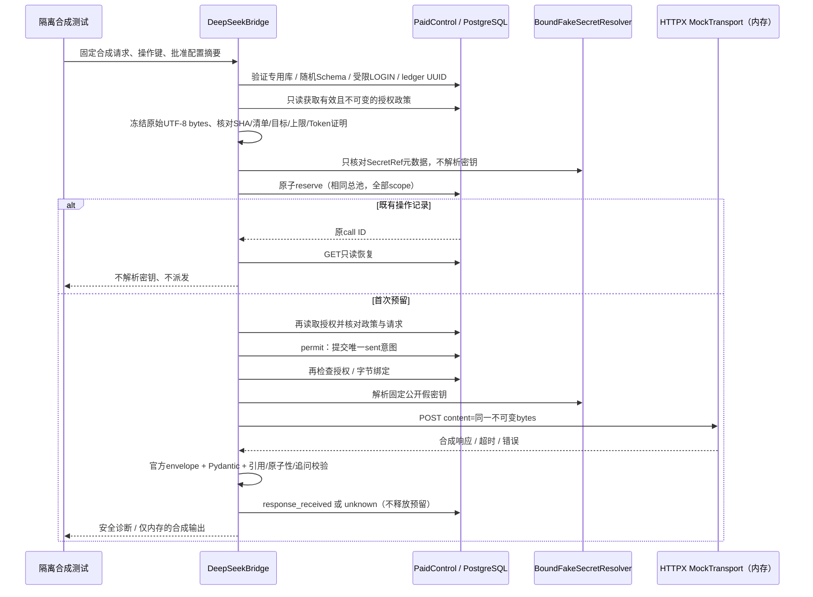

# M1-2C-2 C-1B：DeepSeek 离线 HTTP 安全接线

基线 main `ada8f06c42e28f57552aaf68059a5435a0618dbd`，已核对合并 CI [38706086118](https://github.com/greglien282-a11y/ai-grad-job-assistant/actions/runs/38706086118) 成功，分支 `codex/m1-2c-2c1b-offline-bridge`。依据 C-0/C-1A、适配/上下文合同和 D-006。

**真实请求0次、真实消费0元、真正可用的新增授权0份。** 无真实 Key、账户或余额访问；10元充值计划仍不是消费许可。以下流程只能在随机测试 Schema、受限 LOGIN、固定合成数据和精确类型 HTTPX MockTransport 下执行。不注册到 safe_provider、正式挖掘 API 或页面。

## 编排结构与时序

`DeepSeekBridge.exercise_offline()` 连接既有 `PaidControl` 与 `DeepSeekOfficialTransport._post_once()` 的离线协议路径；不调用 C-0 的 ProbeControl，也不将收费控制伪装为 scripted/synthetic Provider。原有 MockRunner、ProbeControl 和 0007/0008 约束保持。没有新增迁移。

实际网络入口 `DeepSeekBridge.invoke()` 无条件拒绝；`DeepSeekOfficialTransport.invoke()` 仍无条件拒绝。没有 enabled/env/debug/live 参数，也没有生产 SecretResolver 或真实网络 client。内部 POST 同样只接受精确类型 httpx.MockTransport 和公开假值，普通配置无法打开真实派发。不能把 Mock handler 的任意测试代码当成安全沙箱；测试代码及部署代码完整性仍是信任边界。

## 请求字节、授权和发送许可的绑定

1. `synthetic_request(case, turn, cap)` 只能从已固定摘要的12组/24个输入清单取请求。dataset 与 Wire Schema 摘要不变；不读用户会话、简历、材料库。
2. `bind_bytes()` 要求精确 SyntheticRequest 和不可变 bytes、严格 UTF-8。使用 `hashlib.sha256(body)` 核对原始字节，并逐字节比对同 case/turn/cap 的固定清单。额外空格、换序、替换 system/user、Unicode变化或相同语义的重新 JSON 编码均拒绝，不修复后发送。
3. 同时核对独立 BridgeProfile 与授权政策的 provider/model/版本政策/endpoint/region/mode/cap、政策 SHA、账户及 SecretRef 摘要。请求 SHA 必须出现在本授权的完整 Token 证明中。只传一个模型名或 SHA 字符串不够。
4. 创建私有 SyntheticRequest 副本，保留同一个不可变字节缓冲区；调用者即使绕过 dataclass 冻结修改原对象，也不能替换此副本。预留、许可、后续验证及最终 `content=body` 都绑定该缓冲区，没有派发前重新序列化 JSON。
5. PaidControl 在同一 PostgreSQL 总池锁下绑定操作键、授权、请求 SHA、政策 SHA 与批次；permit 再验证期限/撤销/额度等。读取政策时检查数据库时钟、ledger UUID、快照重新计算的 SHA 与行中摘要一致。所有校验失败均停止。

Mock handler 验证实际 `request.content` 与批准字节、SHA 完全相同，URL、Authorization假值与模式一致。测试还包含原对象被修改、过期/错误授权、目标/上限漂移、同键多进程竞争及批次总池竞争。

## 密钥与数据库身份隔离

`SecretRef` 仅含供应商/账户/受控名称，摘要覆盖三者，不含 Key。`BoundFakeSecretResolver` 仅解析内置公开假字符串，验证 ref、账户、供应商、授权摘要、有效期与撤销；repr 隐藏 ref，不读环境、.env、文件或 vault。它与 C-0 FakeSecretResolver（假值摘要绑定）、DisabledSecretResolver（永远拒绝）严格区分。生产 SecretResolver 没有实现，必须另审受控注入及权限。

没有完整授权或预算预留时不解析假密钥；预留之后也必须先取得 sent 许可并再次核对授权，才能 resolve_fake。元数据检查不解析密钥。无授权/预算失败/许可拒绝均以断言证明 resolver 与 HTTP 未调用。

Bridge 强制连接 localhost/127.0.0.1 的 pathwise_test/pathwise_e2e、随机 `test_UUID`/`test_eval_UUID`；在连接前拒绝 pathwise_dev 或非随机 Schema。数据库当前角色必须等于 session_user，且无超管/建库/建角色/BYPASSRLS、owner 成员资格、数据库/持久Schema CREATE 或收费表写权限。不能用管理员凭证加 SET ROLE 冒充受限业务进程。

CI 隔离 fixture 用管理身份建立随机、短生命周期 LOGIN、随机合成数据库密码，配置现有 C-1A 最小权限。Bridge/子进程只收到受限 LOGIN 连接，不得到管理 factory/凭证。结束撤销权限并删除本次角色；无 Windows 服务或日常库配置变更。既有 DB owner 单元测试不能代替这条链路。本机角色没有 CREATEROLE，新 LOGIN 链路本地明确未执行；CI 遇此条件强制失败，不允许跳过或退回 owner。

## 状态、失败与恢复

预留失败无 HTTP；已预留但没有许可保持 reserved 和全额 held，由 owner 显式核对未发送。相同操作键的后续调用**全部只读恢复**，不会自动消费一个之前尚未使用的 reserved 许可。授权到期/撤销后仍可用 `recover_offline(call_id)` 只读查看，不解析 Key、不重新推理、不对账。

sent 在数据库事务中提交后才进入 HTTP。即便此后尚未触及 Mock handler 就崩溃，也只能保守保留 sent；GET 对过期 sent 投影 unknown，显式 recover 才持久化，费用不退款。许可提交错误可能不明确：返回 ledger 错误并停止，不重做数据库许可或 HTTP。

401/429/500/503、超时、断线、取消、截断、拒答、无效 JSON/Schema、用量超界、错误引用/复合或不确定事实都进入 unknown，全额 held，必要时阻断同总池后续请求。异步取消持久化 unknown 后重新抛出不含原始消息的 CancelledError；突然 os._exit 保留持久 sent。数据库更新也失败时报告 `bridge_unknown_not_persisted`，等待只读恢复/人工处置，不伪造已知失败或退款。迟到状态不会覆盖 reconciled。

成功的 response_received 同样不结算、不释放占用；没有自动零元发票或假装获得真实供应商账单。合成测试记录的 `actual/actual_usd` 保持 null，最终 diagnostic 明确 offline、真实请求/消费0、真实质量/延迟null。既有 PaidAdmin 手工账单入口不在 Bridge 中使用。

HTTP 无 SDK、无 POST 自动重试、trust_env=false、无代理/重定向/自定义域名或跨平台回退；连接/read/总墙钟和256KiB响应上限继续复用 C-0，Bridge 另检查解码/验证后的墙钟。生产代理重试和远端取消效果仍未测量。**本地一次许可不等于供应商绝对只执行一次**；在许可提交、实际出网、供应商执行、响应返回之间存在未知窗口，不能用“exactly once”宣传。

响应先经过严格官方 envelope（含缓存/总量一致性、版本、结束原因、Token cap），再通过共享 `validate_context_v2`：只接受实际发送快照中的 user 原文及准确 Unicode code-point offsets、完整原子句、否定/限制、合法问题来源和去重/数字约束。原 `validate_v2` 保留真实 DB 用户归属和原文检查，调用相同纯校验；旧测试不变。本 Bridge 不向经历库发布结果；未来接正式挖掘仍必须经过 mining.complete 的项目/会话、revision、lease、active 及 pending 写入规则，不能因通过 HTTP 验证就自动确认事实。

`safe_error` 仅返回固定错误码；diagnostic 不含请求/回答/完整响应、Key、Bearer、原始数据库/供应商错误或操作明文。不上传 trace/HAR/原始响应。源代码没有业务日志输出。

## 官方核验与 Token 阻塞结论

2026-10-15 只读检查公开文档，网页工具部分页面超时后获取官方静态 HTML；不是调用推理/余额接口。[机器证据记录](evaluation/deepseek-c1b-official-evidence.json) 包含每个来源 URL、HTML SHA、公开 tokenizer 归档 SHA、未批准价格观察及候选请求 SHA。摘要标识本次读取，不保证供应商以后不修改页面。

- [Chat 合同](https://api-docs.deepseek.com/api/create-chat-completion/)列出 deepseek-flash、thinking.disabled、json_object、非流式和有限 max_tokens；JSON object 不等于严格 JSON Schema。max_tokens 限制生成数量，截断/拒答仍失败，不能保证 cap 内产出完整业务 JSON。
- [价格](https://api-docs.deepseek.com/quick_start/pricing/)观察到 Flash 对应 V4.1-Flash，USD/百万token：未命中峰/谷0.30/0.15、命中0.006/0.003、输出1.20/0.60；峰为工作日 UTC01–04/06–10，排除中国法定假日。服务别名和 fingerprint 不能证明权重不变。这个观察不是授权快照，没有批准账户、有效期、FX 或税费，不可自动导入为有效收费政策。
- [缓存](https://api-docs.deepseek.com/guides/kv_cache/)只作尽力前缀复用，返回命中/未命中用量；不保证命中，清理时间也不构成安全日志/训练零留存承诺。最坏预留不依赖缓存或谷价。
- [限流/超时](https://api-docs.deepseek.com/quick_start/rate_limit/)说明账户级并发、429、空行保活及十分钟未开始推理断开；不是本地超时后远端取消或免费保证。[错误码](https://api-docs.deepseek.com/quick_start/error_codes/)列出401/429/500/503，本项目不采用其重试或换供应商建议。
- [隐私政策](https://cdn.deepseek.com/policies/en-US/deepseek-privacy-policy.html)（页面2026-02-10）描述输入处理、改进/训练目的、按用途保留和中国境内处理，也区分下游开发者责任。没有从该页得到本账户 API 专属确定保留期、退出训练或 ZDR 承诺；不能因此允许真实资料外发。首探仅固定完全虚构输入。

**完整请求 Token 上界结论：目前仍无法离线可靠证明，因此真实派发继续阻断。** [官方 Token 文档](https://api-docs.deepseek.com/quick_start/token_usage/)提供 V4 tokenizer zip，同时说明实际用量以返回 usage 为准。只读取 zip 成员/JSON/示例源代码，没有运行它建议的 trust_remote_code=True，也没有安装 transformers。包有 chat_template，但样例只演示 encode 普通文本；元数据未给出与线上 V4.1、json_object/non-thinking/服务器内部 framing 完全一致的计费上界保证。配置中的 model_max_length 也不能当作当前 API 的计费保证。

这不是宣称官方 tokenizer 无用；可用于未来经审核的估算/比对，但**存在模板不等于完整付费上界已证明**。需要可信版本/模板映射及服务器包装开销保证或更保守的供应商计费合同。不可拿字符/字节比例、Mock input_bound=5000、单次真实返回 usage 或一份 owner-attestation 标签直接冒充证明。当前所有正向证书都是标注 TEST ONLY 的隔离夹具，不能启用真实调用。

## 验收运行与范围

使用既有 Python3.12 环境、显式专用 TEST_DATABASE_URL。`python -m pytest -q -ra` 保留原321项后端断言，新增 Bridge 字节/权限/故障/多进程测试；62 React、构建/类型、30 Chromium E2E、迁移/check/清理及12项离线合同/Mock CLI继续执行。代码没有更改旧测试、前端或迁移版本。

新增包括12组合成案例完整 HTTP→账本链路、24个固定字节合同、来源否定/团队/假设/不确定边界、相同键两进程只派发一次、不同批次共享预算、os._exit 在HTTP之前/过程中退出、取消/超时/无效响应、保留 held、恢复只读、无权时 resolver 不调用、日志脱敏、owner/SET ROLE 拒绝。本机缺少 CREATEROLE 时，仅新增受限 LOGIN 集成项明确报告未执行；CI 强制执行，原321项不因此跳过。最终测试数量、平台及CI链接写入Draft PR。

## 首次真实合成探针执行前检查（尚未获准）

1. 先审查 C-1B；真实 Bridge/Transport invoke 仍拒绝，生产 SecretResolver、无重试 egress/代理及真实接线需要独立批准和实现，不能靠配置打开。
2. 解决完整 Token 证明阻塞；审查账户币种、适用价格、有效期、峰谷/缓存/税费规则，批准保守FX/税费及单次/授权/全局预算。所有批次仍共用同中央账本。
3. 明示账户、SecretRef、供应商/URL、region/别名风险、模型/模式、时间窗、执行及核账人；批准具体请求 SHA、次数与输出 cap，审核仅外发固定合成内容。不能提供任意用户输入。
4. 推荐候选 S03/b「我实现了本地筛选。」：output cap256，完整原始请求SHA `5cc2def4f875e43760e799678a43c1f2d2072dd4245eaf54457dfe78ee0b373e`。2521字节仅用于字节一致性，**不是Token数/上界**。次数批准仍0、输入上界null、预算0。
5. 验证独立 LOGIN/生产凭证最小权限、固定中央 ledger UUID、管理凭证不在业务进程、无已有 unknown、全球额度和每层上限；审批原件和账单证据由管理方保管。
6. 单独批准安全密钥注入、合成资料外发和人工账单核对方式。超时/429/5xx/解析失败立即停，不补第二次，不换渠道，保持未知预留；只读恢复后人工确认账单。

Token证明、真实授权、真实密钥边界和真实派发工程任一未完成，阻断所有收费功能；离线 Mock、现有 Scripted UI 和人工流程不受此影响。完成后保持Draft等待审查，不自动合并、不迁移日常库。
