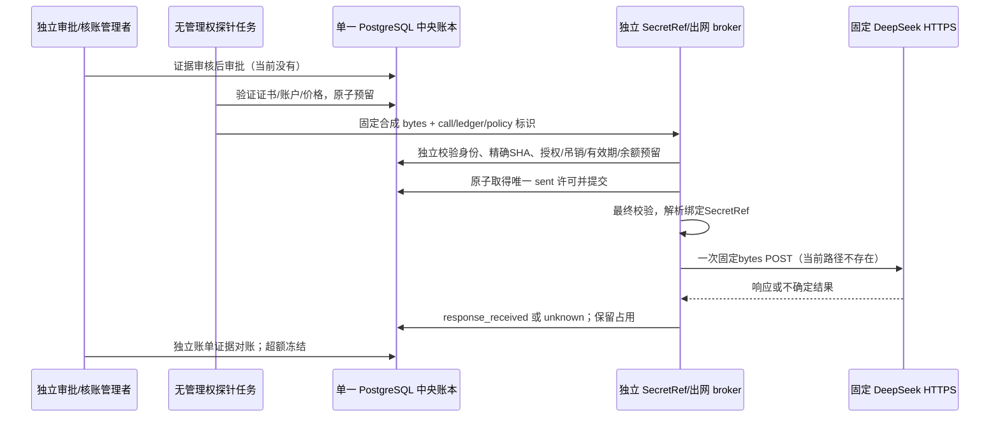

# C-1C：首次真实探针前的计费边界与安全接入

基线 main `a575ee5b29be0c463515c78288ea6ab6e6bc0877`；合并 CI `38715931781` 成功。核验日期：2026-10-15。本阶段真实调用批准次数 **0**、批准费用 **0元**。没有读取、索取或注入真实密钥，没有调用余额、模型或推理接口。

## 结论与实现范围

**目前无法证明完整请求的真实计费硬上界。两种候选策略均未启用，真实 Bridge/Transport 继续无条件拒绝。** 公开 Chat 合同比此前调查提供了更直接的输入+输出长度约束，但仍不足以证明所有可计费 Token、失败路径及附加费用都受同一上限约束。这里的“不足”是本项目安全要求下缺少证据，不是断言供应商一定超额收费。

新增 `app.billing_boundary`、离线检查 CLI、拒绝测试和本说明；没有修改 PaidControl、Bridge、Transport、数据库模型、0007/0008、应用界面或既有验收。不存在生产 broker 实现、新授权、预算充值、网络开关或新迁移。新评估器是只读诊断，**不是** PaidPolicy 的生产证书校验器，结果不接入 reserve。C-1A 的正向 owner-attested 夹具仍只用于隔离测试；现有 `kind`/digest/布尔声明不足以证明供应商行为，不得用其开通真实派发。

[机器证据清单](evaluation/deepseek-c1c-billing-evidence.json)记录公开来源、抓取内容 SHA-256、事实/条件推导/缺口、两套原币报价和空的已批准策略集合。哈希用于辨认读取内容，不是供应商签名、不可变合同或价格有效期保证；不会把在线页面自动转成授权。公开原始网页仅留在 Git 忽略的本地调查缓存，不上传完整页面或账户资料。

## 1. 输入 Token 上界调查

### 已由官方页面支持的事实

- [英文定价](https://api-docs.deepseek.com/quick_start/pricing/)与[中文定价](https://api-docs.deepseek.com/zh-cn/quick_start/pricing/)列出 deepseek-flash 对应 DeepSeek-V4.1-Flash、上下文长度1M。别名不保证不可变权重；页面未在这里明确1M的精确整数含义。
- [Chat API](https://api-docs.deepseek.com/api/create-chat-completion/)及[中文版](https://api-docs.deepseek.com/zh-cn/api/create-chat-completion/)说明 max_tokens 是生成上限，输入和生成长度之和受模型上下文限制；返回 prompt_tokens、completion_tokens、total_tokens 及缓存拆分。length 结束可能意味着生成上限或会话达到上下文上限。JSON object 仍须 JSON 指令，不能当作严格 Schema 保证。
- [Token 说明](https://api-docs.deepseek.com/quick_start/token_usage/)的字符比例是估算，用量以实际返回为准。C-1B 已检查链接的 V4 tokenizer 包及模板，未发现与线上 V4.1、全部包装及计费逐项对应的保证；本轮未运行远程代码或安装 tokenizer。
- 两种语言的价格页说明按模型输入和输出的总 Token 数计量计费。这支持研究“上下文限制可以约束正常输入计费”的方向；但页面未逐项定义计费输入与上下文中内部包装的对应关系或失败路径，不能省略这些前提。
- [Responses 指南](https://api-docs.deepseek.com/guides/responses_api/)明确不支持 truncation，超上下文返回400。**该结论属于 Responses，不可移植为本次 Chat 端点的错误或免费保证。** 本次也不切换 API 模式。

### 严格的条件推导

令 C 为已证明的上下文整数上限，I/O 为上下文内输入/输出数。若 I+O≤C 且 I、O≥0，则 I≤C；max_tokens=256 只保证 O≤256，**不能推出 I≤C−256**。若再有证据表明所有可计费输入均被 I 覆盖、计费输出不超过256、无其他费用且峰值单价有效，才可用独立保守界 `C×输入未命中峰价 + 256×输出峰价` 预留，无需精确 tokenizer。

这条推导逻辑有效，但前提尚未全部成立。不能把“总长度”直接替换为“所有收费 Token”，不能把单次返回 usage/一次成功实验当成所有未来请求及失败路径的证明。

### 未获证明的事项及解除条件

1. 1M 的精确定义，以及 system/user、role、消息分隔、json_object 包装和任何内部可计费开销是否全部计入相同 C。需要供应商明确的计费口径与端点/模型版本范围。
2. Chat 超上下文时拒绝、截断或其他行为；拒绝、取消、超时、解析失败是否收费，是否仍受同一上限或有其他收费。公开 length/400/错误码不能替代收费合同。
3. 官方可靠的完整请求预计数接口或 tokenizer+framing 上界机制。所查 Token、Chat、Responses、Anthropic 兼容和 FAQ 资料未发现足以满足本合同的机制；这是检索结果，**不宣称供应商永远没有计数接口**，不臆造兼容接口，也没有试探任何 API。
4. 账户适用价格、实际结算币种、税费和价格变更保护。观察日价格不保证执行日价格。

可接受证据候选：供应商公开端点合同或可审计书面答复，明确完整输入/内部收费范围、计数/上限、失败收费及适用版本/时间；或可靠 tokenizer 和完整 framing 的供应商保证。只有负责人批准金额、自己填写 owner_attested、页面哈希或测试假证书均不够。证据必须独立技术审核，再与批准原始请求字节 SHA、profile、cap、有效期及价格绑定；证据撤回/过期/配置改变即拒绝。当前接受策略集合为空，不签发证书。

## 2. 原币定价与账户币种

以下为2026-10-15两份官方价格页观察，单位均为**每百万 Token 的原币单价**，不是获批价格快照。

- 中文 CNY：输入缓存未命中峰/谷 **2 / 1**；命中 **0.04 / 0.02**；输出 **8 / 4**。
- 英文 USD：输入未命中峰/谷 **0.30 / 0.15**；命中 **0.006 / 0.003**；输出 **1.20 / 0.60**。
- 峰时为周一至周五北京时间09–12/14–18，排除中国法定假日；英文 UTC01–04/06–10 对应同一时段。页面将周末全天列为空闲，不自行套用调休工作日历。保守预留不依赖谷价、缓存命中或赠金。
- 官方说明按用量计费、有赠金及充值余额时先扣赠金，价格可能改变。没有找到不可变报价承诺或保证有效的快照 TTL；需要执行前核验、批准适用窗口和价格变动处理。文档抓取日期不是自动24小时有效期。

**不能证明页面语言直接选择账户币种，也不能证明两套报价是实时汇率换算。** 不把“计划充值10元”、页面中文或用户所在地区当作账户币种证据。不把赠金当作无需授权的免费调用。

[余额接口文档](https://api-docs.deepseek.com/api/get-user-balance/)提供 `balance_infos[]`，每项有 CNY/USD currency、total/granted/topped_up 的十进制字符串及 is_available。本轮只读文档，没有请求 `GET /user/balance`。未来需单独授权只读核对：绑定官方账户/SecretRef，负责人查看账户结算设置与账单，再以余额币种辅助核验。多币种数组不能默认取第一项或自动选汇率；`is_available`、充值收据及余额变化不能单独证明适用单价、某次扣账、税费或防透支硬限额。

C-1A PaidPolicy 当前只接受 USD、价格/FX/税费批准证据，不能把 CNY 填入 USD 字段或设 FX=1 冒充兼容。将来若确认 CNY 账户，需独立审查原币 ledger 扩展：价格、用量、实际扣账币种明确，CNY 原币直接进入中央 CNY 总池；若 USD 则使用获批保守 FX/税费作 CNY 预留，保留 USD 原始实际账单及换算证据。两者不得混账或通过换币种/namespace复制额度。**本 PR 不实施此扩展，不新增迁移或默认 FX/税费。**

### 仅供讨论的条件算术

假设 C=1,000,000：CNY `2.002048`，USD `0.3003072`；假设 C=1,048,576：CNY `2.099200`，USD `0.3148800`。均采用输入未命中峰价和输出256上限的独立保守计算。没有把 CNY 与 USD 互换；不含未批准税费，也不认为任何 C 假设已获认证。

这些数字**不是已验证费用上界、预算或授权**，不可用于 reserve。人民币条件金额已大于旧草案0.05元；不能降低估计使它符合0.05元，也不能把旧30元草案或10元充值计划当授权。证据不充分时，正确结果是 verified_maximum_cost=null、拒绝派发。

## 3. 离线拒绝工具与未来证书合同

仓库根目录执行（Python3.12，已有后端依赖）：

```powershell
apps/api/.venv/Scripts/python.exe scripts/check_deepseek_billing_boundary.py
```

输出只含固定合成请求的诊断、缺口和明确标注的条件算术；**退出码2表示预检阻断，属于预期结果**。没有 URL、账户、密钥、预算或网络启用参数；不从环境读取凭据，不连接数据库或余额接口。新测试验证此退出码，CI 不把它改成“预检成功”。

`assess_boundary` 比较实际 UTF-8 bytes 与固定合成 fixture 及 SHA，不接受单独的哈希声明；两个候选策略都返回 dispatch_allowed=false、verified_input_upper_bound=null、verified_maximum_cost=null。调用者的 bound、evidence_kind 仅是未可信提案，不可能注册有效策略，也不回显到诊断。条件算术接口只接受显式 CNY/USD 和两种待讨论上下文整数，不支持语言推断币种、任意小 bound、浮点或 FX。

未来生产证书至少绑定：已审核证据集版本/摘要及来源、issuer权限、完整请求SHA、供应商/账户/端点/API模式/模型版本政策/区域、覆盖项和失败收费口径、精确输入计费上界、输出cap、有效时间及吊销状态。批准金额与技术证明是两个独立门槛；证书不能自行发预算。不能扩大当前12000的测试证书限制来“接纳1M”后声称已解决，需先完成证据及原币预算设计审查。

## 4. 生产安全接入设计（未实现）



设计要求：

- **隔离 broker** 是另一个受限进程/身份，拥有固定官方 egress 和密钥权限；业务 worker不拿 API Key，也不拿管理 DB factory。C-1B `ProductionSecretResolver` 只是未来接口，实际生产需避免把明文Key返回worker；推荐 broker 自行发送并只回安全诊断。Fake/Disabled/生产实现不可互相冒充，不允许普通配置切换。
- SecretRef绑定 provider/account/授权policy，存的是引用摘要。未来凭据在专用安全存储按需解析，不自动读 `.env`/通用环境变量；密钥/原始头/完整正文/响应不入DB或日志。需先授权与原子预留，后最终验证，再解析密钥及DNS；过期、撤销、身份或摘要不符即停止。
- 固定 `https://api.deepseek.com/chat/completions`、443、证书校验/SNI、模型和模式白名单；禁任意目标、跳转及环境代理。网络出站策略、防DNS重绑定和受信代理须独立部署核验。HTTP/SDK/代理层全部无 POST 自动重试、无服务网格补发、无跨模型/供应商回退。固定原始bytes直接发送，不重序列化、修复JSON、改cap或自动补发。
- 运行LOGIN没有SUPERUSER/CREATEROLE/CREATEDB/owner成员关系、管理表写权或schema CREATE。仅受审查的 SECURITY DEFINER函数及最少查询权；固定search_path和schema。现有 C-1B 角色检查仅限离线测试，生产身份/连接/网络策略需另审，不能把提供的用户名或布尔自证当证明。
- 所有批次共用**一个中央数据库、一个固定 ledger UUID/总池**；schema或namespace不产生新额度，broker固定部署位置与账本身份，不信任worker传来的新ledger。限制管理连接暴露；独立管理员负责审批/吊销/价格/FX/核账/解冻，普通任务不能写授权或增资。
- broker在获取唯一sent许可前及发送前复核请求bytes、policy、授权吊销/有效期和预算冻结。授权撤销与出网之间不可消除的竞争窗口必须如实记录：sent代表不可自动重派的本地交接意图，不是供应商exactly-once证明；需要定义受控交接临界点，未sent的请求必须受撤销约束。
- reserved未取许可：保持预留，GET只读，管理者可审计关闭未发送项；不自动释放或换键。sent后、HTTP前崩溃也视作unknown；连接/读取/总墙钟超时、取消、401/429/5xx、超限/截断/JSON无效不重试。恢复仅读，过期sent转unknown保留完整费用，必要时冻结后续调用。
- 成功解析只到response_received，usage是供应商报告不是扣款凭据；仍占用预留，不自动算零元或释放。账单标识唯一、人工对账，实际超额如实计入并冻结；解冻要独立管理操作。外部余额差可能含其他活动，不可自动归因到本调用或拿余额无变化当退款依据。
- 将来余额GET也要单独许可、固定目标、独立最小用途、脱敏返回、不自动尝试其他账户；这里只设计流程，没有余额客户端或生产密钥broker实现。

## 5. 首次 S03/b 探针授权清单（未请求本轮批准）

以下每项都需未来明确确认；缺一即停止。当前没有可填入的已验证输入上界/最大费用，因此尚不能生成可执行授权。

1. 指定官方账户非秘密引用、结算币种证明、适用价格及有效窗口，原币峰值/cache规则、税费及必要的获批FX；充值不等于支出许可。
2. 审核技术上界证书与所有证据缺口；明确输入上限、输出256、已验证最坏原币费用及中央CNY预留。批准单次、授权、模型、供应商与全局额度，其他批次共同占池。
3. 固定供应商DeepSeek官方、完整URL、deepseek-flash→预期DeepSeek-V4.1-Flash别名风险、provider_managed_unverified区域、non-thinking+json_object、stream=false、max_tokens=256；任何漂移停，不换配置重试。
4. 只批准 S03/b 固定完全虚构正文。UTF-8 SHA `5cc2def4f875e43760e799678a43c1f2d2072dd4245eaf54457dfe78ee0b373e`（2521bytes，不是Token证明）。逐字节绑定现有fixture；外发许可不包含真实简历、数据库资料或动态用户输入。
5. 最多一次候选调用、唯一操作键、开始/截止时间、执行人与核账人。当前次数仍0；不得在原操作未知时换键再次调用。
6. 单独批准安全SecretRef绑定/注入方式（不在聊天/Git/普通.env提供Key）、独立broker和运行LOGIN/固定ledger UUID部署与无重试网络核验。完成生产工程审查后才可能授权执行；本PR没有这种执行入口。
7. 明确账单/余额只读核对许可、凭据保存/脱敏方式、核对期限、unknown持续占用及超额冻结/人工恢复权限。
8. 任一证据过期、配置/账户/摘要不符、授权撤销、预算不足、未知调用未核账、远端错误/超时/取消/解析失败即停；不自动补调、回退、退款或解冻。

若不能获得硬上界，见[风险明确的单次受控实验分析](M1_2C_2C1C_CONTROLLED_EXPERIMENT.md)。该分析不是替代授权或绕过门禁。

## 6. 验收与限制

新增离线测试覆盖：两类上界提案和伪证书声明均拒绝、原始字节SHA、原币条件算术、拒绝语言/FX/低估、假环境Key与AI_ENABLED不能打开现有真实入口、socket/secret访问陷阱、CLI退出码2。原415后端、62React、30真实E2E和12合同不改动，另执行隔离迁移/Mock CLI。完整结果和CI写入本PR。

本机2026-10-15验证：Python3.12/PostgreSQL16临时独立实例，后端 **444 passed、0 skipped**（原415+新增29，431秒），包含受限LOGIN、多进程及异常退出恢复；新增29项另行复核通过。React **62 passed**，TypeScript/Vite构建及E2E类型检查通过；Windows Edge真实隔离E2E **30 passed**（2.4分钟）；随机schema迁移/check/清理、12项离线合同及Mock CLI通过。CI使用既有Chromium作业，最终状态见PR。既有Starlette弃用和Zod/Rollup注释提示未改变。

临时实例不注册Windows服务、不修改系统安装。结束时fast shutdown超时；核验postmaster可执行文件、进程命令行及随机数据目录后，仅对本轮实例immediate关闭并删除其已核验目录。测试迁移只在独立测试schema，未访问或迁移日常pathwise_dev。

真实版本、账户币种、账单/超时/缓存实际行为、生产无重试链路和硬费用上界均未真实测量；真实质量与延迟没有新增数据。证据不足阻断所有收费派发、真实密钥解析和真实余额核对，不影响既有离线Mock、Scripted页面和手工事实库。无迁移、无日常库访问或修改，完成后保持Draft等待审查。
