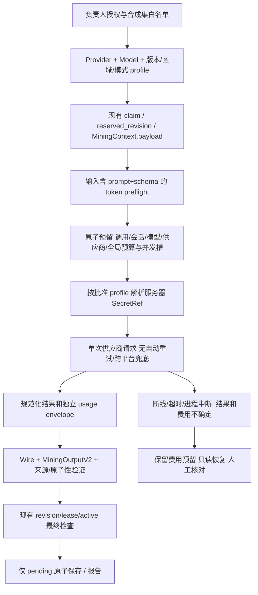

# M1-2C-2：供应商分层、真实接入准备与合成评测设计

状态：**待审设计；真实调用授权=无，已批准费用=0 元**。30 元只为预算草案，不是消费许可。基于 main `5fde27320abb640c4f96cd18cfb275d7db0cacc6`，合并 CI `38567493672` 已通过；设计分支 `codex/m1-2c-2-evaluation-design`。官方资料复核日期为 2026-10-14，未查看账户或密钥、未访问付费推理/账单 API。

采用负责人最后补充的优先级：**DeepSeek 官方渠道 + V4.1-Flash 首选**；百炼为第二供应渠道，可分别接阿里部署的 DeepSeek 与 Qwen3.7-Plus。早先“Qwen 主模型”的初选不再是本轮顺序；OpenAI 不进入首轮。此 PR 只含设计、合成数据、离线合同检查及 CI 检查步骤，没有业务适配器/费用数据库/付费模型。

## 1. Provider 与 Model 必须分层

[禁用的配置草案](evaluation/m12c2-profile-drafts.json) 用 profile 标识完整组合：provider、model family、api_model、expected version、pin/alias policy、region、deployment、API 类型、思考模式、结构模式和输出 cap。Provider 是输送、鉴权、用量与账单渠道；Model 是能力/版本，不能用同一个名称代替二者。禁止根据模型名自动推断供应商或换端点。

- 首选：provider=deepseek_official，api_model=deepseek-flash，文档当前映射 DeepSeek-V4.1-Flash；region=provider_managed_unverified，Chat Completions + non-thinking + json_object。
- 百炼同模型通道草案：provider=bailian，api_model=deepseek-v4.1-flash，cn-beijing、阿里部署（排除 vanchin/ 直供）、non-thinking、json_object。地域/业务空间仍待负责人确认。
- 百炼不同模型草案：api_model=qwen3.7-plus-2026-05-26，cn-beijing、non-thinking；后续能力比较先用共同 json_object，json_schema 作为另外一层结构模式比较。其 cap 兼容性尚未核实，所以不得直接启用。

固定版本不做虚假承诺：DeepSeek 官方请求只列 deepseek-flash 等服务别名，没有在文档中找到可请求的 immutable V4.1 权重快照 ID；不得发明 deepseek-v4.1-flash 作为官方参数。记录 expected version、response.model、可用 fingerprint/release evidence、UTC 时间与版本可信级别；只返回别名时标 alias-only，不能声称权重已固定。百炼带日期的 Qwen snapshot 比动态别名更可追踪，但仍未得到权重 digest 保证。版本/价目或预期别名漂移即暂停新调用，先审查，不静默升级。

比较分层：

1. 同模型跨平台：官方 Flash 对百炼 Flash；固定相同数据/prompt/schema/温度/非思考/输出上限/重复次数、尽量相同 JSON 模式，分别标地域/部署/网络路径。权重无证据时只叫“名义同模型跨渠道比较”，不能把差异归因于渠道本身。
2. 不同模型：同一百炼地域的 Flash 对固定 Qwen，或官方 Flash 对百炼 Qwen（显式注明模型和渠道均变化的混杂因素）。
3. JSON模式、思考开关、缓存命中、峰谷与 API 端点变化各自另分组，不混合平均。顺序随机/交错以减少时段影响，但绝不自动切渠道补跑失败调用。

## 2. 官方接口、Schema 与留存复核

### DeepSeek 官方

公开 [Chat API](https://api-docs.deepseek.com/api/create-chat-completion/) 的请求模型名为 deepseek-flash；thinking.type=disabled 或 reasoning_effort=none 显式关闭默认思考，max_tokens 有上限参数。response_format 只列 text/json_object；必须在提示中要求 JSON，截断/拒答不是成功，不应把支持 JSON 说成严格 Schema。

公开 [Responses API](https://api-docs.deepseek.com/api/create-response/) 列 text.format 的 json_schema/name/schema 与 max_output_tokens（含推理 token），并声明 stateless。该页未列可逐项确认的 Schema 关键字子集，也没有在字段段落找到可直接等同 OpenAI strict 的承诺；$ref、nullable、format、组合约束均标待授权后的有界合同探针。它是后续 profile，而非 Chat 失败后的自动兜底。stateless 应用状态不等于无安全日志或零留存。部分网页工具超时后，只读重新获取了官方静态 HTML；没有请求推理接口。

[价格](https://api-docs.deepseek.com/quick_start/pricing/)：当前 Flash 每百万 token 的缓存未命中输入 $0.15（非高峰）/$0.30（高峰），输出 $0.60/$1.20，命中输入 $0.003/$0.006。官方高峰为工作日 UTC 01–04 和 06–10（排除中国法定假日），与百炼忙时不同。账户结算币种未核对，USD→CNY 汇率/保守余量未批准；不能使用未批准汇率扣人民币预算。

[连接与并发](https://api-docs.deepseek.com/quick_start/rate_limit/) 文档 Flash 并发示例 2500，超限 429、可能持续 keep-alive、十分钟未开始推理后断开。不是 Pathwise 的并发许可；本应用仍拟全球同时 2 个、每会话 1 个、总墙钟 45 秒、连接 5 秒、现有 lease 60 秒。read timeout 必须配合总 deadline，不能被空行续命。

[官方隐私政策](https://cdn.deepseek.com/policies/en-US/deepseek-privacy-policy.html) 有改善/训练相关用途及下游应用责任说明；本轮未取得 API 专属保留期、训练退出或 ZDR 承诺，不能从 stateless 推出零留存。首轮仅传本文固定合成集；真实用户资料继续禁止。

### 百炼：阿里部署的 DeepSeek 与 Qwen

[DeepSeek 接口](https://help.aliyun.com/zh/model-studio/deepseek-api)：地域/业务空间专属域名如 https://{WorkspaceId}.cn-beijing.maas.aliyuncs.com/compatible-mode/v1/chat/completions；Responses 仅特定 DeepSeek 型号、北京/新加坡有文档支持。DeepSeek 关闭思考用 enable_thinking=false，不能照抄官方 thinking 对象。未来 vanchin/ 是不同部署/计费主体，不自动代替阿里部署。

[Qwen 结构化输出](https://help.aliyun.com/zh/model-studio/qwen-structured-output) 将 Qwen3.7-Plus 列入 json_schema 支持系列。文本支持 type、nullable、enum/const、本地 $defs/$ref、组合和条件约束，以及字符串长度、数值范围、数组长度、additionalProperties。oneOf 不保证严格 exactly-one；外部引用不生效，multipleOf、uniqueItems/contains 等、patternProperties/propertyNames 明确不支持。default/title 等只是提示，不是业务默认值。DeepSeek 不能仅因在百炼运行就继承 Qwen 的 Schema 能力；Flash 的完整支持组合仍要单独探针。

[价格](https://help.aliyun.com/zh/model-studio/model-pricing)：北京 Flash 未命中输入忙/闲 2/1 元、输出 8/4 元/百万 token（含思维链）；忙时北京时间 08–22、闲时22–次日08。固定 Qwen3.7-Plus-2026-05-26 短输入阶梯（≤256K）2/8 元/百万 input/output，长阶梯6/24；不把动态别名的限时折扣或免费额度当作预算保证。

重要冲突：结构文档建议不设置 max_tokens，以免截断；预算控制不能因此放弃上限。Qwen 在“结构模式+有限 cap”下的实际兼容性未验证。后续先审查一个预算内、明确限制 token 的合成探针；若参数不支持/不能证明上限，拒绝该 profile，不能静默删除 cap 或改模式重试。截断也计一次费用/失败。

[地域和域名](https://help.aliyun.com/zh/model-studio/regions) 的空间专属域名超时上限说明可达3600秒，旧域名/试用域名600秒；错误资料还可能依模型给其他超时语义。统一应用总 deadline，不能当作远端取消保证。旧 dashscope 域名自2026-09-30不支持新特性，负责人原有域名不能未经确认自动迁移。

[隐私说明](https://help.aliyun.com/zh/model-studio/privacy-notice) 声明不用于训练；[国际站留存政策](https://www.alibabacloud.com/help/en/model-studio/data-retention-policy) 2026-10-11 更新，默认 prompt/response 可能保留≤30天，状态功能直到删除；ZDR 需企业资格、指定空间/支持模型且不覆盖第三方直供，并非北京账户的自动承诺。必须核对所选购买站点/地域/部署主体，不用旧“默认24h缓存”摘要替代当前默认政策。

### Wire Schema 与既有服务端合同

[Wire Schema](evaluation/provider-wire-output.schema.json) 由 MiningOutputV2 派生：移除 model tokens_in/out（用量只信 transport/invoice）、去掉默认提示、所有属性显式 required、对象 additionalProperties=false。保留 source/offset/type/length 的服务端完整约束；可选 stop_reason 明确 nullable。该文件是提议载荷，不是已经远端认证的可用子集。

DeepSeek Chat：Schema 仅作为提示内容，远端只保证 JSON；DeepSeek Responses：Schema 关键字子集待测；百炼 Qwen：按文档白名单提交，UUID format 等具体实现仍要探针。遇到400不自动降低 Schema 或换 API。服务端 Pydantic strict 与 model_validator、数据库 validate_v2 必须再次验证；供应商无法执行的关联/语义/状态约束绝不从服务端删除。

## 3. 统一适配层（设计，尚未接入运行时）

接口拟分三层：ProfileRegistry 验证 allowlist/版本/区域/endpoint/mode/cap/价目；TransportAdapter.build_request、invoke_once、normalize_envelope 只处理供应商协议；MiningBridge 把合成来源快照和通过的输出交给既有矿掘状态机。NormalizedEnvelope 含 request_id、reported_model、status/finish、usage来源、input/cache/output/reasoning与输出对象，不包含密钥或完整 SDK 异常。拒绝重复 JSON key、代码围栏、截断、多个对象及自填 tokens；不让 JSON 修复模型二次收费。

当前必须先解决的接入障碍：safe_provider 只允许 scripted+synthetic+零费用；后端 MiningRunView 和前端 Zod 都限定 scripted/true，assistant 状态文字也固定“合成”。**不能把真实 Provider 伪装成 scripted 来绕过。** 后续先开发独立隔离评测 CLI/DTO 与真实提供者元数据，不连接当前 01/02/03；必要的核心标签/费用元数据改造及迁移另开可审 PR，日常库继续不动。真实页面接入是另阶段审批，不在本设计授权内。

预留完成再解析 SecretRef/创建 transport；失败恢复 GET 只读本地 run/账单状态，不调用推理、JSON修复、ListModels或跨供应商。保持一会话一项目、answered question ID/version、context_revision 和原回答只写一次。同键重放返回本地记录；远端 Chat/Responses 的幂等性未得到保证，不能声称同键远端重试免费。

## 4. 合成评测与报告

[12组数据](evaluation/m12c2-synthetic-cases.json) 全是虚构星桥课程资料，包含 code-point gold、动作事件、期待问题目标、禁止断言和人工 rubric。12组覆盖团队、模糊、否定、假设、无指标、遗忘/跳过、历史编辑/再确认、重复提交/丢响应、隐藏/纠正/同义重复、主动停止、连续空轮、Unicode/注入与隐私。不是从真实简历匿名化来的资料。

先做 teacher-forced 统一上下文评测，确保每渠道看同样用户回合、操作、问题版本和事实状态；再另做闭环多轮（只从预先批准合成回答库选择，禁止把模型自己的回答写成 user turns）。12组每 profile 首轮一次，重复次数、总调用数及模式变化需列入授权清单；不为了填满报告补调失败。

[报告模板](evaluation/m12c2-report-template.json) 的记录维度为 call、session、model、provider、完整 profile。记录请求模型、实际返回版本/证据、部署/区域、处理模式、peak/cache/价目/FX、延迟、真实 token 与账单状态。模型返回别名不冒充实际权重版本；缺失 token、版本或金额记 null/unknown。

真实性/引用/未经确认升级为硬门禁：任何虚构数字、scope/negation丢失、非法来源或自动确认均不允许发布。原子 precision=人工认可独立且真实候选/全部原始候选，recall=覆盖的gold/可提取gold；原始和服务端接受后的两套数值同时报告，无候选或无gold分母记null。追问人工0–2评分相关性、信息增量、无预设、尊重遗忘/停止；归一化精确重复和同义重复分开。结构成功=原始 JSON+Wire+Pydantic通过/所有尝试，失败、拒答、截断不能被排除。模型不能给自己打真实性分数。

耗时分应用/供应商，p50/p95附超时删失数量/下界，不把45秒超时当快速失败而删除。tokens 取供应商 usage，reasoning通常是output的子集，不能重复收费；cache hit/miss按每个协议核对。费用分预留、按用量/价目估算、原币发票实付、批准汇率人民币实付；未对账金额不是0。

本地 checker 用内存数据/模型 Schema、引用字面位置和预算 test double，网络socket/DNS禁止、无数据库连接、无密钥/环境读取。它不证明供应商子集支持、真实延迟、质量或多进程原子性。运行：`apps/api/.venv/Scripts/python.exe scripts/check_m12c2_contracts.py`。12项合同测试通过；0供应商请求、实际费用0，真实token/质量/供应商耗时为null。诊断明确指出 S02a 的“我帮忙做过一个课设”可被现词表接收但不符合人类期望明确事实：记录为真实启用前需审的语义缺口，未偷偷放宽gold或修改旧校验。

## 5. 费用统计与预算防护（草案，不是批准）

拟全局上限30元、每会话2元、每次0.50元；供应商子额度和模型额度共享全局，合计不得扩大30。当前批准额0；REAL_MODEL_ENABLED默认false、profile.enabled=false、approval_ref空，任何真实dispatch均拒绝。30元还需明确是否含税/汇差/失败账单及未知预留缓冲；不因账上已有余额就视为授权。

未来 DB 账本（本PR无迁移）：RateSnapshot（原币/分段/峰谷/cache/思考规则/有效期/批准FX）、BudgetScope（限额/预留/已结算/未知/冻结）、CallAttempt（app操作摘要、run/合成session标签、provider/model/profile、request_id、状态、token、费用）、Reconciliation（账单条目和幂等对账键）。不存原始资料、系统提示、模型完整响应、Bearer或供应商密钥；费用记录与会话业务删除分开，最少必要账单数据保留期另审。会话删除不能抹掉未知费用或使旧键复活。

费用预留上界 = 所有输入token上界（含system指令/schema/上下文）×未命中最坏时段输入价 + 明确输出cap（含thinking）×最坏输出价 + 批准的汇率/税费余量。优先使用可离线核验 tokenizer；否则仅用已证明保守的UTF-8上界，超限拒绝，不能拿字符数或token平均值冒充上界。未批准FX、价目失效、cap/usage含义不明、无法证明计费上界时拒绝。Qwen结构模式的cap冲突必须先解决。

以同一事务、确定顺序取得 global/provider/model/session 预算锁和并发槽，验证 `settled + reserved + unknown + new_reservation <= limit`（每scope都适用）并写唯一 call attempt，再允许一次dispatch。每会话最多1个活跃、全局最多2个；进程租约过期可释放本地计算槽，但**不能自动释放费用unknown**。未知请求还可能在供应商运行，另有每供应商/全局未知请求计数及冻结阈值，首轮出现未知即暂停该profile，避免越积越多。

状态：reserved（无网络）→sent→response_received（可有已知usage但账单未清）→reconciled；发出之后的断线/取消/超时/崩溃→unknown，维持全额费用暴露。HTTP400/429/5xx也不自行认定免费；除可证明未dispatch或已确认0账单，不退预留。GET只读；供应商请求已成功但输出非法/stale仍可能收费，不能因为业务failed退钱。

同操作键再次提交不dispatch；用户明确再次推理必须新attempt、关联retry_of，同时保留旧未知预留并通过所有预算。绝不自动同渠道重试、跨供应商或跨模型兜底。SDK retries=0，代理/网关重试也必须禁用；并发事务失败可重试本地预留事务，但不能重复外部请求。Crash窗口用sent意图先提交，来不及发请求也保守unknown，之后由人工对账释放。

usage仅生成成本估算，actual以授权账单/价目证据核对；Token发票延迟时保持预留。对账唯一键防重复扣/返；费用超过预留记录实际超额、冻结所有相关scope，不把超额截断为预算数。按call/session/model/provider统计已核对原币、CNY实际、未知预留、API用量估算及差额；API账单缺明细需负责人人工核对，不自动申请新权限或充值。专用供应商账户/空间额度是额外防线；本应用账本不保证同账号其他程序的消费受控。

## 6. 密钥与隐私

本轮不读取、索取、注入任何API Key，不打开账户或调用余额/模型列表/账单接口。未来批准后才由服务器 SecretResolver 按批准profile绑定SecretRef，采用独立测试空间/项目和最小范围，进程内注入，不放URL/命令行/Git/前端/sessionStorage或trace。配置文件只存secret引用名，日志只打印自有call id/错误白名单。密钥轮换不触发模型调用；未知密钥或环境错配失败关闭。

百炼 [权限文档](https://help.aliyun.com/zh/model-studio/application-permission-management-overview) 中 API Key 属于地域/空间，权限随空间；控制台用户权限不等于Key模型调用约束。优先专用非默认空间、空间模型限制与可用IP白名单；账单只读权限是单独批准项，不授予购买权限。DeepSeek Key是否能有模型/额度/IP级细分未核实，不假装具备；拟独立测试Key/账户绑定本地allowlist与budget gate，具体创建/注入等到单独授权。

首轮只接受仓库这12组固定synthetic白名单及hash，拒绝任何日常session id/前端输入、真实或匿名化简历、真实个人经历、材料文件或全历史会话。报告只输出合成质量标注与用量/费用元数据；不上传网络trace、headers、完整SDK响应或私有账单。供应商保留期/用途差异不靠脱敏解决；跨区域和真实用户数据需要另阶段批准，本轮不含。

## 7. 分阶段实施与真实授权清单

A（本PR）：技术方案、禁用配置、12组数据、Wire/报告、离线合同检查及现有CI。没有应用/界面/迁移修改。

B（方案批准后、仍默认不消费）：独立评测CLI、Provider Registry和无网transport合同测试、持久账本/锁/崩溃恢复、真实元数据/DTO与运行标签改造、预算与价格/用量/FX转换测试；必要迁移仅在独立test schema验证，日常库不执行。保留原171后端、62React及30E2E，任一失败不能跳过。

C（再单独明确授权）：只启用获准渠道/型号/地域/模式，先一次有硬上限的合成探针，再按获批次数运行12组；失败或unknown先停止核对，不自动补测。出具人工评测和账单报告后决定扩展百炼同模型/Qwen，不触碰已有UI。

负责人下一步需要明确授权：

1. 是否批准方案与先开发B的无费用实现（不包含真实调用）。
2. 首次真实probe和评测的供应商、账号/空间、地域、端点、固定/别名版本政策、non-thinking/JSON模式及明确调用次数/token/cap。
3. 人民币总预算是否批准30元，单次/会话/供应商/模型额度、有效期限、税费/汇率与unknown缓冲，谁确认账单及何时释放预留。
4. 是否允许服务器注入该指定测试SecretRef、仅外发指定合成集，以及接受对应已核验的数据条款/保留地区；不能在聊天中直接贴Key。
5. 是否批准只读账单/版本核对方式、必要测试软件/隔离库迁移，以及Qwen cap兼容性探针；不含日常库迁移、跨供应商自动重试、充值或真实资料。

未得到这些具体授权前，真实开关保持关闭，不继续真实接入/费用验证。等待技术审查与确认，不自动合并。
