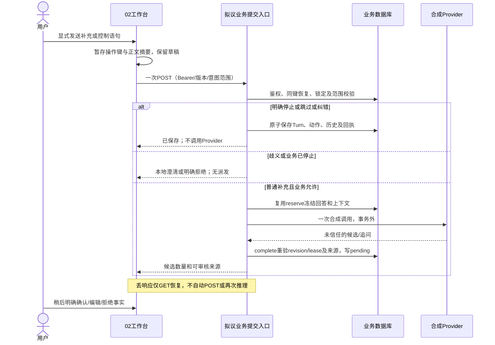

# Pathwise V0.3｜阶段 A：经历维护、回答关联与停止语义设计

状态：**仅供独立审查的技术设计，未实现、未部署**。2026-10-18。

依据：[用户提供的产品审核及分阶段方案](Pathwise_V0.3_20Cases_Product_Review_Implementation_Plan.md)。其中20/20表示产品行为原则获首轮认可，不代表20个模型输出获人工评分。

代码基线：main `cf89a9b6af596b133fc8cbcb3c37a80b77084d34`；合并CI [39089003427](https://github.com/greglien282-a11y/ai-grad-job-assistant/actions/runs/39089003427) 三项成功。本PR只提交上述原文及本文，不改变产品PRD、三入口、01/02/03页面、代码、数据库或供应商准入。

## 1. 决策层级与冻结边界

- **已认可产品规则**：普通补充不等于撤回；明确纠错不反复索要同一确认；关联不确定时不臆断；跳过不等于结束；新增/实质修改的事实仍待用户审核；无指标/无材料/经历普通都可真实结束。
- **本文推荐实现，待本PR审查**：版本化纠错命令及当前来源、受控自然语言操作入口、自动关联的准入/回退、话题边界和新增持久操作回执。它们不是现有API，也不是阶段B–E的开发授权。
- **不可据此启用**：真实Provider、模型消费、动态付费授权、Secret读取、生产库迁移、自动重试或旧冻结请求重签。业务操作回执不属于费用账本，不产生派发许可。
- 原始 `docs/evaluation/quality-v1/` **逐字节保留**，包括数据、Rubric、样例、报告及manifest。冻结版本 `grad-mining-quality-v1-draft-r2`，canonical数据SHA `e0af925ad6b431ff5d50eb7f59aaa42bd3b2598c2d51edfc878b6bdf59bb6fd7`。产品规则写在新文档里，不回填DRAFT标签为人工gold。
- 本阶段不添加测试实现；以下用例是未来验收计划。现有CI成功不是这些未来行为已通过的证明。

## 2. 现状与差距（基线代码证据）

- [facts.py](../apps/api/app/facts.py)：`authorize()`锁父会话；`change_fact()`检查整数version，编辑使当前事实pending并清空当前evidence_id；`snapshot()`把后续编辑指向FactChange，旧FactSource仅作原始来源；`eligible_facts()`只选确认/材料支持状态。现有编辑来源没有对话纠错的turn引用。特别注意：rejected的**状态迁移**为空集合，但statement编辑分支未按rejected拒绝；不能声称现有所有编辑路径都禁止复活。新自动维护路径须显式禁止修改/复活rejected，旧手工规则是否收紧须另审查。
- [models.py](../apps/api/app/models.py)：一会话一项目；Turn不可变；FactSource关联原turn，FactChange有before/after及user/system actor；Question只有active/skipped/corrected/hidden/deleted。没有话题、进度/事实类型、纠错来源关系或自然语言操作回执结构。不能把memory_state当作“已完成/计划中”。
- [mining.py](../apps/api/app/mining.py)：`reserve()`冻结原始幂等正文，先恢复既有回执，再检查会话/上下文；原回答最多关联当前轮两题；failed/unknown/stale须显式重试。`complete()`只新增pending，跳过已用引用/重复陈述，**不会识别并替换旧事实**。模型v2 stop=true、合法第六轮完成、连续两轮无新增事实均使整个mining_status变stopped。
- [mining_api.py](../apps/api/app/mining_api.py)：`start()`先safe_provider；`question()`仅PATCH单题；`stop()`显式停止挖掘；无自然语言控制、话题暂停、恢复挖掘或批量语义关联API。不能把新增控制入口挂在必须先取得Provider的依赖之下。
- [0005](../apps/api/alembic/versions/0005_answer_questions.py)：AnswerQuestion更新被触发器禁止；原关联有版本且不可改写。晚到模型推断不能假装原回答当时显式选了题。
- [mining_context.py](../apps/api/app/mining_context.py)：build_context数distinct input_turn_id（重试不另算轮），最近两次completed里没有关联事实则计空轮；隐藏/删除题不发送正文，拒绝事实不发正文，编辑事实不发旧版本。六轮是上限，不是质量达标声明。
- [useDiscovery.ts](../apps/web/src/features/discovery/useDiscovery.ts)、[AnswerComposer.tsx](../apps/web/src/features/discovery/AnswerComposer.tsx)：显式选择题目，POST前保存key，丢响应只GET恢复，草稿保留。客户端没有自动关联；管理操作在unknown/needsReload时受限。该保护不因减少点击而移除。
- [FactReview.tsx](../apps/web/src/features/discovery/FactReview.tsx)、[FactCard.tsx](../apps/web/src/features/FactCard.tsx)：已有逐条确认/编辑/拒绝、记忆状态、材料及历史。来源展示原文，但没有通用code-point区间高亮工具；不得称浏览器已完成跨语言偏移验证。
- [mining_validation.py](../apps/api/app/mining_validation.py)：完整简单句/单动作/个人贡献/原文区间等保守校验；GQ03“整理”未命中。v1只允许当前完整用户回合，v2允许受限上下文中合法原句；新功能不得偷偷扩大历史来源范围。

## 3. 事实维护规则：补充、纠错、撤回、进度

### 3.1 普通补充（GQ01/GQ11/GQ19）

“又补充：我编写了借阅状态组件。”提供新动作，不推断它撤销原背景。合法独立引用新建pending；原事实状态/版本/材料不变。完全同一来源区间和相同事实只恢复/去重；语义近似但无法证明相同则保留独立候选或提示合并建议，不能自动覆盖/删除。多动作只在不丢否定、主语、假设、模糊程度的合法句界拆分。

项目背景、团队贡献、知识储备、计划、否定/未知边界与“个人已完成贡献”要区分。推荐后续类型：personal_action、background、plan、boundary；类型不是确认状态。03应只纳入经用户确认且适用于经历正文的当前贡献；“没部署/记不清规模”作为约束，不能仅因确认就当简历亮点。当前03只按确认状态过滤，**新增类型过滤是后续合同变更，不是已有能力**。

### 3.2 明确纠错（GQ12）

只有用户明确撤销/更正，且定位到唯一同项目事实及其版本，才可自动维护；模型置信分或“后一句不同”不能充当用户纠错授权。用户明确说“自动标注不是我写的，我只测试了导出按钮”时，不能再次机械询问“是否确认你在纠错”；但指代可能指向两条事实时，只问**纠正哪条**，不先改任何一条。

推荐：同一可定位事实的新陈述替换当前版本，经既有change_fact进入pending，清空当前材料支持，保留旧before/after与原始来源。无替代内容的明确撤回将旧事实置rejected并记录撤回原因；另有新贡献则独立建pending。不得用空字符串、删除旧Turn或将新旧陈述都留为当前已确认来表达撤回。

已确认/材料支持事实也可被明确纠错，但修改后必回pending；未审核的新句不能继承旧确认/证据。已rejected的事实自动路径永不重开；相同旧引用再抽取仍拒绝。若用户日后明确重新主张已撤回内容，需另审查可追溯的恢复合同，本轮不设计成换key/新Fact绕过。

证据校验不降低：新贡献仍需合法user turn及准确引用。若整句包含多分句而当前原子性校验拒绝，先保存原回答/纠错边界，明确显示新贡献尚未形成有效候选，允许用户手工编辑或一次聚焦澄清；不自动补造句子、改quote、去掉否定或切片逃过guard。

### 3.3 进度与不确定性（GQ06–GQ10/GQ18）

“计划部署”与“后来完成部署”是进度变化，不是前句说谎；保留早期计划，新完成陈述为pending，不能无来源推断上线效果。无法判定同一动作时不自动合并。未知规模/没测速度/没材料作为后续提问限制，不生成数字、不强索证明；确定做过与材料辅助核实继续分开。最终是否引入progress_status，须连同类型字段在阶段B schema审查，不复用memory_state或改写用户原文。

### 3.4 推荐持久化与事务

阶段B先做**一对一纠错**，不做自动多事实合并/拆并。每次操作带base_revision、目标fact_id/expected_version、新用户turn和引用；session/project均由服务端鉴权得出，客户端不能提交actor=user_confirmed或材料支持结论。

推荐新增FactChangeSource关系，绑定change_id、session_id、user_turn_id、code-point引用、change_reason（explicit_correction/withdrawal）及目标版本，复合FK保证同会话；追加记录不可重写。现有FactSource保留原始来源，编辑后的当前来源读取最新FactChange及其新关系；不让旧用户回合“支持”新陈述。source_kind可继续user_edit，新增edit_method=conversation_correction与current_citations DTO；历史手工编辑无引用则如实标无，不补造。

不推荐仅把新引用塞进FactChange.after JSON当正式约束：虽可少迁移，但缺少turn归属FK、版本一致性及删除约束。该选项只适合离线原型，不作为上线安全结论。原文、历史及新来源随业务删除清理，不能借费用审计留存无限保留。

新turn、纠错/撤回、来源关系、before/after、业务回执必须在同一事务提交。先锁会话再校验version，统一重读；冲突409，无半套新事实。版本由现有触发器/ORM递增，事务前后的revision不假定只加1；幂等重放不加版本。任何收费相关锁仍遵循既有Funding→Session→Run顺序；本功能不取得Funding锁，也不引入Session→Funding反向链。

## 4. 问题、话题、挖掘、会话四层边界

- **跳过某题**：q.state=skipped，版本递增，原回答/来源/历史不删。未回答的另一题不自动关联或跳过；mining_status保持原值，不新增Run、不调用Provider。纠正题目产生新版本，旧回答仍指旧版本；隐藏仅隐藏正文，删除题目清除其正文但保留ID/关联且不误删用户回答。不得将删除文本写到新控制事件副本中复活。
- **停止当前话题**：推荐MVP范围为用户所指当前1–2题及其澄清目标的边界，不猜一个无限大的“主题”。记录TopicBoundary并停止这些追问；会话仍active，挖掘可在用户**再次显式提交其他素材**时继续，不能自动接着问同义题。没有可靠话题/目标合同前，此能力BLOCK；仅改按钮文案或把q.hidden当话题停止都不成立。
- **停止挖掘（GQ15）**：mining_status=stopped，session.status仍active；不再取得新推理资格，仍可审核事实、手工补充和看03。明确的“本次先停在这里/停止挖掘”由本地业务控制处理，Provider调用为0。自然语言含引用、否定、假设（如“不要停止挖掘”“如果停止会怎样”）不能误执行。scope不明的“别问这个了”先本地澄清，期间不派发。
- **结束会话**：status=ended，业务写入禁止，仍可读取/技术导出/按现有规则删除。保留显式二次确认，不把“跳过”“先停”自动映射成结束。不自动恢复ended或stopped；现有API没有resume，任何未来恢复方案须另审查，且不重置六轮、空轮、幂等或费用责任。
- **删除会话**：另一个破坏性动作，继续显式确认；不能由一般自然语言猜测执行。其资料清理及费用墓碑沿既有独立合同，不扩大本PR范围。

客户端needsReload、未恢复的写操作和unknown仍保持既有只读恢复保护；自然语言控制不能成为绕过禁写的后门。恢复完成后也不自动提交暂存的停止意图，要由用户再明确操作。若将来需要unknown期间的紧急仅停止能力，须另行审查独立幂等控制合同，不在本设计中顺带开放。

现有v2 `stop=true`就是全局mining停止，不能就地改解释为跳过话题。推荐后续独立v3输出用followup_action区分continue、pause_topic、suggest_stop，并由业务规则裁决；供应商建议不是业务控制命令。旧v1/v2的DTO、Prompt、Schema及历史SHA全部保留，不能悄悄换语义。

GQ13拒答某题只限制该题；若两题都跳过且无新资料，不为“保持聊天”空跑模型。GQ16合法第六轮先保存本轮合法pending，再由complete停止；第七个独立输入不能再推理。GQ17两轮**实际新增0**事实后停止；模型返回重复候选但去重后新增0也算空轮。GQ15/GQ17仍是business_gate/no-dispatch，不纳入模型质量分母。

## 5. 自然语言提交与低点击合同（拟议，非现有API）

一个显式“发送”对应一个稳定业务操作。推荐新版本ConversationSubmissionV1，不把客户端连续PATCH/POST拼装当原子操作。字段包括client操作键、base_revision、原始content、intent（可选显式控制）、目标及版本、association_mode；正文摘要包含这些字段。Bearer仍仅Authorization，操作键在发送前暂存；不将原文长期放sessionStorage。

入口先鉴权/恢复同键回执，再做有严格原话证据的本地意图判定：

1. 明确局部控制/纠错：只做已授权业务动作，0 Provider；不依赖AI_ENABLED、不解析任何供应商Secret。纠错也不自动触发“顺便再整理”。
2. 普通经历补充：复用mining.reserve/claim/complete，最多1次合成调用；pending集中在右侧可稍后审核，不弹出每条强制确认。
3. 混合或歧义意图：保存原文一次、结果needs_clarification，0 Provider；显示局部选项，不把普通“记不清”当全局停止。用户的后续明确选择是绑定父操作的独立幂等resolution，不再次保存原回答、不能修改原键正文或自动推理。停止优先于同条信息的推理；用户撤回停止后不能靠resolution暗中续跑。

建议新增业务ConversationOperation回执：作用域内key摘要唯一、request_tag、鉴权会话引用、turn/run/result引用、状态applied/needs_clarification/deleted及到期信息；原文只在Turn，不在回执复制。现有MiningReceipt要求run非空，IdempotencyOperation限定三种创建操作，**均不能直接承载无Run的控制操作**。应新增版本化回执而非放宽历史表约束。失联后只GET恢复；回执不存在/过期不能静默换键，需明确恢复边界及安全的用户决策。删除后最少防重放墓碑不含原文/凭据，期限须在schema审查与现有保留政策一致。

新回执和来源表是建议的必要迁移项，不是新增资金池/调度系统。阶段B可先落原子纠错命令，阶段C复用该回执框架加入自然语言控制；不能先上线浏览器多请求串联再补原子性。

上述补充路径继续受当前safe_provider/get_provider控制，真实适配器仍不可注册。控制动作入口独立于Provider依赖不意味着模型分支可以跳过门禁。单次显式提交不保证供应商端绝对只执行一次；本设计没有新的真实派发权力。

## 6. 多题自动关联（GQ14）

推荐三层优先级：用户显式IDs/版本 > 已审核的唯一自动匹配 > 自由补充。用户可选择auto_if_unambiguous模式并看见其说明；原显式模式及“回答这题”保留。不在打字时自动改勾选、草稿或POST，不用一个未经校准的置信阈值代替证据。

可自动接受：本轮可回答的同会话/同项目题目中，某个原文片段明确回答其唯一目标；两题均有独立支持片段时最多关联两题。回答“我只测试了导出按钮”不能因为语义相关就同时标记“采用什么技术”已回答；“不知道/跳过”不是有效贡献答案。两题仅回答一题，其余保持未回答，不能机械催答或强绑。

现有MiningOutputV2无关联建议字段，Question持久化也无purpose/目标/话题。推荐阶段C新增版本化AssociationDecision（explicit/auto_unique/unlinked及原话区间、候选题ID/版本、规则版本/拒绝理由），最初只用确定性合成解释器验证；真实模型解释需后续单独准入。模型返回的任意UUID、错误版本、跨会话目标都拒绝，不自动修补。

时序选择：显式关联仍在reserve写入；若关联建议随本轮输出产生，**只在complete同一事务**、新事实写入前的fresh状态检查后附加尚未存在的关联。必须核对reserve时冻结的最多两道可答题ID/版本、当前状态及尚未被回答；不能改写已有显式链接。该事务内部链接/事实的revision递增与外部并发区分，不能因自己写入而伪造“原reserved_revision仍相等”。冲突整事务回滚或运行stale，不半挂链接。

模糊但合法的决策保持unlinked，原文照常可保存/提取pending；界面说明“已保存为自由补充”，可由用户后来显式澄清。后补关联需独立幂等resolution及当前版本，不能UPDATE旧AnswerQuestion或重新跑原回答。若需要纠正已落地的自动链接，必须追加撤销/替代审计关系；没有该迁移前禁用不可撤销的自动关联上线，仅提供建议供显式选择。

真正降低操作量的目标是明确回答不必先点题、不必每轮逐条确认，而非减少事实审核权。集中审核仍逐项明确选择；任何未来批量确认需展示具体ID/版本、排除冲突/隐藏变化并单独审查，本阶段不批准默认全选。

## 7. GQ03 与 GQ20

### GQ03：基础工作价值与保守词法guard

产品认可“我整理了27条缺失记录”可作pending，但冻结v1仍保留拒绝差异。阶段B先做最小、单独可审查的atomic规则变更候选：只研究将“整理”作为动作，不顺手放开复合句/非个人/假设/团队/数字校验。正例须原文精确并保留27；反例覆盖“我们整理”“计划整理”“记不清整理多少”“我整理并训练”“整理后提升80%（无原文）”、伪造区间和重复来源。否定句若合法也只能作边界，不能转亮点。

测试分别报告schema_valid/source_valid/runtime_guard/product_target四轴；新增动作词不是充分的语义理解。词法变更若仍不能安全处理则维持拒绝/手工流程，不追求Oracle满分。不得修改冻结quality-v1使旧报告变绿；阶段E建立新数据/报告版本，旧guard差异可用Git基线或显式版本化测试复现。

### GQ20：引用采用Unicode code point，区间[start,end)

服务端以保存的Turn原文为唯一坐标系：Python字符串索引；不Unicode NFC/NFKC归一化，不重写emoji、不trim改变区间。脱敏保持code-point长度但不等于匿名；不能引用遮蔽块冒充原文证据。人工编辑后的正文必须指新编辑/纠错来源，不把旧坐标用在新版本。

“我制作了🧪原型图”共8个code points、9个UTF-16 code units、非等长UTF-8 bytes；冻结GQ20原句还含句末“。”，完整区间是[0,9)，共9个code points/10个UTF-16 units，不能漏句号。浏览器不能直接text.slice(start,end)处理后端区间；推荐以Array.from(text)按code points切片，DOM Range若需要UTF-16 offset再用前缀.join('').length转换。组合字符、ZWJ emoji可含多个code points，视觉字素边界不是引用坐标；显示不能反向替换原始引用。

未来共用工具/fixture同时跑Python与TypeScript，核对quote、半开区间、turn_id、当前事实版本及export/summary的原文一致性。覆盖BMP中文、🧪、组合音标、ZWJ、CRLF、首尾标点、非法负数/反转/超长区间及空quote。浏览器高亮不接受任意HTML；当前没有高亮则只展示原文，不伪造“位置已验证”。生产来源校验继续在服务端执行。

## 8. 逐阶段影响范围与迁移判断

### A（本PR）

只新增产品审核原文和本文。冻结目录、Prompt/Schema、models/API/React/迁移/CI配置零变更。检查引用和源码依据、Git范围与冻结文件blob一致性；不连接数据库，不创建任何审批或执行真实请求。

### B：原子纠错与pending维护（先审查schema，再实现）

预计触及facts.py、models.py、schemas.py、experience_api.py/新增业务命令模块、mining.py::complete、mining_validation.py及相应测试。复用change_fact，不复制另一套确认逻辑。

建议必要迁移：FactChangeSource、ConversationOperation（scope/key唯一、turn/current change跨会话FK、不可变来源、清理/防重放）；事实类型/进度若进入03过滤，需正式字段/默认unknown与旧资料兼容评估，不能静默回填旧资料为“个人已完成”。一对多关系/自动合并暂不做。只做单个显式手工PATCH可不迁移，但无法满足自然语言原子多写和恢复目标，不把该缩减方案当完整B交付。

当前仓库单头0012_request_manifest；未来候选编号在开工时重新核实，不本轮预占0013。不改0008–0012，不改中央费用表；先在随机测试Schema验证空库/上版升级、失败回滚、旧数据兼容、权限及非空危险降级保护，部署另批。

### C：控制意图、话题边界、自动关联

预计新增本地意图解释/提交编排模块；修改mining_api/mining的版本化入口、context/输出DTO和question聚合；新增TopicBoundary/AssociationDecision及不可变撤销/替代关系、幂等resolution约束。旧v2 stop语义、原关联历史和旧receipt正文保持兼容。purpose/topic/stop_reason的真实持久化需新字段或表，不把客户端显示当持久事实。

在正确性未证明前：只给关联建议、保留显式选择；停止话题不开放；含歧义的停止先本地澄清且0派发。不得用新入口把stopped设回active或重置轮数。后台已有running与停止竞争时，停止先提交→后续claim/complete必须stale；许可已提交的历史费用责任不追溯取消。本阶段仍不接费用发送路径。

### D：工作台低点击与集中审核

预计只改DiscoveryWorkbench、Conversation、QuestionCard、AnswerComposer、FactReview、FactCard、useDiscovery、TS合同/来源工具与测试。保留路由、三入口、合成标识、显式高风险确认和草稿保护。新DTO齐备前不在前端猜语义；200%原生缩放与CSS zoom分开记录。时序不稳定另PR处理，不借此UX阶段掩盖InteractionFlow.test.tsx:93。

### E：新版本评测

另建quality-v2（命名待审查），引用而不覆盖v1；产品规则、模型Schema/来源检查、人工语义Rubric、交互成本四层分开。无需数据库迁移即可增加离线数据/报告，但真实用户测量/模型输出采集需独立同意及授权。20例公开材料不再宣称盲测，真实质量评分和耗时在未采集前为null。

## 9. 未来自动化验收计划（非本PR已执行）

### 9.1 每动作的预期请求/数据/界面

以下从已有02会话开始计；“1 POST”含PATCH等单次写动作的统称，真实方法按既有或新合同标明，不含显式GET恢复。Provider次数仅指合成测试。

- 普通补充：发送一次业务POST、最多1次Provider；原Turn一次，合法新事实pending/created，原已确认事实不动；UI“已保存/新增N条待核对”。N来自服务端。
- 明确纠错/撤回：一次命令POST、0 Provider；Turn、FactChangeSource、edited/status_changed及回执原子写；UI展示变化和待审核/撤回，不再问是否纠错。目标歧义则一次POST保存needs_clarification，0事实变更/0Provider；用户选目标后另一次resolution POST，不重复Turn。
- 显式确认：一次既有PATCH expected_version，仅pending→user_confirmed；编辑后再确认是新的明确动作。材料核实另一次PATCH且必须有material_reference/basis；自动维护不制造材料。
- 单题跳过：一次现有PATCH（未来自然语句一次命令POST），0Provider；仅q状态/版本及审计，不增加Run/事实。两题单答：一次普通补充POST、最多1Provider，只关联有证据的一题，另一题不变。
- 停当前话题：一次拟议命令POST、0Provider；TopicBoundary/目标题变更可恢复，session仍active；等待用户新素材，不自动补问。
- 停挖掘：一次现有mining-stop POST或未来命令POST、0Provider；mining_status stopped、旧事实保持；仍可审核/03。不确定控制语义不派发、不擅自置stopped。
- 结束：取消二次确认0写请求；确认后一次现有end POST、0Provider；status ended/只读。删除亦取消0、确认1 DELETE，清理既有业务资料与新来源，不碰费用责任。
- 第六轮：一次原mining POST、最多1Provider，合法候选pending后停止；第七轮请求409且0Provider。连续两轮新增0：第二轮完成即停止，之后0Provider，不计作模型stop质量。
- 刷新/丢响应：只读GET次数可因显式刷新增加，写/Provider次数不增加；unknown/needsReload继续禁写，不能自动换key、清空草稿或把未知变成可重试。

### 9.2 PostgreSQL/HTTP与故障窗口

- **F01** GQ01补充不覆盖；**F02** GQ12精确纠错使旧确认/材料失效，新来源只能新turn；**F03** 模糊冲突/指代不改目标；**F04** rejected/旧引用不复活；**F05** GQ08计划到完成与GQ09否定界线；**F06** GQ11多事实不得因一个不合法而半提交声明为全部成功。
- **F07** 同键同正文/关联/目标版本只提交一次；不同正文或目标409专用幂等冲突；Fact版本409与context冲突分开。保存Turn后、改Fact后、写来源前、提交后响应丢失各注入崩溃；原子回滚或GET恢复原结果。
- **C01** GQ13单题skip与GQ15全局stop不同；**C02** GQ14一题/两题/自由补充/歧义；**C03** q纠正/隐藏/删除与回答关联竞争，版本错配不能指向新问题；**C04** GQ16/17与当前build_context计数一致，重试不刷轮；**C05** stop/end/delete与reserve/claim/complete双连接受控竞态，迟到输出不发布、不生成第二次Provider调用。
- **C06** 跨session/project的事实/问题/turn、assistant turn伪装来源、同一用户伪造账号均拒绝；**C07** 提示注入、引用内“停止”、否定/假设停止、LLM伪造控制动作不执行；**C08** 关联建议不能修改显式链接，非法ID/版本fail-closed，合法歧义free supplement而非假成功。
- **M01** 新迁移升级/回滚/失败原子性及旧API重复恢复；**M02** 受限角色不能伪造来源、改历史或扩大资金权限；**M03** 删除清除新原文关系，原回执墓碑不含正文，既有manifest/审计危险降级不绕过。

### 9.3 React、真实浏览器与质量

- **U01** 相同合成任务比较旧显式选择与新自动唯一关联：输入、可见关联理由、自由补充、草稿、键盘/中文IME、390/320px、桌面和200%缩放；不在输入时偷偷POST。
- **U02** 纠错后03不出现旧版本或pending；有已确认事实时停挖掘仍可审核/看03，ended不能继续编辑；空结果如实显示。
- **U03** needsReload及已打开管理面板禁结束/删除、GET不显示AI思考、失联不自动重推；原38项E2E与全部React/后端/12及48合同保留，不降低断言。
- **L01** GQ03正反例、原子性/数字/团队/模糊/来源guard分别验证；**L02** GQ20 Python/TS共用精确偏移样本，刷新、导出、来源和03一致；**Q01** 新数据/提示词版本化、v1文件blob不变，门禁案例分母排除；产品批准不变成人工gold。

体验基线协议：用完全合成的固定输入、相同确认目标及步骤做成对测量；分别记录必需点击、键盘提交、显式澄清、每条有效pending所需追问、重复/拒答话题追问率、关联正确/错误/歧义回退分子分母、完成耗时及不可测数量。人工确认/删除等必要选择单列，不能靠移除安全确认刷低操作数。无实际运行前所有收益/耗时保持未测量，不预设提升百分比。严重真实性错误独立阻断。

## 10. 审查门槛与停止点

阶段B开工前须通过纠错可定位条件、FactChangeSource/操作回执schema及类型是否影响03的审查。阶段C开工前须通过话题范围、v3停止含义、自动关联可撤销性及晚到结果协议；未通过时保留显式操作，不能让提示词替代合同。任何真实模型/价格/隐私/中央账本/生产部署仍是独立BLOCK，旧S03/b许可不能复用。

停用策略：后续新入口未启用时保持现有v1/v2行为；有历史操作/来源时只关闭入口，不能DROP审计来恢复资格；危险downgrade需拒绝。GET恢复始终只读，无自动修复。本文不设置生产开关、不创建迁移文件、不执行任何数据库操作。

提交本PR后停止，等待ChatGPT独立复审。两份文档的入库不是对阶段B–E实现、真实资料外发或费用支出的批准。
