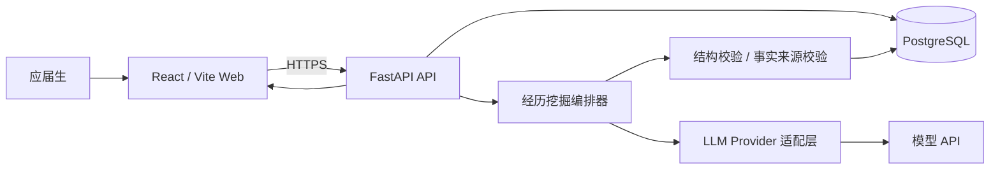

# Pathwise / AI 应届生求职助手：技术架构与 MVP 开发方案 v0.1

> 日期：2026-10-13  
> 状态：技术选型已确认；M1-0 工程骨架建设中（真实 AI 尚未实现）  
> 对应：产品目标 V0.3；原型 `prototype/` v0.2  
> 仓库：https://github.com/greglien282-a11y/ai-grad-job-assistant

## 1. 本阶段目标与边界

项目以应届生的**真实经历挖掘 → 结构化事实确认 → 有依据的简历表达**作为第一个可交付里程碑；随后接入 JD 分析、一岗一简历和快速面试复习。

**MVP-1 成功定义**：第一次使用者输入一句模糊项目经历，AI 能依据已有回答每次追问 1–2 个高价值问题；用户可以确认、修改、否认事实；系统最终生成可编辑、可复制的项目经历，并为每个关键陈述展示所依据的事实。需要可以恢复/查看本次会话的进度。

暂不实现：自动投递、全网职位聚合、爬虫、浏览器插件、付费、复杂简历模板市场、多智能体编排、向外部网站代用户操作。三入口首页保留，但 MVP-1 可让除「从零挖掘」以外的入口展示现有原型或“开发中”状态，不冒充已完成。

## 2. 技术选型与理由

| 层 | 方案 | 备注 |
|---|---|---|
| 前端 | React + TypeScript + Vite | 渐进迁移现有 `prototype/`；不直接重写全部 UI |
| 样式 | Tailwind CSS + 抽取既有设计 token/CSS | 先保留已认可的信息架构，视觉精修另开任务 |
| API | Python + FastAPI + Pydantic | 清晰的请求/响应模型，自动 OpenAPI 文档 |
| 数据库 | PostgreSQL + SQLAlchemy + Alembic | 正式环境可扩展；本地由 Docker Compose 提供数据库 |
| AI | 服务端大模型 API，适配层 + schema 化输出 | 不在前端暴露密钥；不得直接信任模型生成 JSON |
| 测试 | Pytest（后端）、Vitest/Testing Library（前端），关键流程 E2E | 测试事实状态、追问终止、异常处理 |
| 自动化 | GitHub Actions | 测试工作流与已有 Pages 部署工作流并存 |

**为何不先 fork 重型简历编辑器**：首个价值验证在“事实挖掘”，不是排版与模板；先用简洁的项目经历卡和复制文本完成闭环。后续单独评估 `easy-resume` 等开源项目的代码、许可证和集成成本，绝不宣称已复用未实际采用的代码。

**为何暂不引入 LangChain / 多 Agent 平台**：MVP-1 只需要少量有状态交互和结构化输出；普通应用服务 + 清晰的状态机更易测、更可解释。需求复杂后再考虑工具编排。

## 3. 系统边界与数据流



### 仓库结构（目标；`prototype/` 保留）

```text
ai-grad-job-assistant/
├── prototype/                # 当前已上线的静态原型，继续保留
├── apps/
│   ├── web/                  # React + TypeScript + Vite
│   │   └── src/
│   │       ├── pages/        # Home、ExperienceWorkspace、Profile
│   │       ├── features/     # experience、resume、jd、interview
│   │       ├── components/
│   │       └── lib/api.ts
│   └── api/                  # FastAPI
│       ├── app/
│       │   ├── main.py
│       │   ├── api/routes/
│       │   ├── core/         # config/security
│       │   ├── models/       # DB tables
│       │   ├── schemas/      # Pydantic requests/responses
│       │   ├── services/     # experience, generation, facts
│       │   └── llm/          # provider, prompts, validators
│       ├── alembic/
│       └── tests/
├── docs/
├── .github/workflows/
├── .env.example              # 示例配置，绝无真实密钥
└── compose.yaml              # 本地数据库与可选服务
```

## 4. 真实经历数据模型（MVP-1）

M1-1A 的实际持久化设计与运行步骤见 [M1_1A_PERSISTENCE.md](M1_1A_PERSISTENCE.md)。
事实来源使用关联表，材料核实记录和事实变更历史独立保存；本阶段不实现简历草稿表或业务 HTTP 接口。

| 对象 | 核心字段 | 作用 |
|---|---|---|
| `experience_sessions` | `id`, `status`, `created_at`, `updated_at` | 一次经历挖掘会话，可结束和继续 |
| `experience_projects` | `id`, `session_id`, `raw_input`, `title`, `summary` | 用户描述的项目/课程/实践 |
| `conversation_turns` | `id`, `session_id`, `role`, `content`, `created_at` | 追问及用户回答，保留事实来源 |
| `experience_facts` | `id`, `project_id`, `statement`, `source_turn_ids`, `status`, `updated_at` | 原子事实、引用来源及确认状态 |
| `resume_drafts` | `id`, `project_id`, `content`, `supported_fact_ids`, `status`, `created_at` | 结构化候选简历及依据 |

### 事实状态

`pending`（AI 提议 / 用户尚未确认） → `user_confirmed`（用户确认） → `evidence_supported`（有附件资料辅助核对，需记录核对依据）。另设 `rejected`（用户否认）。

`user_confirmed` **不是客观验证过的事实**。模型产出的新陈述必须先进入 `pending`；候选简历自动引用 `user_confirmed` 或 `evidence_supported`，不能直接引用 `pending`/`rejected`。任何状态变更都记录时间与来源，不能静默覆盖用户原始说法。

### 候选简历的可追溯性

- 一条简历 bullet 绑定若干 `supported_fact_ids`。
- 后端校验所有引用 ID 在当前项目且状态允许；不通过则拒绝候选或要求重新生成。
- **仅校验 ID 不等于语义真实性保证**：还应让用户逐条审核新表述，尤其是数值、职责、技术名词、绩效和“独立完成”等词。
- 拒绝不代表“真实能力不足”；UI 应能区分 **历史事实待核实**、**技术知识不理解**、**岗位能力缺口**。

## 5. AI 经历挖掘编排方式

采用可测试的服务端状态机，而非让大模型完全决定跳转。

```text
START
  → 收到原始经历
  → 提取候选原子事实 (pending, 带回合引用)
  → 显示给用户确认 / 修改 / 否认
  → 根据已知信息选择下一个问题（每轮 1–2 个）
  → 保存用户回答和新增候选事实
  → [达到停止条件] 生成简历候选 → 人工确认 → SAVED
  → [未达到] 返回追问
```

**停止条件**：用户选择结束；或已经具备项目目标/个人贡献/具体操作/可证实结果中足够的信息且继续追问边际价值低；或到达可配置上限（建议默认不超过 4–6 轮）后主动建议结束。绝不强迫用户填充成绩或模型/框架名。

**模型输出结构示例（概念）**：

```json
{
  "candidate_facts": [
    {"statement": "使用 Python 处理图像数据", "source_turn_ids": [1]}
  ],
  "next_questions": [
    {"question": "你具体亲手做过哪些图像处理操作？", "reason": "确认个人贡献"}
  ],
  "ready_to_draft": false,
  "uncertainties": ["具体处理步骤尚未确认"]
}
```

这是接口格式示意，不是要求模型根据上述示例编造事实。所有输出必须做 Pydantic 校验、来源 ID 检查、字段长度限制和失败重试/降级处理。

### 成本与安全

- LLM 调用通过后端集中管理、可替换模型提供商；每轮限制长度与调用次数，避免重复传入全量聊天日志。
- 后端使用环境变量保存 API Key，仓库只提交 `.env.example`；浏览器端绝不持有服务端密钥。
- 先做请求频率限制、内容长度限制、超时与错误状态；不得将真实简历/个人隐私打印到生产日志。
- 对原始用户资料说明用途并提供删除入口；开发期用合成样本测试，避免把真实求职资料推到 GitHub。
- 读取外部 JD/文件内容时作为不可信数据处理，不能把其中的提示指令当成系统指令。

## 6. MVP-1 API 草案（后续按实际实现调整）

| Method | Path | 含义 |
|---|---|---|
| `POST` | `/api/v1/experience/sessions` | 输入初始经历，创建会话 |
| `GET` | `/api/v1/experience/sessions/{id}` | 获取经历状态、事实及当前待答问题 |
| `POST` | `/api/v1/experience/sessions/{id}/answers` | 提交本轮回答，更新候选事实与下一题 |
| `PATCH` | `/api/v1/experience/facts/{id}` | 用户确认、修改、否认某事实 |
| `POST` | `/api/v1/experience/sessions/{id}/draft` | 基于已确认事实生成项目经历候选 |
| `PATCH` | `/api/v1/resume-drafts/{id}` | 修改候选文案 |
| `GET` | `/api/v1/health` | 运行状态检查 |

API 返回清晰的 `pending_facts`、`confirmed_facts`、`next_questions`、`draft` 等结构化字段。异常时不删除用户已确认的事实。正式开放多用户访问前须加会话访问控制，不能仅凭可猜测的 `id` 读取他人的数据。

## 7. 第一版前端用户体验

1. 首页保留已确认的三入口 +「了解全流程」轻按钮 + 头像个人空间。
2. 首先把入口 B「我还没有像样的简历」接入真实 API；入口 A/C 暂保持模拟或明确提示尚未接入。
3. 经历挖掘工作台包含：原始输入 / AI 追问 / 候选事实确认 / 当前进度 / 随时结束。
4. 生成后展示「原始一句话 → 已确认事实 → 专业简历 bullet」，并在 bullet 下列出事实依据与编辑操作。
5. 不要求用户先注册才能进行最初的探索；若有持久化或跨设备功能，再设计账户与数据控制。演示阶段可用临时会话方案，但后端必须提供不可猜测的会话访问凭证；纯前端 `localStorage` 不适合存放长期敏感简历数据。

## 8. 分阶段开发计划（建议顺序）

### M1-0｜工程骨架（先完成）

- 新建 `apps/web`、`apps/api`、`compose.yaml`、`.env.example`。
- 开发/构建命令跑通；前端能调用 `GET /api/v1/health`。
- 添加 TypeScript / Python 测试及 GitHub Actions CI。
- 保留旧 `prototype/` 和既有 Pages workflow，不直接覆盖线上演示。

**验收**：陌生开发者按 README 可启动，页面显示 API 连通，测试/构建无错误，没有明文密钥。

### M1-1｜事实库和无 AI 骨架

- 建立数据库表与迁移。
- 实现项目创建、对话记录、事实确认/修改/否认。
- 前端把交互接到真实 API，先用可预测的假 AI 测试完整状态机。

**验收**：刷新后可恢复同一会话；待确认事实不能被自动当作确认事实；能导出或删除本次数据。

### M1-2｜真实 AI 经历挖掘

- 接入模型 API 适配层、提示模板、结构化返回校验。
- 依据已知事实自适应追问，支持提前停止。
- 使用已确认事实生成候选简历和依据映射。
- 创建至少 15–20 条合成测试用例：极少经历、模糊回忆、矛盾回答、用户否认、试图诱导编造、模型不可用等。

**验收**：一条模糊经历能在数轮交互中形成真实可编辑的简历 bullet；对未确认技术栈/数值不擅自添加；异常发生时有可理解的重试入口。

### M2｜JD 定制与简历复用

- 粘贴 JD → 结构化拆解硬性条件/加分项 → 映射真实经历。
- 生成定制策略与修改理由，保持事实引用关系。
- 先做纯文本与 Markdown 复制；PDF 导出、上传解析按成本评估后跟进。

### M3｜快速面试与复盘

- 3 题模式，随时结束；区分技术概念未掌握与历史细节忘记。
- 简洁反馈 + 可复习的知识卡，不能把教学中的参考答案自动记成历史项目事实。

### M4｜小范围真实用户测试

- 邀请少量真实应届生，在获得同意的前提下观察首轮耗时、问题有效性、事实修改率、是否真正愿意保存/复用简历。
- 根据真实数据迭代，不用虚构的准确率或完成率宣传产品。

## 9. 推荐首批 GitHub Issues

1. `chore: initialize React/FastAPI monorepo and development environment`
2. `feat(api): design experience sessions and fact confirmation API`
3. `feat(web): migrate experience-mining flow from static prototype`
4. `feat(ai): implement structured experience discovery with citations`
5. `test: add hallucination and user-confirmation regression cases`

每个 Issue 以小 PR 完成，PR 写清“做了什么 / 如何验证 / 截图或接口示例 / 尚未实现什么”，避免只堆提交次数。

## 10. 第一个 Codex 任务提示词（复制即可）

> 请在当前 `ai-grad-job-assistant` 仓库中新建正式应用目录 `apps/web` 和 `apps/api`，保留现有 `prototype/`、`docs/`、GitHub Pages workflow，不覆盖任何原型文件。前端使用 React + TypeScript + Vite；后端使用 Python + FastAPI + Pydantic。先只搭建最小工程骨架：后端 `GET /api/v1/health` 返回 `{ "status": "ok" }`，前端显示 API 连接状态；配置开发环境变量示例、CORS 开发白名单、基本测试和 README 启动步骤。不要接入真实大模型、不要虚构已完成的功能、不要在仓库写入任何密钥。完成后运行测试和构建，列出所有变更文件、验证结果、下一阶段建议，并在提交前让我查看 diff。

## 11. 待确认的工程选择

- 第一批内测是否仅支持单设备临时会话，还是需要邮箱登录？**建议暂用受保护的临时会话，登录延后。**
- 是否使用已有简历编辑器？**建议首版不依赖第三方完整编辑器，先实现文本候选和复制。**
- 优先部署平台与预算上限？先完成功能，选择 Python API + PostgreSQL 可部署的低成本服务；前端正式站点迁移时再决定是否保留 GitHub Pages 作为正式入口。

**下一决策点**：先确认 MVP-1 的范围和技术栈，再创建 Issue 并开始 M1-0 工程骨架。不要直接把现有静态原型误标成“真实 AI 产品”。
