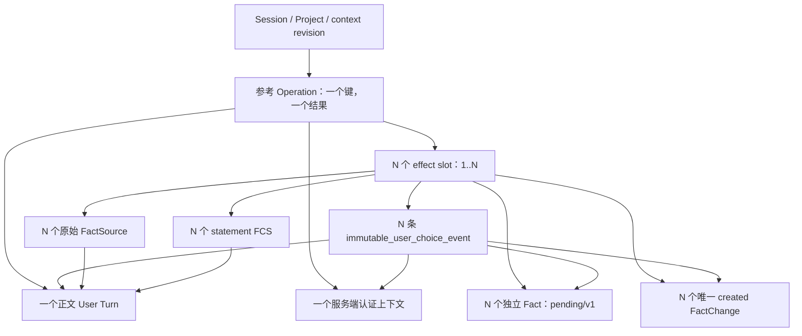

# G3：分类依据如何成为可审计记录（研究候选，未批准）

## 给产品负责人的结论

建议继续审查 **A：一份用户原话，另为每条事实保存一条不可变的分类选择事件**。它能清楚表达“这个账户在当时选择了什么”，不会把点选的标签伪装成用户说过的话。**这不是已经确认事情真实发生**；用户选 completed、用户审核事实、平台独立认证是三件不同的事。

**B：原话加一条分类选择 Turn，同事务保存**也能建立完整图，本研究实际在 PostgreSQL 执行了两种方案。B 没有省掉逐事实的绑定记录：一条含 N 项选择的 Turn，仍需 N 条独立审计绑定，否则无法说明哪次选择属于哪条事实。两种方案都不能自行解决被拒绝主张换说法后再次录入的 R03 问题。

建议 A 的理由是责任边界更清楚，不是测试数量更多或它已获得生产授权。下一步需要用户批准来源模型、正式操作协议、认证与保留政策后，才能另行实施；本 PR 没有正式 writer、CO3、迁移或运行工厂。

## 基线、范围与已有合同

基线 main `034c192828f5b5152b950300223f5282af4aa191`，开工及提交前远端再次核验一致。#48/#50/#51/#52/#54 已合并；#53 未被修改。G0/G2 已有成果不重做。

精确 main SHA 的 Actions 查询为空，不能声称该 SHA 的应用 CI 全绿。最近正式应用基线 `776f257ebfcb036b718d414703567da2b4359ba1` 的 CI 40190058125 已成功；#54 源 HEAD 的原型 CI 40193631441/G0 CI 40193631515 成功。它们是祖先/源分支证据，不冒充 main 034 的同 SHA 证据。本轮新增研究 CI，在本 PR 精确 head_sha 重新执行参考验证和完整既有应用回归。

代码核验依据：`0015_fact_classification.py`、Fact/FactChange/FactSource/FCS/ConversationOperation 模型、CO1/CO2 恢复、`research/declaration_read/contract.py`、`docs/goal/G2_3_CO3_DATABASE_CONTRACT.md` 与 c3a/c3b。

- 正式 CO 身份约束仅允许 1/2；0015 约束分类矩阵、当前/历史快照，没有分类事件表。
- 正式 FactV3/SummaryV2/ExportV2 和 classification_citations 的既有含义不变；缺失分类依据仍是缺失，不能自动补造。
- G2.1 是合成的选择 Turn 读取候选。M4 内存模型中的 statement source 也不是新的选择事件。两者均未被改写成 A。
- 新代码仅在 `research/g3_choice_protocol/`；SQL 仅安装在随机 `g3_ref_<uuid>` 测试 Schema，全部对象名以 `ref_` 开头。`ref_operations.contract_version=3` 只是研究取值，**不是正式 ConversationOperation v3**。

## G3.1：两张候选关系图

### A：一份原话 + N 条选择事件

每条事件有独立 event ID、合同 `g3-choice-event-ref-v1`、session/project/fact/version、operation/effect_slot/change、显式三列分类、原话 Turn ID/quote/code-point 半开区间、独立 selection ID、原始选择 payload、server authentication context ID、validator 合同及结果、服务端 recorded_at。selection source 固定为显式 UI 选择，**不是一个 Turn**。

认证上下文由受限运行 LOGIN 调用固定 search_path 的服务端函数生成。函数校验合成会话凭证，从保存的 Session 读取 subject/project，记录 session_user、issuer 和时间；客户端不能 INSERT 该表或直接指定 subject/actor/时间。N 条事件可共享同一已认证请求上下文，但不能共享 event/selection/fact/change/effect slot 身份。

这证明的是“持有该合成凭证的请求提交了这些声明”。不证明自然人点击、真实账户体系、身份实名认证或动作完成。客户端 `actor=user` 被拒绝；DTO 中即使长得像认证上下文，也不因此获得认证。

### B：原话 + 一条结构化选择 Turn

恰好两个 Turn：正文 Turn 和 `purpose=choice` 的 User Turn。选择 Turn 保存 N 行确定性编码 `slot:kind/stage`；N 条审计绑定分别记录选择行的完整 quote/区间、原话引用、fact/version/slot/selection ID 和同一服务端认证上下文。正文来源与选择来源使用不同 Turn；错绑会在 COMMIT 拒绝。

选择 Turn 是 UI 点选的序列化，**不是用户手写原话**。正式采用 B 必须新批准 purpose、显示方式以及对 Mining/导出/恢复的影响，不能让旧 transcript 把它当自然语言输入。这里并未向正式 Turn 加字段。

G2.1 当前要求每条声明引用独立且完整的选择 Turn。B 的 N>1 单 Turn 多行也不能直接通过它；A/B 都需要显式新读取合同。另一种 N 个选择 Turn（共 N+1）未在本轮实现，不能宣称被当前比较证明。

### 身份、版本和不可变性

N=1–5；operation 下 slot 必须恰好 1..N，Fact/created FC/FS/FCS/choice 各 N，不能缺、多、重用、错位或跨 Session/Project。数据库同时检查所有图边、正文 code point、顺序、不重叠及非空白全文覆盖；after JSON 要精确匹配初始事实和来源，保留 JSON 类型，before 必须 SQL NULL。

初始 Fact 固定 pending/v1、manual、memory_state=unspecified，无当前 evidence/ai_run。分类允许 0015 的六种 explicit typed 组合；研究写模型不创建 legacy/unclassified。纯读取解析仍能表达已有八种合法分类组合。

Fact.version、Session revision、operation contract、event contract、validator contract 分别表示事实历史、并发版本、操作协议、声明记录格式和窄规则版本，不能相互替代。新图各行必须同一服务端 txid；writer 不能指定 txid/时间/到期时间。同一 Session 在一次研究事务只允许一个新操作并使 revision 精确 +1。

UPDATE/DELETE/TRUNCATE 被禁止；即使故障测试给专门 mutator LOGIN 这些权限，图不可变触发器仍拒绝。只有独立且鉴权的整会话删除函数能删除完整图并留下最小研究墓碑。原话重复保守阻断；标签相同的独立新选择允许，但必须使用新事件与 selection ID。

未来修改分类应追加新事实版本和新不可变事件，保留旧声明；不能 UPDATE 原事件或把旧正文来源当成新选择。classify/自动退级/related_plan 的正式规则、编辑后依据如何继承均未实现或批准。

## G3.2：真实 PostgreSQL 研究及边界

每项数据库测试使用随机 Schema、NOLOGIN owner、独立随机 writer/reader/eraser LOGIN。另有专用 mutator 只用于攻击测试。provisioner 仅在正常请求外建夹具、授予临时权限或注入故障；正常读写不使用 owner。finally 删除本次 Schema 和角色，不复用生产对象或读取真实凭据。

writer 仅能 SELECT 所需表/列、INSERT 图的允许列、UPDATE Session.revision，不能改历史、DDL、成为 owner 或直接生成认证上下文。reader 只有 SELECT/白名单只读函数，无 issuer/erase 执行权限。eraser 只有单独删除函数执行权限。均无 superuser/createdb/createrole/bypass/replication/成员身份。

admit 核验有效列 ACL（缺少和过大均拒绝）、无 Schema CREATE、无业务对象 owner、函数 NOLOGIN owner/SECURITY DEFINER/search_path/PUBLIC EXECUTE 和触发器配置。**不是函数体指纹/所有默认 ACL/数据库全局权限的完整正式 D8 审计**。测试库继承已有 TEMP 权限；用临时同名表攻击不能改变 fully qualified 认证函数，不能宣称角色在整个数据库没有任何 DDL 能力。服务器角色是受信应用身份，不是 RLS 多租户隔离证明。

真实测试覆盖两方案 N=1/3/5、六种 typed 单项组合、错误区间/项目/版本/认证关系/选择/快照、缺失与重复事件、非法矩阵、assistant 来源、JSON null before、零写回滚、并发、进程终止、历史结果读取和删除。完整全表摘要比较覆盖本研究九张表；没有连接正式生产业务表。既有正式合同另跑原应用回归，不能混称同一个模型。

**限制的可重复反例：**`test_real_db_does_not_prove_validator_executed_or_declared_completed_is_true` 首先证明正常适配器拒绝“我计划部署服务”声明 completed；然后同一受限 LOGIN 直接 INSERT 关系完整的图并填写 finite_rule_match，数据库允许 COMMIT。未使用 owner 改数据、临时禁用约束或强行变绿。这证明数据库没有运行 c3a，也不能信任被攻破 writer 填的校验标签。未来必须明确受信服务边界，评估数据库受控写函数/独立校验凭证等方案；本轮没有批准或实现这些方案。

## G3.3：A 的独立读取候选

`g3-choice-basis-read-candidate-v1` / scope `synthetic_or_disposable_reference_only`：

- `turns` 与 `text_provenance.original/current` 只表达 conversation_turn 原话及完整、精确的 code-point 引用。
- `basis.event` 明确标为 immutable_user_choice_event，包含独立选择、绑定及服务端认证记录；不塞进 turns，不伪造 classification_citations。
- `legacy_unclassified` / `not_recorded` 必须 event=null；有记录也只叫 event_recorded，不叫 verified。
- 对未知版本、缺来源/认证、错位版本/项目/slot、篡改数字、布尔整数、坏时间和重复 JSON key 整份拒绝；批量解析验证 N 项双射、同 operation、同认证上下文、同一原话及顺序覆盖。
- 每个 Result 固定 truth_verified=false、persistence_authorized=false，另固定 authentication_verified/database_history_verified/language_validation_replayed=false。纯解析收到服务器记录也不等于自己验证了服务器。

Python 复用 G2.1 的基础字段/quote 校验，不复用其声明投影；TS 仅复用原子类型定义。两端严格解析器、新共享反例、八种分类×四种状态测试均不修改旧 DTO。原文为计划却显式声明 completed 的自洽 JSON 可被结构解析接受：该层不重跑语言规则，更不能被用作 writer 准入。

`projection.py` 只从一次 REPEATABLE READ READ ONLY 中读取完整 A 图，经 auth、reference graph 校验后生成候选；B 被固定拒绝，不隐式转 A。真实 PG 五事实结果由 Python 导出为仅含合成资料的测试产物，再被 TS bridge 严格消费。原话中的 emoji、组合字符、ZWJ、CRLF 不归一化。桥接产物不含 token/key/hash/密码。

这不是新 HTTP/正式读工厂，也未升级 FactV3/SummaryV2/ExportV2、React 页面或完整技术备份合同。正式 export 若采用 A，将来必须额外完整保存事件、认证/验证记录与图边，且区分遗失、历史未记录和显式选择；不能仅把事件 ID 当作备份。数据库角色名等研究审计字段是否面向客户端暴露还须单独审查。

## G3.4：事务、恢复与威胁模型

研究新命令顺序：身份/权限与 Session 鉴权 → 同键 advisory lock → 查既有结果 → 同合同合法 replay 优先 → 仅新请求检查 Session 行锁/Project/revision/review marker → unchanged c3a 与精确复用检查 → 全图与回执 → revision +1 → 延迟约束 COMMIT。未 COMMIT 的返回固定叫 uncommitted_reference_graph，不能显示为保存成功。

GET 研究恢复使用 SELECT-only LOGIN、一个 RR/READ ONLY 快照，无 key 注册/认证上下文新建/advisory lock/清理/修复。校验完整图后返回旧结果；后续 revision 或新命令审核 marker 不得重执行原操作。错误凭证先于合同/历史信息披露；外会话不透露删除状态。

**碰撞矩阵：**参考存储版本 1/2/3 与请求版本 1/2/3 的九格、A↔B、未知版本、同键改正文/声明/selection ID/区间/revision 均固定拒绝或仅合法 replay。1/2 是 owner 在请求外放入的 opaque marker，**不是旧正式 CO 回执**。参考 key 用 SHA256/canonical JSON，不是正式 CO1/CO2 的 HMAC/key proof；不能推导版本3已接入同一真实碰撞域。正式旧版本真实兼容由原 2340 级后端回归中的既有测试证明。

**并发与崩溃：**独立连接以 Barrier 同时执行同键同体、同键异体、异键同 revision，最多一份完整图。新 key 重复原文仍拒绝；后续无关事实相同标签可以保存。真实子进程在 STAGED 或 COMMITTED 标记后被 kill，不是抛 Python 异常模拟崩溃：提交前全表零效果、GET not_found；提交后 GET 恢复同一完整图，POST 同键不重建。

**删除：**独立 eraser 鉴权、持有 Session 锁，清除全部原话/事件/事实/来源/认证；operation 墓碑只留 id/key-scope-owner digest/合同/状态/服务端时间与期限。正文、选择和 request digest 被清除。墓碑不可删除，旧 key 不复活。A/B 的 append 持锁后删除，以及删除过程中一个旧 RR 快照继续读到一致旧图，都有实际测试；后者是候选快照语义，若产品要求删除立即撤销所有正在进行的快照，需要另行设计。反向 delete-first 锁竞争、过期清理/密钥轮换、服务端主机或 PostgreSQL 崩溃恢复、跨 Session 多命令死锁/大规模压测尚未证明。

**R03：**参考 Session 只有合成 new_command_review_required marker。它证明“新请求不能换 key 绕过当前审核门槛，旧回执仍能读”，**不扫描正式 rejected 历史、不认定同义或数字改写独立**。完整拒绝历史/澄清沿用既有 G2 研究；这里没有 force、ignore_duplicate、history_safe、用户点确认解锁或旧 writer 行为变化。R03 全入口语义防复活继续 BLOCK。

## G3.5：工程比较、代价与审批清单

**A 的工程代价：**新增声明事件与认证上下文模型、N 项图约束、独立来源 union、新 export/reader 和前端事件显示。不会污染对话原文；未来更改分类可以指向新事件。需要额外迁移和权限审核，不能拿本研究 SQL 直接安装。

**B 的工程代价：**正文与选择两 Turn 必须原子，N 个绑定和认证仍不能省；Turn 计数、purpose、原话/结构化生成内容的差异、worker/Mining 上下文、旧 transcript/来源读取都需改变。现有选择 Turn 思路有参考价值，但 N>1 不兼容 G2.1 完整单 Turn 引用假设。未来重分类可能产生更多非自然语言对话记录。

两者的回滚、锁、幂等、删除约束量级相近，本轮没有性能结论。A 值得优先评审的核心是表达准确；B 保留为真实可执行对照，不因偏好而删去或故意限制它。迁移复杂度、上线成本与真实用户误解率未做生产量测。

需要逐项批准：

1. A/B 正式选择，以及客户端“明确选择”的交互/同意记录语义；服务端能证明什么，不能证明什么。
2. 正式 CO3 路由/合同、born-contract、key proof/碰撞域、期限、认证与锁顺序；保留旧回执恢复，不能照搬 opaque marker。
3. 分类事件表、不可变图、未来分类修改和 snapshot 格式、迁移升级/降级保护；不预占 Alembic 编号。
4. R03 全历史审核与人工决议，保守误阻断和语义不可证明时的产品行为；D4/D5 仍待批准。
5. D6 新来源/导出/客户端安全协议、审计隐私字段及旧客户端交接；旧事实不回填假依据。
6. 整会话删除、墓碑最小留存、TTL/密钥与并发快照删除语义；不改变现行 DELETE。
7. D8 正式 owner/LOGIN/ACL、函数体与默认权限审计、受信 validator 边界、工厂启用及生产准入。

前置验证还包括正式 Schema 迁移失败回滚、旧数据/来源/JSON 字节兼容、真正 CO1/2/3 互操作、真实认证、完整 transaction-level R03、worker 收尾、删除所有竞争顺序和基于最终协议的崩溃矩阵。**本轮不批准任一项；保持 Draft，R03/D4/D5/D6 剩余/D8 及 typed writer/CO3/classify/related_plan/付费/部署全部 BLOCK。**

执行与连续检查点见 [G3_CHECKPOINT.md](G3_CHECKPOINT.md)，精确 HEAD/最终 CI 以 Draft PR 说明和 GitHub head_sha 为准。
